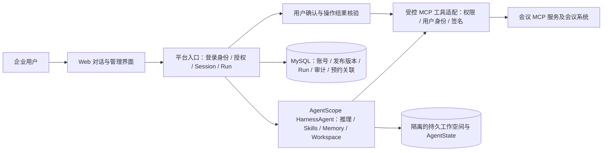

# 数字员工平台一期总体设计

> 状态：需求已确认，本文为实施设计；尚无代码实现或真实环境验收。  
> 基线日期：2026-10-18（北京时间）。实施时再次核对 AgentScope Java 的最高稳定版本并固定依赖版本。

## 1. 目标与范围

一期面向单家企业的少量真实用户，在独立的 Java 17 / Spring Boot 3 项目中交付一个**会议室数字员工**。员工通过 Web 对话工作，使用阿里千问、AgentScope Java 的 Harness 能力、受控 Skills，以及会议平台提供的 MCP 工具完成预约。会议室员工是首个实例；架构保留后续增加员工和消息渠道的入口，一期不开发多员工可视化设计器或其他渠道适配器。

| 已确认的产品选择 | 一期边界 |
| --- | --- |
| 账号 | 管理员开通账号并设置初始密码；用户首次登录必须重置密码。平台以稳定 `UserId` 标识用户，手机号是经核验的会议账号映射。 |
| 员工入口 | 登录后直接进入会议室员工；内部仍保留员工标识、用户授权和路由边界。 |
| 员工配置 | 管理员通过受控配置维护模型、指令、Skills、MCP 和权限，按草稿、测试、发布、回滚管理版本；运行中的任务固定使用启动时的发布版本。 |
| 会话与记忆 | 同一用户可开启多段独立会话；该用户与会议室员工的长期记忆可跨会话使用。不同用户及不同员工的可写状态默认隔离。 |
| 操作权限 | 查询可在授权范围内自动执行；会议预约和取消必须在调用写工具前取得当前登录用户的明确确认。 |
| 运行 | 一期按单节点、低并发、持久化和可核对审计设计；多节点高可用不作为一期验收项。 |
| 数据与模型 | MySQL 保存平台业务状态；千问模型和密钥由平台统一配置。外部服务受批准名单及数据范围约束。 |

具体预约步骤由后续提供的会议 Skill 和届时实际开放的 MCP 工具确定。参会人邀请、日历通知属于会议平台职责；设备精确过滤不是一期硬要求。

## 2. 架构与责任边界

**AgentScope 负责**模型推理、Harness 工作区、Skills 装载、长期记忆和工具执行框架。**平台负责**企业账号、发布版本、员工可见范围、业务 Session/Run、最终业务授权、确认记录、会议 MCP 调用身份、审计和 Web 交互。会议系统是会议室占用、预约状态和业务权限的权威来源。

Web 一期直接接入统一业务入口。将来新增钉钉、飞书、企业微信等渠道时，渠道适配器只承担消息验真和归一化；同一套平台身份、员工授权、Session/Run 和工具策略仍生效。渠道发送人不能直接变成已认证的平台用户。

## 3. 数字员工定义、发布与运行

一期只部署会议室员工，但定义模型保持可扩展：`employeeId + definitionVersion` 指向一份不可变的已发布配置，包含模型引用、指令、Skills 版本、MCP 连接与工具白名单、工作空间模板和权限策略。普通用户不能修改这些配置或注入新工具地址、密钥。管理员的配置及发布操作留审计记录。

用户发起一次对话轮次时，平台先校验用户状态和员工授权，创建业务 `Run`，固定发布版本及调用者身份，再构造 AgentScope `RuntimeContext`。同一 Session 的并发轮次顺序执行；流式事件返回 Web，最终状态和必要事件写入持久存储。`Run` 的业务事实与 AgentScope 的 `AgentState` 是不同数据面，不能仅靠框架状态代替业务任务记录。

发布新版本不改写正在执行的 Run。旧版对话状态不得未经迁移校验直接交给新版运行时；个人偏好记忆如需跨版本沿用，须保持原用户和原员工边界，并记录迁移规则。

## 4. 登录身份与会议 MCP

1. 管理员创建账号、设置初始密码；用户首次登录重置。平台从已认证服务端会话取得稳定 `UserId`，再读取其已核验的手机号映射。
2. 模型输出、对话文本和浏览器请求参数均不能指定本次 MCP 调用的**操作者手机号**。例如李四登录后查询张三，操作者仍是李四；张三只是查询对象或参会人候选。
3. 平台在**每一次** MCP HTTP 请求中按会议平台约定携带 App Key、时间戳、当前登录手机号及 HMAC 签名。密钥只从受控配置读取，不写入项目、模型上下文或日志。签名证明平台持有应用凭据并绑定请求中的手机号；平台登录链负责证明该手机号对应当前用户。
4. 会议 MCP 校验请求签名、账号有效性及工具所需业务权限。平台在调用前还要检查用户、员工发布版本和当前工具是否获准。两侧的权限判断不能相互替代。
5. HTTP 鉴权失败与工具业务失败分开记录。实际可用工具以目标环境 `tools/list` 为准；用户提供的联调说明明确指出，手机号鉴权及新增工具需部署对应服务端版本后才生效。

联调说明包含测试凭据，设计和后续代码只描述凭据注入方式，不复制其具体值。

## 5. Skills、工具与写操作确认

会议室 Skill 负责组织查询、选人、预约、核验等工作方法；MCP 工具执行会议系统动作。一期 Skill 是受控指引，不开放任意命令、脚本或容器执行。后续 Skill 的具体文本和工具调用顺序由业务方补充，平台负责不随 Skill 变化的权限、确认、身份和幂等边界。

确认分为三种，不能混用：

| 类型 | 触发条件 | 结果 |
| --- | --- | --- |
| 人员选择确认 | `identity.resolve` 返回多个候选，或模糊匹配即使只返回一个候选 | 用户选定具体参会人；不会因此授权预约或取消 |
| 预约/取消前确认 | 展示本次具体会议室、时间、主题和参会人，或展示待取消的具体会议后 | 仅当前登录用户可确认本次写操作；确认绑定操作类型和参数，不能成为长期通用授权 |
| 结果核验 | 预约工具返回后调用会议系统核验，或查询最终状态 | 属于系统核验，无需再询问用户是否同意 |

用户通过 Web 确认按钮或针对已展示内容的明确肯定答复完成本次确认；最初提出预约或取消意图本身不能代替这一步。确认后，平台才允许调用 `room.reserve` 或 `meeting.cancel`。发起人来自签名手机号，不会自动加入 `attendeePhones`；若发起人也参会，须明确列入参会人。取消还必须由会议系统核验其为发起人、会议未开始且具有对应权限。

每笔写操作生成稳定 `requestId`，同一笔操作重试时保持请求号和参数不变。遇到 `IN_PROGRESS` 或结果无法确认，停止盲目重试并核对原操作；不得更换请求号重复提交。`room.search` 结果不锁定会议室，以 `room.reserve` 的事务性结果为准。当前联调说明中的设备参数不参与过滤，因此不宣称设备条件得到精确保证。

## 6. 记忆、会话与预约事实

AgentScope Java Harness 支持 `memory/YYYY-MM-DD.md` 的事实提炼和 `MEMORY.md` 的长期合并，并可通过 `memory_search` / `memory_get` 找回内容。一期按“员工 × 用户”隔离长期记忆和可写工作空间；每段 Web 会话保留独立对话上下文。会议室员工可以提炼常用会议室、时段、主题类型及常合作人员等个人习惯。

**记忆不是预约台账。**提炼是模型处理且可能在响应后异步完成，某笔预约的编号、状态、时间、参会人及取消结果应从会议系统和平台结构化操作记录核对。当前 `meeting.list_mine` 只返回未开始的有效会议；若要查询平台上线前的完整历史，需会议平台增加历史工具，不能让员工凭记忆声称掌握全部过去记录。

Web 提供“我的记忆”入口，让用户查看、更正、删除个人提炼结果。记忆编辑须在当前用户与当前员工的隔离范围内进行；删除或更正后不得由旧摘要再次错误恢复。业务审计与用户可编辑的偏好记忆分别管理。

## 7. 存储、运维与验收

MySQL 至少保存用户、角色与授权、员工发布版本、业务 Session/Run、写操作确认、工具调用及预约关联审计。AgentScope `AgentState` 和工作空间使用单节点可持久恢复的受控存储；实施时按固定版本的官方能力选择具体后端，并验证重启恢复及用户隔离。部署环境保管千问与 MCP 密钥，日志不输出手机号全量、参会人资料或密钥。

一期验收以目标环境真实执行为准，至少覆盖：

1. 管理员开通账号、首次改密、停用账号和用户授权；非法或停用用户不能发起 Run。
2. 两名用户在不同会话中的 AgentState、工作空间、长期记忆及 MCP 操作者手机号互不串用。
3. 参会人候选确认与预约前确认分别生效；未经预约/取消确认不能调用写工具。
4. 真实会议 MCP 的签名、`tools/list`、查询、预约、结果核验和取消；确认实际部署版本支持所需工具与业务权限。
5. 冲突、权限不足、超时、重复 `requestId` 和结果不明时不产生重复预约；可从平台记录追查原操作。
6. 进程重启后可查看既有会话、Run 结果、确认和审计；个人偏好记忆仍受同一用户边界约束。

## 8. 后续输入与版本依据

业务方后续提供会议室 Skill 及新增工具契约。实施前还需确定千问的具体模型 ID、目标会议 MCP 已部署版本、环境凭据与 MySQL 实例；这些是接入参数和验收前提，不改变本文已经确认的产品边界。

框架依据固定到当前核对的正式版，避免把开发分支或预发布能力当作一期契约：

- [AgentScope Java Releases](https://github.com/agentscope-ai/agentscope-java/releases)：2026-10-18 核对到 `v2.0.4` 标记为 Latest，`2.1.0-BETA1` 为预发布；实施时再次确认最高稳定版后锁定具体版本。
- [v2.0.4 快速开始](https://github.com/agentscope-ai/agentscope-java/blob/v2.0.4/docs/v2/zh/docs/quickstart.md)：JDK 17+、HarnessAgent、DashScope 扩展、RuntimeContext 与 AgentState。
- [v2.0.4 Workspace](https://github.com/agentscope-ai/agentscope-java/blob/v2.0.4/docs/v2/zh/docs/harness/workspace.md)：静态配置与按用户隔离的运行时数据边界。
- [v2.0.4 Memory](https://github.com/agentscope-ai/agentscope-java/blob/v2.0.4/docs/v2/zh/docs/harness/memory.md)：两层长期记忆、异步提炼与检索。
- [v2.0.4 Skill](https://github.com/agentscope-ai/agentscope-java/blob/v2.0.4/docs/v2/zh/docs/harness/skill.md) 与 [Channel](https://github.com/agentscope-ai/agentscope-java/blob/v2.0.4/docs/v2/zh/docs/harness/channel.md)：Skills 层级及后续多渠道扩展依据。
- 外部接口资料：《MCP身份查询联调说明 (1).md》（用户提供的测试环境文档；未纳入仓库）。
