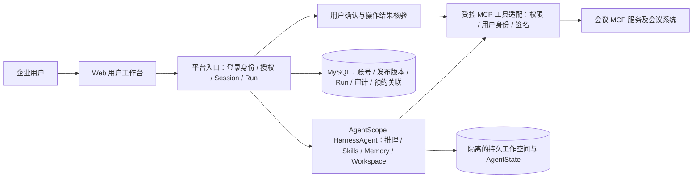

# 数字员工平台一期总体设计

> 状态：需求已确认，本文为实施设计；尚无代码实现或真实环境验收。  
> 基线日期：2026-10-18（北京时间）。实施时再次核对 AgentScope Java 的最高稳定版本并固定依赖版本。

> 2026-10-23 正式应用设计范围调整：用户已确认以用户工作台、内容渲染、事件投影和人机交互为主线，覆盖真实后端及会议 MCP 闭环。一期支持数字员工动态提出结构、服务端校验、前端受控渲染的通用动态表单；不开发管理页面或管理 API，固定管理员暂不开放 Web 登录，管理操作通过受控 SQL／脚本维护；多渠道逻辑和数据保留策略延后。本轮参照原型已收到，见[接收记录](正式应用设计/参照原型接收记录.md)；前端技术栈结合参照及交互方案确定。新决定优先于历史规格中的管理页面、角色分流和渠道实现表述；其余已确认业务规则继续沿用。参见[正式应用设计入口](正式应用设计/README.md)及[正式 Web 应用设计决策地图](https://github.com/BeyondzychenProton/agentscope-brain/issues/14)。本轮建图与研究不代表应用已实现。

> 2026-10-24 #22 最新范围：用户确认后端采用一个 Spring Boot 应用、一个 Maven 模块，按业务能力分包，Web／Agent／后台协调在同一 Java 进程。当前任务只在数据库预置一个普通账号及必要授权／员工配置，先完成用户相关功能；管理员角色、管理端、账号／授权／配置维护及通用维护命令交给另一个任务补齐，不作为本任务前置。以下管理员相关历史规则保留为后续模型输入，不构成当前交付要求。普通用户登录、首次改密、可信 UserId、固定配置、数据隔离、独立确认及恢复规则继续沿用。见[后端工程与用户链路设计草稿](正式应用设计/后端工程与用户链路设计草稿.md)。

> 同日 #22 第二轮：用户采用 Spring MVC，并指定 MyBatis-Plus 操作平台业务数据库，覆盖当轮 Spring JDBC 应用数据访问推荐；既定锁序、CAS、业务变更与投影同事务规则继续沿用。精确依赖、登录组件及真实接入仍待后续收敛，不表示已创建或验证正式工程。

> 同日 #22 第三轮：用户采用 Spring Security + Spring Session JDBC 完成普通用户登录，使用 HttpOnly Cookie、服务端持久会话及 CSRF 防护；生产网页／HTTP 接口／SSE 使用同源 HTTPS 入口，开发时由 Vite 代理。登录期限、具体接口和部署配置仍待继续收敛，尚未创建正式工程。

> 同日 #22 第四轮：登录采用用户指定的固定 24 小时，不自动续期；允许多个浏览器并行登录，普通退出仅结束当前会话，改密沿用既定旧会话失效规则。图片由后端验证后上传到私有对象存储，并经后端鉴权读取。启动校验数据库／表结构、单预置账号、授权和固定配置，基础缺失时失败；模型／会议 MCP 暂时不可用不阻止整个应用启动及已有历史读取。对象存储接入、暂存与提交回查等接缝继续收敛。

> 同日对象存储补充：用户选择 MinIO 保存私有原件；后端上传／鉴权代理读取、不可覆盖对象键和不可变 storage_profile 规则保留。实际连接、bucket、凭据注入及客户端依赖在接入时核验，尚未连接或执行上传。

> 同日 #22 第五轮：用户采用 Q11—Q13。未发送图片自上传票据创建起固定暂存 24 小时，正式素材不受临时 TTL 清理；普通发送增加持久提交控制及原键封闭，结果未知先核对，封闭后禁止迟到接纳；随机确认凭据保留摘要并增加加密恢复副本，刷新领取原凭据不重建确认、不延长原十分钟、不改变消费状态。最小数据调整与事务接缝仍待细化，尚未执行 DDL 或真实接口。

> 同日 #22 第六轮：依据新的官方支持状态核验，用户采用 Java 17 + Spring Boot 4.1.2，覆盖旧 Boot 3 输入；AgentScope Java 正式设计基线固定 v2.0.4／`0b6743b263ba8e39eb417e35048026f1e0196548`。既定 MVC、MyBatis-Plus、Security／Session JDBC 及 MinIO 职责沿用，组件版本按 Boot 4 重新核对。设计锁定不代表已生成实际依赖文件、编译或通过 SDK／Web 集成。

> 2026-10-25 #22 第七轮：用户采用 networknt JSON Schema Validator 3.0.6 与 Boot 管理的 Jackson 3.1.7；采用专用 SDK 状态适配器，隔离证明无模型／工具执行和可恢复性后再启用，未证明时仍待核对；form-v1 完整时间值固定为上海 `+08:00`、秒精度与严格表示，不接纳小数秒、其他偏移或宽松写法，不静默截断。前后端共享格式与错误 fixture，尚未运行一致性验收。

> 同日 #22 第八轮：用户采用前台 2 条执行许可／16 条普通待执行、续接优先、记忆独立 1 worker／5 秒扫描，以及 SYSTEM_BOOTSTRAP 单账号初始化来源。Q1—Q21 已全部逐轮确认，现形成[整体规格](正式应用设计/后端工程与用户链路设计规格.md)、[接口与事务契约](正式应用设计/后端接口与事务锁序契约.md)、[数据与初始化契约](正式应用设计/后端最小数据调整与初始化契约.md)，2026-10-25 已通过用户整体评审并授权同步 GitHub；没有正式代码、DDL 执行或真实集成验收。

## 1. 目标与范围

> 2026-10-24 工作台范围更新：一期前端不开发“我的记忆”页面、入口及查看／编辑／清空交互；既定后端长期记忆、隔离、学习和恢复设计保留，不自动新增记忆管理 API 交付承诺。前端采用 Vue 3 + TypeScript + Vite + Vue Router + Pinia、Element Plus 及有限 form-v1 renderer + Ajv。表单选择放在聊天底部；等待填写／确认时暂时切换底部交互区域并保留聊天草稿，任务结束后恢复普通输入。执行过程在聊天内折叠，动态呈现“正在理解需求、查询会议室”等可信阶段说明，不设置右侧详情抽屉。Markdown 采用 markdown-it + DOMPurify；Q1—Q21 及整体修订版已确认，见[工作台与前端规格](正式应用设计/工作台交互与前端工程设计规格.md)；[#21 最终结论](https://github.com/BeyondzychenProton/agentscope-brain/issues/21#issuecomment-6381120106)已发布并按设计完成关闭，尚未创建正式工程。

> 同日整体评审补充：一期移出归档列表／归档／恢复前端；不显示正常连接常驻标记及任何发布／会话版本标签、版本历史／升级入口。实际异常继续按既定规则提示，后台归档、固定版本、版本隔离及恢复契约不因此删除。

一期面向单家企业，在独立的 Java 17 / Spring Boot 4.1.2 项目中先预置一个普通账号，交付一个**会议室数字员工**。员工通过 Web 对话工作，使用阿里千问、AgentScope Java v2.0.4 的 Harness 能力、受控 Skills，以及会议平台提供的 MCP 工具完成预约。会议室员工是首个实例；架构保留后续增加用户、员工和消息渠道的入口，一期不开发管理员功能、多员工可视化设计器或其他渠道适配器。

| 已确认的产品选择 | 一期边界 |
| --- | --- |
| 账号 | 当前任务在数据库预置一个普通账号，不实现管理员角色和账号管理流程。普通用户以手机号登录，首次登录必须改密，姓名仅作展示；以稳定 `UserId` 标识用户，操作者手机号从可信登录身份读取，会议 MCP 另行检查会议账号可用性。后续账号维护由另一个任务补齐。 |
| 员工入口 | 登录后直接进入会议室员工；内部仍保留员工标识、用户授权和路由边界。 |
| 员工配置 | 当前在数据库预置所需模型、指令、Skill、MCP 工具绑定和有效发布配置，只实现装载与用户侧校验；不实现配置管理或发布维护流程。已发布配置不可变，新会话使用预置有效版，已有会话及其 Run 固定原版本；后续配置维护交给另一个任务。 |
| 会话与记忆 | 同一用户可开启多段独立会话；该用户与会议室员工的长期记忆可跨会话使用。不同用户及不同员工的可写状态默认隔离。 |
| 操作权限 | 查询可在授权范围内自动执行；会议预约和取消必须在调用写工具前取得当前登录用户的明确确认。 |
| 运行 | 一期按单节点、低并发、持久化和可核对审计设计；多节点高可用不作为一期验收项。 |
| 用户交互 | 展示流式回复和可展开的阶段进度、工具动作与结果摘要；支持通用动态表单。数字员工可按任务提出结构，经服务端校验后由前端受控组件渲染。表单数据收集与预约／取消前的具体操作确认保持区分；事件投影、交互续接和恢复契约由正式应用设计收敛。 |
| 数据与模型 | MySQL 保存平台业务状态；千问模型和密钥由平台统一配置。外部服务受批准名单及数据范围约束。 |
| 留存策略 | 2026-10-23 用户调整：一期暂不考虑数据保留策略；正式数据保留期限、自动过期、历史内容物理销毁和备份淘汰规则延后。归档、持久化和恢复规则保留；记忆更正／清空的既定后台设计保留，但 2026-10-24 已明确一期不交付其用户前端。 |

具体预约步骤由后续提供的会议 Skill 和届时实际开放的 MCP 工具确定。参会人邀请、日历通知属于会议平台职责；设备精确过滤不是一期硬要求。

## 2. 架构与责任边界

**AgentScope 负责**模型推理、Harness 工作区、Skills 装载、长期记忆和工具执行框架。**平台负责**企业账号、发布版本、员工可见范围、业务 Session/Run、最终业务授权、确认记录、会议 MCP 调用身份、审计和 Web 交互。会议系统是会议室占用、预约状态和业务权限的权威来源。

Web 一期直接接入统一业务入口，不实现渠道绑定、外部渠道适配、跨渠道续传或投递逻辑。既有多渠道研究和数据库预留保留为后续参考；将来实际接入时另行评审，仍需遵守稳定平台身份、员工授权、Session/Run 和工具策略边界。

## 3. 数字员工定义、发布与运行

一期只部署会议室员工，但定义模型保持可扩展：`employeeId + definitionVersion` 指向一份不可变的已发布配置，包含模型引用、指令、Skills 版本、MCP 连接与工具白名单、工作空间模板和权限策略。普通用户不能修改这些配置或注入新工具地址、密钥。管理员的配置及发布操作留审计记录。

2026-10-23 调整为受控 SQL／脚本维护模型及必要参数、指令、Skills 和已接入 MCP 的子工具绑定，不开发草稿维护或发布管理页面／API。MCP 服务地址、连接参数与凭证引用由后端受控配置维护，身份、签名及操作确认由 Java 适配。Workspace、Memory 采用平台统一约定；运行时仍装载固定发布版本的完整内容与工具绑定，不能原地覆盖旧会话使用的版本。凭证值单独管理；固定管理员暂不开放 Web 登录。历史配置决定见[一期配置与发布决策](数据库设计/数字员工配置与发布/一期配置与发布决策.md)，逻辑关联与事务见[配置发布与授权数据模型](数据库设计/数字员工配置与发布/数字员工配置发布与授权数据模型.md)；其中管理界面及管理员 Web 使用表述由本次范围调整替代，具体维护协议交[确定正式后端与受控维护方案](https://github.com/BeyondzychenProton/agentscope-brain/issues/22)收敛。

2026-10-22 补充确认：草稿可暂不完整保存；有效内容同当前版时不产生空发布，也不恢复停用状态；改回历史内容后发布为新版本。管理员可停用／重新启用指定版本，恢复不改变当前版本指针，一期不增加员工整体启停。八表字段、授权审计扩列及发布协议见[建表规格](数据库设计/数字员工配置与发布/一期员工配置发布授权建表规格.md)，全库逻辑关系见[29 表评审](数据库设计/一期全库实体关系与约束评审.md)。01～05 号 DDL 已通过 29 表隔离结构、关联及 SQL 并发验收，详见[验收记录](数据库设计/数字员工配置与发布/员工配置发布授权与全库建表验收记录.md)；应用、真实框架存储和 MCP 仍待实施验收。

用户发起一次对话轮次时，平台先校验用户状态和员工授权，创建业务 `Run`，固定发布版本及调用者身份，再构造 AgentScope `RuntimeContext`。同一 Session 存在运行中或等待确认的 Run 时，拒绝新的普通输入；确认与取消仍归属当前 Run。流式事件返回 Web，最终状态和必要事件写入持久存储。`Run` 的业务事实与 AgentScope 的 `AgentState` 是不同数据面，不能仅靠框架状态代替业务任务记录。

发布新版本不改写正在执行的 Run。旧版对话状态不得未经迁移校验直接交给新版运行时；个人偏好记忆如需跨版本沿用，须保持原用户和原员工边界，并记录迁移规则。

## 4. 登录身份与会议 MCP

平台提供普通用户的手机号、密码登录界面，通过唯一的“登录”按钮提交，不提供角色选择。认证与账号状态校验由服务端完成，首次登录先完成受限改密流程，再进入数字员工工作台；固定管理员 Web 登录由服务端拒绝，不进入管理端或普通工作台。前端不能通过表单参数或客户端角色值改变身份和权限。现有[登录与会话工作台原型](../prototypes/session-ui-prototype.html)仅作历史背景，正式视觉和交互结合[本轮已接收参照](正式应用设计/参照原型接收记录.md)及后续设计决定确定。

1. 固定管理员依据可信员工名册核对手机号归属后手工开通普通用户、设置初始密码；用户首次登录改密。平台从已认证服务端会话取得稳定 `UserId`，再读取其当前登录手机号。号码可由管理员更正，`UserId` 不变，旧登录会话立即失效；固定管理员本人改号走受控运维流程。
2. 模型输出、对话文本和浏览器请求参数均不能指定本次 MCP 调用的**操作者手机号**。例如李四登录后查询张三，操作者仍是李四；张三只是查询对象或参会人候选。
3. 平台在**每一次** MCP HTTP 请求中按会议平台约定携带 App Key、时间戳、当前登录手机号及 HMAC 签名。密钥只从受控配置读取，不写入项目、模型上下文或日志。签名证明平台持有应用凭据并绑定请求中的手机号；平台登录链负责证明该手机号对应当前用户。
4. 会议 MCP 校验请求签名、账号有效性及工具所需业务权限。平台在调用前还要检查用户、员工发布版本和当前工具是否获准。两侧的权限判断不能相互替代。
5. HTTP 鉴权失败与工具业务失败分开记录。实际可用工具以目标环境 `tools/list` 为准；用户提供的联调说明明确指出，手机号鉴权及新增工具需部署对应服务端版本后才生效。

开通或改号后，平台通过签名的 MCP 初始化和 `tools/list` 探测会议账号可用性。探测失败不阻止平台登录，但阻止会议工具；每次实际 MCP 请求仍由会议系统校验。`tools/list` 不能证明手机号属于当前登录人，HTTP `401` 也不能单独证明号码无效。账号、管理员、密码、改号、授权和停用的细则见[一期用户与管理员数据模型](数据库设计/用户与管理员/用户与管理员数据模型.md)。

联调说明包含测试凭据，设计和后续代码只描述凭据注入方式，不复制其具体值。

## 5. Skills、工具与写操作确认

会议室 Skill 负责组织查询、选人、预约、核验等工作方法；MCP 工具执行会议系统动作。一期 Skill 是受控指引，不开放任意命令、脚本或容器执行。后续 Skill 的具体文本和工具调用顺序由业务方补充，平台负责不随 Skill 变化的权限、确认、身份和幂等边界。

Skills 使用 MySQL 管理：草稿随员工保存，正式正文与文本参考资料按员工发布版本写入两张不可变快照明细表，员工发布配置仅保存快照引用和摘要。一次员工发布统一提交完整内容与版本指针，运行时通过固定发布版本的只读 `AgentSkillRepository` 复用框架装载能力；不强制先生成本地目录，也不允许可变 Workspace Skill 覆盖发布内容。详情见[Skills MySQL 管理与版本装载设计](数据库设计/数字员工配置与发布/Skills_MySQL管理与版本装载设计.md)。此处为已确认设计，不表示数据库或运行接入已经实现。

确认分为三种，不能混用：

| 类型 | 触发条件 | 结果 |
| --- | --- | --- |
| 人员选择确认 | `identity.resolve` 返回多个候选，或模糊匹配即使只返回一个候选 | 用户选定具体参会人；不会因此授权预约或取消 |
| 预约/取消前确认 | 展示本次具体会议室、时间、主题和参会人，或展示待取消的具体会议后 | 仅当前登录用户可确认本次写操作；确认绑定操作类型和参数，不能成为长期通用授权 |
| 结果核验 | 预约工具返回后调用会议系统核验，或查询最终状态 | 属于系统核验，无需再询问用户是否同意 |

用户通过 Web 确认按钮或针对已展示内容的明确肯定答复完成本次确认；最初提出预约或取消意图本身不能代替这一步。确认后，平台才允许调用 `room.reserve` 或 `meeting.cancel`。发起人来自签名手机号，不会自动加入 `attendeePhones`；若发起人也参会，须明确列入参会人。取消还必须由会议系统核验其为发起人、会议未开始且具有对应权限。

每笔写操作生成稳定 `requestId`，同一笔操作重试时保持请求号和参数不变。遇到 `IN_PROGRESS` 或结果无法确认，停止盲目重试并核对原操作；不得更换请求号重复提交。`room.search` 结果不锁定会议室，以 `room.reserve` 的事务性结果为准。当前联调说明中的设备参数不参与过滤，因此不宣称设备条件得到精确保证。

## 6. 记忆、会话与预约事实

AgentScope Java Harness 支持 `memory/YYYY-MM-DD.md` 的事实提炼和 `MEMORY.md` 的长期合并，并可通过 `memory_search` / `memory_get` 找回内容。一期按“员工 × 用户”共享长期偏好，各业务会话分别隔离 AgentState、计划和运行文件；跨会话引用运行资料需用户明确选择并固定内容快照。不同 Session 可以并行，同 Session 最多一个活动 Run，等待确认只占当前 Session。会议室员工只从成功轮次的正式对话提炼长期个人偏好，共享记忆写入由平台单独协调。

长期记忆采用框架优先复用：默认通过 Workspace 将正文和日记保存到框架 JDBC KV（默认表名 `agentscope_store`，可配置），复用原生 `MemoryFlushManager`、`MemoryConsolidator` 及读取/检索能力。平台将可信身份、成功来源、记忆代次、手工更正/清空、持久任务和审计集中到长期记忆 Module；其 Interface 表达读取有效文档、替换文档和登记成功 Run 学习三类行为。正文不另存一份可独立修改的副本；逻辑记录不直接等同于新增表，物理映射留给完整实体评审。

默认后台 hooks、压缩前提取及 `memory_save` 不是上述业务协议的开箱实现，所有写入口须经过同一受控 Seam。复用原生提取/合并引擎不改变“只学成功来源、清空后旧任务不复活”的要求；固定版本的提示配置差异、正文条件提交和 JDBC 事务关系见[长期记忆机制调研](调研/状态与持久化/AgentScope长期记忆机制与自动提取调研.md)及[正式隔离存储规格](数据库设计/状态记忆与工作区/状态记忆与工作区隔离存储设计规格.md#9-框架复用与实施约束)。本次只回填设计，不修改或执行 SQL，不表示 Module 或存储接入已经实现。

业务 Session 固定所属用户、数字员工、发布版本和入口渠道；同一业务对话跨版本升级时创建关联的新 Session，保留原版本消息并按完整版本链提供历史查看。工作台以当前对话和 Run 状态为主，切换数字员工后加载该员工自己的会话与最近查看位置，员工之间不合并对话状态或会话历史。Web 与未来外部渠道仍使用独立业务 Session；仅在用户选择后续传指定内容。详细生命周期、多模态消息及交互规则见[业务会话、运行、消息与跨渠道续传设计规格](数据库设计/会话运行与消息/业务会话运行消息与跨渠道续传设计规格.md)，对话优先原型见[会话工作台原型](../prototypes/session-ui-prototype.html?variant=B)。

**记忆不是预约台账。**提炼是模型处理且可能在响应后异步完成，某笔预约的编号、状态、时间、参会人及取消结果应从会议系统和平台结构化操作记录核对。当前 `meeting.list_mine` 只返回未开始的有效会议；若要查询平台上线前的完整历史，需会议平台增加历史工具，不能让员工凭记忆声称掌握全部过去记录。

既定记忆管理模型支持整份偏好文档查看、修改和清空；2026-10-24 用户已将“我的记忆”的页面及入口从一期前端范围移出，以下保留后端业务规则，不作为一期 Web 交付项。手工保存或清空开启新记忆代次，旧日记和旧任务停止参与检索、合并及提交；后续新输入可以重新学习。手工内容优先，新的明确偏好按用户输入的服务端接纳顺序判定；在途 Run 可用启动快照完成，下一新 Run 使用最新有效记忆。记忆更新异步记录状态，失败不推翻已完成的业务回复；重启只恢复经查权、去重的有效记忆任务，不重放业务 Run 或会议操作。业务审计与用户可编辑偏好分别管理。

员工使用授权撤销后，账号有效的本人仍可管理已有记忆，停止新自动学习；再授权不重放撤销期间旧任务。固定管理员成功留内容访问审计后可读记忆及运行资料，不能代用户改记忆。完整隔离键、存储绑定、条件提交及验收见[状态、记忆与工作区隔离存储设计规格](数据库设计/状态记忆与工作区/状态记忆与工作区隔离存储设计规格.md)。2026-10-23 用户明确将数据保留策略延后，旧代次及备份的物理销毁不再作为一期前置决策。

## 7. 存储、运维与验收

2026-10-23 范围调整：#10 的留存期限、自动过期及物理销毁策略延后，不作为一期验收前置。前一轮关于正式历史到期退出服务、旧副本限期销毁和备份按期淘汰的建议不纳入一期实施承诺。已确认的联合恢复目标仍为最多丢失 15 分钟已提交数据、4 小时内恢复服务，须由实际演练验证；首次交付以全新空库初始化为基线，已有业务数据另行盘点并制定迁移方案。下一步推进框架存储接入、应用事务与重启恢复，再完成真实会议 MCP 闭环。

MySQL 至少保存用户、角色与授权、员工发布版本、业务 Session/Run、正式消息与素材元数据、通用工具操作、独立操作确认及访问审计；素材原件保存在私有对象存储。通用模型与跨存储恢复规则见[通用素材与工具操作设计](数据库设计/会话运行与消息/通用素材与工具操作设计.md)。会议是首个工具 Adapter，不为每个新增 Skill 创建一套操作表。AgentScope `AgentState` 使用独立 MySQL 框架状态后端；长期记忆正文与日记默认复用框架 JDBC KV，文本运行资料也优先复用 Workspace 的数据库文件存储，平台另存必要控制及引用元数据；需保留的文件原件用私有对象存储与 SQL 索引，本地仅为可重建缓存。共享基础设施不代表框架状态、平台事务及对象原件原子提交；真实后端读写、隔离及重启恢复仍须验收。部署环境保管千问与 MCP 密钥，日志不输出手机号全量、参会人资料或密钥。

一期验收以目标环境真实执行为准，至少覆盖：

1. 固定管理员通过受控 SQL／脚本开通账号、重置密码、更正普通用户手机号、停用／重新启用和维护员工授权；普通用户首次登录改密，固定管理员 Web 登录被拒绝。改号后原用户不能再用旧手机号登录，旧登录会话不能继续创建 Run，停用用户不能发起 Run。
2. 两名用户在不同会话中的 AgentState、工作空间、长期记忆及 MCP 操作者手机号互不串用。
3. 参会人候选确认与预约前确认分别生效；未经预约/取消确认不能调用写工具。
4. 真实会议 MCP 的签名、`tools/list`、查询、预约、结果核验和取消；确认实际部署版本支持所需工具与业务权限。
5. 冲突、权限不足、超时、重复 `requestId` 和结果不明时不产生重复预约；可从平台记录追查原操作。
6. 进程重启后可查看既有会话、Run 结果、确认和审计；个人偏好记忆仍受同一用户边界约束。

## 8. 后续输入与版本依据

业务方后续提供会议室 Skill；会议 MCP 联调说明已提供，但目标环境的已部署版本和实际工具仍须核实。实施前还需确定千问的具体模型 ID、环境凭据与 MySQL 实例；这些是接入参数和验收前提，不改变本文已经确认的产品边界。

框架依据固定到当前核对的正式版，避免把开发分支或预发布能力当作一期契约：

- [AgentScope Java Releases](https://github.com/agentscope-ai/agentscope-java/releases)：2026-10-18 核对到 `v2.0.4` 标记为 Latest，`2.1.0-BETA1` 为预发布；实施时再次确认最高稳定版后锁定具体版本。
- [v2.0.4 快速开始](https://github.com/agentscope-ai/agentscope-java/blob/v2.0.4/docs/v2/zh/docs/quickstart.md)：JDK 17+、HarnessAgent、DashScope 扩展、RuntimeContext 与 AgentState。
- [v2.0.4 Workspace](https://github.com/agentscope-ai/agentscope-java/blob/v2.0.4/docs/v2/zh/docs/harness/workspace.md)：静态配置与按用户隔离的运行时数据边界。
- [v2.0.4 Memory](https://github.com/agentscope-ai/agentscope-java/blob/v2.0.4/docs/v2/zh/docs/harness/memory.md)：两层长期记忆、异步提炼与检索。
- [v2.0.4 Skill](https://github.com/agentscope-ai/agentscope-java/blob/v2.0.4/docs/v2/zh/docs/harness/skill.md) 与 [Channel](https://github.com/agentscope-ai/agentscope-java/blob/v2.0.4/docs/v2/zh/docs/harness/channel.md)：Skills 层级及后续多渠道扩展依据。
- 外部接口资料：本地《MCP身份查询联调说明 (1).md》（用户提供的测试环境文档，含测试凭据；设计文档仅引用接口规则，不复制凭据）。
