# 一期全库实体关系与约束评审（评审稿）

> 2026-10-22（上海时间），对应 Issue #9。本文汇总 29 张平台表的关系、跨表约束、事务锁顺序和分层验收。**01～05 号初建 DDL 已在一次性 MySQL 8.0.45 中建立并验收 29 表；应用与真实外部后端仍待验收。** 具体结果见[全库建表验收记录](数字员工配置与发布/员工配置发布授权与全库建表验收记录.md)。
>
> 新八表的具体字段、索引和本轮 Q2～Q6 决定见[员工配置发布授权建表规格](数字员工配置与发布/一期员工配置发布授权建表规格.md)。既有结构以 [01 身份](../../db/schema/01_用户与管理员建表.sql)、[02 会话运行消息](../../db/schema/02_会话运行消息建表.sql)、[03 记忆控制](../../db/schema/03_记忆控制建表.sql)、[04 会话运行资料](../../db/schema/04_会话运行资料建表.sql)为准。

## 1. 范围与数量

| 领域 | 表数 | 当前证据 |
| --- | ---: | --- |
| 用户与管理员 | 7 | 01 号 DDL；已扩展授权审计四列并补强 R01／R02。 |
| Session、Run、消息、素材、工具操作与审计 | 10 | 已有 02 号 DDL，包含 2026-10-22 的记忆相关列。 |
| 记忆控制 | 2 | 已有 03 号 DDL；记忆正文不在这两表。 |
| 会话运行资料及快照引用 | 2 | 已有 04 号 DDL；一期没有跨会话快照的写入入口。 |
| 员工、草稿、发布、工具绑定、授权、配置审计、Skill 与资源 | 8 | 本轮新增 05 号 DDL，已完成隔离结构验收。 |
| 合计 | **29** | **01～05 号 DDL 全部建立并验收通过**。 |

AgentScope 状态表、框架 KV、Spring Session 等认证基础设施、私有对象存储不计入这 29 张平台表。模型／凭证／对象存储配置引用也不因画 ER 而增加一套未决定的配置管理表。一期仍为单企业、Web、一个会议室员工，媒体验收为文字与图片。

## 2. 全库逻辑 ER

图中只展开主要归属和业务链；所有关联都是**逻辑引用**，不生成物理外键。可空引用、条件归属、操作者以及完整关系以第 3 章为准；不能仅凭连线推断 SQL 已保证存在性或级联操作。

```mermaid
erDiagram
    platform_user {
        bigint id PK
        bigint authorization_version
    }
    user_credential {
        bigint id PK
        bigint user_id UK
    }
    fixed_admin_assignment {
        bigint id PK
        bigint user_id UK
    }
    phone_reservation {
        bigint id PK
        bigint owner_user_id
    }
    meeting_identity_check_state {
        bigint id PK
        bigint user_id UK
        bigint checked_phone_id
    }
    meeting_identity_check_attempt {
        bigint id PK
        bigint user_id
        bigint phone_id
    }
    identity_audit_event {
        bigint id PK
        bigint target_user_id
        bigint employee_id
        bigint grant_id
    }
    digital_employee {
        bigint id PK
        string employee_code UK
        bigint current_release_id
    }
    employee_draft {
        bigint id PK
        bigint employee_id UK
        bigint draft_revision
    }
    employee_release {
        bigint id PK
        bigint employee_id
        bigint release_no
    }
    tool_binding_revision {
        bigint id PK
        string tool_binding_version UK
    }
    employee_use_grant {
        bigint id PK
        bigint user_id
        bigint employee_id
    }
    employee_configuration_audit_event {
        bigint id PK
        bigint employee_id
        bigint employee_release_id
    }
    employee_release_skill {
        bigint id PK
        bigint employee_release_id
        string skill_name
    }
    employee_release_skill_resource {
        bigint id PK
        bigint release_skill_id
        string resource_path
    }
    business_session {
        bigint id PK
        bigint user_id
        bigint employee_id
        bigint employee_release_id
    }
    session_upgrade_attempt {
        bigint id PK
        bigint source_session_id
        bigint target_session_id
        bigint target_release_id
    }
    business_message {
        bigint id PK
        bigint session_id
        bigint employee_id
    }
    message_media {
        bigint id PK
        bigint message_id
    }
    message_content_block {
        bigint id PK
        bigint message_id
        bigint media_id
    }
    business_run {
        bigint id PK
        bigint session_id
        bigint input_message_id
        bigint employee_release_id
    }
    run_progress {
        bigint id PK
        bigint run_id
    }
    tool_operation {
        bigint id PK
        bigint run_id
        string tool_binding_version
    }
    operation_confirmation {
        bigint id PK
        bigint operation_id UK
    }
    conversation_audit_event {
        bigint id PK
        bigint target_user_id
        bigint employee_id
    }
    memory_profile {
        bigint id PK
        bigint user_id
        bigint employee_id
    }
    memory_update_job {
        bigint id PK
        bigint user_id
        bigint employee_id
        bigint source_run_id
    }
    workspace_entry {
        bigint id PK
        bigint session_id
        bigint source_run_id
    }
    workspace_snapshot_reference {
        bigint id PK
        bigint source_entry_id
        bigint target_session_id
    }
    platform_user ||..o| user_credential : credential
    platform_user ||..o| fixed_admin_assignment : fixed_admin
    platform_user ||..o{ phone_reservation : phones
    platform_user ||..o| meeting_identity_check_state : check_state
    phone_reservation ||..o{ meeting_identity_check_attempt : check_attempts
    platform_user ||..o{ identity_audit_event : target_user
    platform_user ||..o{ employee_use_grant : grants
    digital_employee ||..o{ employee_use_grant : users
    digital_employee ||..o| employee_draft : one_draft
    digital_employee ||..o{ employee_release : releases
    employee_release o|..o| digital_employee : current_pointer
    digital_employee ||..o{ employee_configuration_audit_event : config_audit
    employee_release ||..o{ employee_release_skill : skills
    employee_release_skill ||..o{ employee_release_skill_resource : text_resources
    employee_release }o..o{ tool_binding_revision : selected_in_json
    platform_user ||..o{ business_session : owns
    digital_employee ||..o{ business_session : employee
    employee_release ||..o{ business_session : pinned_release
    business_session ||..o{ session_upgrade_attempt : source_attempts
    business_session ||..o{ business_message : messages
    business_message ||..o{ message_media : media
    business_message ||..o{ message_content_block : ordered_blocks
    message_media o|..o| message_content_block : optional_media
    business_session ||..o{ business_run : runs
    business_message ||..o{ business_run : input_and_retries
    business_run ||..o{ run_progress : progress
    business_run ||..o{ tool_operation : operations
    tool_binding_revision ||..o{ tool_operation : immutable_binding
    tool_operation ||..o| operation_confirmation : confirmation
    business_session o|..o{ conversation_audit_event : session_audit
    platform_user ||..o{ memory_profile : personal_memory
    digital_employee ||..o{ memory_profile : employee_memory
    memory_profile ||..o{ memory_update_job : user_employee_pair
    business_run ||..o{ memory_update_job : successful_source
    business_session ||..o{ workspace_entry : entries
    workspace_entry ||..o{ workspace_snapshot_reference : fixed_revisions
```

图中“发布→工具绑定”是清单中的多对多选用关系，**没有另建连接表**。`current_pointer` 的目标存在性与同员工检查由事务／巡检保证，版本可用性不等于指针存在性。

## 3. 29 表完整关联清单

下表箭头默认指向目标表 `id`，`?` 表示可空；组合键、字符串键及历史值单独写明。新增八表和身份审计新列均为提案。

| # | 表 | 逻辑引用 |
| ---: | --- | --- |
| 1 | `platform_user` | `created_by_user_id?`、`modified_by_user_id?` → 自身。 |
| 2 | `user_credential` | `user_id` → `platform_user`，每用户最多一行。 |
| 3 | `fixed_admin_assignment` | `user_id` → `platform_user`，用户唯一，另有全局单例键。 |
| 4 | `phone_reservation` | `owner_user_id`、`ownership_checked_by?` → `platform_user`。 |
| 5 | `meeting_identity_check_state` | `user_id` → `platform_user`；`checked_phone_id?` → `phone_reservation`。 |
| 6 | `meeting_identity_check_attempt` | `user_id` → `platform_user`；`phone_id` → `phone_reservation`。 |
| 7 | `identity_audit_event` | `target_user_id`、`actor_user_id?`、`old_owner_user_id?`、`new_owner_user_id?` → `platform_user`；`old_phone_id?`、`new_phone_id?` → `phone_reservation`；`employee_id?` → `digital_employee`、`grant_id?` → `employee_use_grant`。 |
| 8 | `business_session` | `user_id` → `platform_user`；`employee_id` → `digital_employee`；`employee_release_id` → `employee_release`；`source_session_id?` → 自身。 |
| 9 | `session_upgrade_attempt` | `source_session_id`、`target_session_id?` → `business_session`；`requested_by_user_id` → `platform_user`；`target_release_id` → `employee_release`；`first_run_id?`、`activation_run_id?` → `business_run`。 |
| 10 | `business_message` | Session、用户 → 对应表；`employee_id?` → `digital_employee`，仅 USER 有值；`initial_run_id?`、`produced_by_run_id?` → `business_run`。 |
| 11 | `message_media` | `message_id` → `business_message`；`user_id` → `platform_user`；对象定位指向私有对象存储，不是数据库外键。 |
| 12 | `message_content_block` | `message_id` → `business_message`；`media_id?` → `message_media`，TEXT 块为空。 |
| 13 | `business_run` | `session_id` → `business_session`；`input_message_id` → `business_message`；`actor_user_id` → `platform_user`；`employee_release_id` → `employee_release`；`retry_of_run_id?` → 自身。 |
| 14 | `run_progress` | `run_id` → `business_run`。 |
| 15 | `tool_operation` | Run、操作者 → 对应表；`tool_binding_version` → 绑定表同名唯一字符串键；`identity_binding_ref` 按类型受控解析到用户／号码登记记录。 |
| 16 | `operation_confirmation` | `operation_id` → `tool_operation`，一提案最多一份；Run、操作者 → 对应表。 |
| 17 | `conversation_audit_event` | `actor_user_id?`、`target_user_id` → `platform_user`；`session_id?`、`run_id?`、`operation_id?`、`employee_id?`、`memory_update_job_id?` → 对应表。 |
| 18 | `memory_profile` | 用户、员工 → 对应表，`(user_id,employee_id)` 唯一。 |
| 19 | `memory_update_job` | 用户、员工 → 对应表；该组合 → `memory_profile` 同列唯一键；来源 Session、Run、用户消息 → 对应表。没有 `profile_id`。 |
| 20 | `workspace_entry` | 用户、员工、Session、来源 Run、写入时固定发布版本 → 对应表。 |
| 21 | `workspace_snapshot_reference` | 用户、创建人 → `platform_user`；员工、来源条目、来源／目标 Session、来源 Run → 对应表。 |
| 22 | `digital_employee` | `current_release_id?` → `employee_release`，必须属于本员工。 |
| 23 | `employee_draft` | `employee_id` → `digital_employee`，每员工最多一行；`saved_by?` → `platform_user`。 |
| 24 | `employee_release` | 员工、发布人及最近可用性设置人 → 对应表；`config_json` 引用本版 Skill 快照和选定工具绑定。 |
| 25 | `tool_binding_revision` | `created_by` → `platform_user`；被发布清单和运行操作引用。 |
| 26 | `employee_use_grant` | `user_id`、`granted_by`、`revoked_by?` → `platform_user`；`employee_id` → `digital_employee`；用户×员工唯一。 |
| 27 | `employee_configuration_audit_event` | 操作者 → `platform_user`；员工 → `digital_employee`；可空结果／目标版本 → `employee_release`。 |
| 28 | `employee_release_skill` | `employee_release_id` → `employee_release`；版本内名称唯一。 |
| 29 | `employee_release_skill_resource` | `release_skill_id` → `employee_release_skill`；包内资源路径唯一。 |

以下值是历史观察或存储定位，不是对当前行的外键：

- `employee_release.source_draft_revision` 不等于草稿此刻的修订；本期没有历史草稿表。
- NO_CHANGE 收据请求的草稿修订不必等于返回版本的真实来源修订。
- 记忆任务的代次／授权版本、Run 启动时记忆快照、审计中的前后版本不要求永久等于当前值。
- 固定资料快照的 `source_content_revision` 不要求来源条目此刻仍保持该修订。
- 状态槽、框架 KV namespace/key、模型／凭证引用、对象定位不能被画成新增平台实体。

## 4. 约束维护责任

| 不变量 | 数据库可以表达的部分 | 服务事务／巡检必须补齐的部分 |
| --- | --- | --- |
| 固定管理员与当前号码 | 单例键、条件唯一键保证“最多一个” | 初始化／启动检查保证恰一名有效管理员，每可登录用户恰一个当前号码。 |
| 发布完整性 | 员工内发布号和来源修订唯一；Skill／资源唯一 | 当前指针、所属员工、清单、绑定、全部资源、摘要和审计一起提交；不可变列不被覆盖。 |
| 无变化发布 | 成功请求条件唯一键提案 | 固定草稿依赖；返回原版，不增号／写快照／改指针／启用停用版。 |
| 授权与身份审计 | 用户×员工唯一；新审计列配对和正数约束提案 | 用户级期望版本先校验，真实变更＋版本提升＋审计一起提交；固定管理员只免员工使用授权。 |
| Session／Run 发布一致 | 同型数值引用；同 Session 最多一个活动 Run | Session 发布属于其员工；Run 等于 Session 的版本；当前权限与可用性每次重查。 |
| 用户／员工归属 | 各局部唯一键 | 消息、素材、Run、操作、确认、记忆和资料的所有者及员工一致；浏览器／模型不能选择操作者。 |
| 正式消息 | 消息序号、提交键、回复 Run 唯一；TEXT/MEDIA 配对 | 用户输入与首个 Run 同事务，`initial_run_id` 提交前回填；有序块连续，原件可读且属于该消息。 |
| 版本升级 | 开放尝试唯一、成功来源唯一、目标会话唯一 | 同用户同员工且无环；全量历史和原件预检；首个新版 Run 成功后同步激活，不提前把来源转只读。 |
| 工具和确认 | 请求号／操作编号唯一，确认一提案一条，状态范围 | 固定绑定被 Run 发布清单引用；重算摘要、十分钟有效期、一次消费、转待发送及发送领取互斥；HTTP 成功不等于业务成功。 |
| 结果不明 | `UNKNOWN`／`RECONCILING` 可以保存 | 核对原操作和框架状态，不换号重发，不把本地取消当作外部撤销。 |
| 记忆控制 | 用户×员工唯一、任务去重、代次／修订条件更新 | 只学成功来源；先准备 KV 再激活 SQL；授权、代次、租约、摘要、日记应用记录及恢复均需真实协议验证。 |
| 资料和对象 | 有效路径唯一、快照修订唯一、存储列互斥 | 受控路径、正文／原件真实存在；快照固定内容；清理与正式引用互斥，SQL 与对象联合恢复。 |
| 管理员内容访问 | 追加审计表可保存事实 | 确认管理员身份且先成功写审计才返回正文／图片／文件；审计失败不返回内容。 |

### 4.1 既有状态的准确口径

- Session 的 `lifecycle_status`、`recovery_status`、`is_archived` 是三个独立维度；发布停用不把 Session 自动改成 READ_ONLY。
- Run 只有 `SUCCEEDED/FAILED/CANCELLED` 释放活动占用；`WAITING_CONFIRMATION/CANCEL_REQUESTED/RECONCILING` 等仍占当前 Session。不同 Session 可以并行，不增加用户×员工级的全程 Run 排他锁。
- 升级尝试的 `FAILED_RETRYABLE` 仍属于开放尝试，不能绕过唯一键另开升级。放弃、过期、成功分别沿用既定流程。
- USER 消息有员工／输入序号／提交键；ASSISTANT 的这些列为空，使用 `produced_by_run_id` 归属成功 Run。
- `SENT` 是发送意图已持久化、可能已发出；`UNKNOWN` 不能直接视为失败或可重发。确认状态中没有 `CANCELLED`，只有 `PENDING/CONSUMED/EXPIRED/INVALIDATED`。
- 记忆任务的 `STALE/CANCELLED` 不等于业务 Run 的状态；学习失败不推翻成功业务回复，撤权再授权不重放旧任务。
- 资料墓碑释放路径，不复用旧条目 ID；同路径重建修订从 1 开始。已固定的历史快照不随来源当前修订变化而失效，一期不开放其触发入口。

## 5. 跨模块锁顺序提案

原规格已经规定各流程的用户→员工→草稿／Session 主干；这里补齐同时涉及多个用户、记忆控制和版本可用性时的顺序。此处是实施约束提案，未用应用并发验收证明。

1. 需要锁定的 `platform_user` 行先按 ID 升序，包含管理员和目标用户；同一行只锁一次，避免管理员自身操作重复加锁。
2. `digital_employee` 行按 ID 升序。
3. 如需，锁 `employee_draft`，再锁目标 `employee_release`；版本停用与 Run 接纳都先经过员工行。
4. 如需，锁 `memory_profile`，再锁有关 `business_session`，多 Session 按 ID 升序。
5. 再锁消息／Run、工具操作／确认、记忆任务等流程记录；同时涉及同类多行时按主键升序。审计和唯一收据随最终事务插入。

可以先非锁定读取可信 Session 来定位用户／员工，真正提交前必须按上述顺序重读并校验归属。成功收据可先快速查询，取得领域行锁后仍需处理并发插入／唯一冲突并读回，不以进程内 Map 代替 SQL 约束。

行锁只覆盖短 SQL 事务，不持锁等待模型、MCP、对象上传或 KV 网络准备；记忆初始化／换代沿用两阶段协议。跨 Session 的输入序号只在接纳事务中短暂串行，不把共享记忆控制行锁贯穿整个 Run。开发时逐流程复核实际 SQL 次序，死锁重试必须保持请求键和语义，不重放已发出的外部业务操作。

## 6. 关联巡检清单

已实现的[09 号全库巡检](../../db/tests/09_一期全库关联巡检.sql)使用包含员工、发布、Skill、绑定和 grant 的[完整合成基线](../../db/tests/10_一期全库巡检种子.sql)。下表 E01～E11 对应 12 个 SQL 查询组（E02 的操作者与发布收据分组）；E12 继续由真实存储验收：

| 编号 | 巡检对象 | 异常判定 |
| --- | --- | --- |
| E01 | 员工当前版本 | 目标缺失或属于其他员工；计数与真实发布号不一致。停用的当前版本本身不是孤儿。 |
| E02 | 草稿／发布／审计操作者 | 用户或员工缺失；非法来源／请求结果关联。NO_CHANGE 来源修订不同不误报。 |
| E03 | Session／升级版本 | 发布或来源缺失、跨用户／员工、来源自环／多节点环；升级发起人、首 Run、激活 Run 与目标会话不一致。递归超限时报错，不能当作零异常。 |
| E04 | Run／消息／媒体 | Run 发布不等于 Session，操作者／消息／素材归属不一致；首轮引用缺失或互相不匹配。 |
| E05 | 选用工具绑定 | JSON 中绑定缺失／内容摘要不符；操作绑定未被其 Run 固定版本选用。 |
| E06 | Skill 清单 | 快照不存在、跨发布引用、名称／资源数量不符、清单外多出正式快照。 |
| E07 | Skill 资源与摘要 | 包／资源缺失、等价路径冲突或 UTF-8 内容摘要不符。资源文本已用 SQL SHA2 重算；完整包与配置规范化摘要仍须应用验证。 |
| E08 | 授权与身份审计 | 用户／员工／操作人缺失，grant 的用户／员工与审计目标不一致；错误版本变化。合法历史撤权不误报。 |
| E09 | 操作／确认 | Run／操作者／摘要／身份版本不一致，确认过期消费，要求确认的待发送／已发送／成功／未知操作缺少 CONSUMED 记录；PLATFORM_USER 引用必须为 actor 本人。会议号码历史记录仅检查引用存在，实时归属和版本仍由调用边界复核。 |
| E10 | 记忆控制／任务 | 沿用 05 号巡检的用户、员工、来源、代次及输入序号，再补真实目标引用；历史授权版本不同不一概当作坏数据。 |
| E11 | 资料／快照 | Session／Run／员工／发布不一致；固定来源归属错误。历史修订不同于当前修订不误报。 |
| E12 | SQL 与外部存储 | KV／对象缺失、摘要／版本不符、引用和清理冲突。须真实后端核对，不能由表内 JOIN 宣称通过。 |

查询发现异常先定位受影响对象并按原协议阻断相关新操作；不得凭巡检自动删除历史、取消已发出的会议操作或将 UNKNOWN 直接转失败。具体物理回收与留存规则归 #10。

## 7. 分层验收与现有探针兼容

本轮已通过[统一隔离入口](../../db/tests/执行一期全库隔离验收.py)分别回归 7／17／21／29 表。全库 29 表通过 183 项预期拒绝、29 项正向、12 组全库巡检、29 个定向异常／2 个合法场景，以及旧 3＋新增 5 项纯 SQL 并发检查。完整种子也同时通过原身份 9 项与记忆 11 项巡检。详见[本轮记录及输入指纹](数字员工配置与发布/员工配置发布授权与全库建表验收记录.md)；框架 KV 与应用集成仍未验证。

| 层次 | 入口／产物 | 本轮处理与后续验收 |
| --- | --- | --- |
| 身份 7 表回归 | 统一入口 `--scope identity`，01 DDL 与身份探针／巡检 | 已通过：78 列、16 CHECK、12 拒绝、2 正向、9 巡检；在本轮临时实例中执行，不使用旧身份入口的既有库连接。 |
| 会话 17 表回归 | 统一入口 `--scope session`，01～02 DDL | 已通过：239 列、60 CHECK、25 拒绝、4 正向、9 项身份巡检。 |
| 记忆／资料 21 表回归 | 统一入口 `--scope memory`，01～04 DDL | 已通过：327 列、91 CHECK、85 拒绝、18 正向、11 巡检、3 SQL 并发。 |
| 新八表与审计扩列 | 08 号约束探针 | 已通过：86 拒绝、9 正向；覆盖成功收据唯一范围、失败可重复、空值配对和旧动作兼容。 |
| 完整 29 表 | 统一入口 `--scope full`，08～11 号 SQL | 已通过：415 列、115 CHECK、完整基线／聚合异常和独立异常场景，最终合成行归零。 |
| 应用与真实存储 | 统一平台业务入口、真实 JdbcStore／对象存储 | 发布原子性、收据、授权并发、KV 激活、资料读写、版本装载与重启恢复。 |
| 会议 MCP 端到端 | 目标环境真实账号及已部署工具 | 身份签名、查询、具体参数确认、预约、核验、取消、冲突和未知写结果。 |

旧 07 号记忆种子中的 `employee_id=1/employee_release_id=1` 没有实际目标实体，只满足局部测试，不能直接作为全库一致基线。追加审计不可变、权限、内容摘要、对象清理与真实外部业务结果也不由单表 CHECK 证明。

本轮已重新计算全部 18 个 DDL／探针／执行器输入的 SHA-256，并保存在[机器结果](../../db/tests/一期全库建表验收结果.json)。旧记录保留历史指纹，不覆盖为新文件的结果。隔离实例身份未核验时不向端口发送 shutdown，清理只针对自建目录与持有的进程；5 项边界单元测试已通过。

## 8. 本轮发现的既有约束补强项

静态评审发现 R01／R02 后，本轮已在 01 号 DDL 修复，并分别加入定向拒绝探针；7／17／21／29 表范围均已重跑。R03 仍是应用实施和真实接入责任。

| 项 | 现有结构与问题 | 后续处理提案 |
| --- | --- | --- |
| R01 | 原 PASSED CHECK 对可空 HTTP 状态仅使用 BETWEEN，NULL 可令校验变成 UNKNOWN。 | 已补显式非空；HTTP 为 NULL 的探针按 `chk_meeting_check_passed` 拒绝。 |
| R02 | 原用户三种版本为 UNSIGNED、默认 1，但没有拒绝 0。 | 已增加 `chk_platform_user_versions`；三个版本各自为 0 的探针均拒绝。应用边界仍需遵循该约束。 |
| R03 | 不可变发布、只追加审计、配置摘要和跨表存在性均无法靠目前单表 CHECK 完整保证。 | 权限、服务事务、完整巡检与真实协议验收同时保留，不为补足图而加入物理外键或触发器。 |

## 9. 收口顺序与证据边界

本轮已完成八表建表基线、全库 ER、初建 DDL、身份审计扩列与 R01／R02 修复，以及全部隔离结构／关联／SQL 并发验收。#9 仍须完成应用事务、规范化摘要、框架／对象存储接入及真实协议验收，不能因结构验收通过就关闭整个 #9 或声称应用可用。

2026-10-23 用户调整：一期暂不考虑数据保留策略，#10 的留存期限、自动过期和物理销毁延后，不再作为下一前沿或一期前置。下一步推进框架存储接入、应用事务及重启恢复，再完成真实会议 MCP 闭环；已确认的归档、在线记忆清空和引用保护继续适用。#8／#13 的未来渠道和多 Agent 议题同样不增加一期前置条件。本次范围调整仅同步本地文档，远端 Issue 另行处理。
