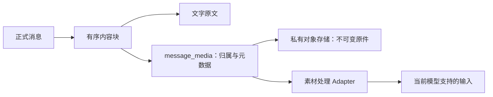
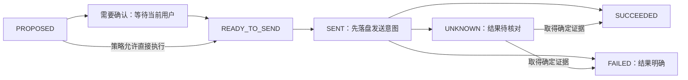

# 通用素材与工具操作设计

> 状态：2026-10-19 用户确认的设计调整；以“通用素材 + 对象存储 + 通用工具操作 + 独立操作确认”替代图片原件存 MySQL 和会议专用操作模型。本文是实施设计，不代表对象存储、工具 Adapter 或恢复流程已经实现。
> 一期产品范围仍是一个会议室数字员工、Web 入口、文字与图片验收。结构可表达其他文件和业务，不表示已上线音视频、文件解析、请假或邮件能力。
> 关联：[业务规格](业务会话运行消息与跨渠道续传设计规格.md)、[建表规格](一期会话运行消息建表规格.md)、[十表 DDL](../../../db/schema/02_会话运行消息建表.sql)、[术语](../../../GLOSSARY.md)。

## 1. 决策与职责

| 对象 | 平台保存的事实 | 外部事实或内部差异 |
| --- | --- | --- |
| 正式消息和有序内容块 | 谁发送、属于哪段会话、文字和素材的原始次序 | 不用框架压缩后的上下文替代原始历史。 |
| `message_media` | 素材归属、私有对象定位、类型、长度和 SHA-256 | 对象存储保存原件；素材处理 Adapter 负责验证、解析及模型输入转换。 |
| `tool_operation` | 一次逻辑工具操作的目标、版本、可信操作者、参数、执行和核对结果 | 工具 Adapter 负责业务校验、身份映射、上游请求与结果解释。 |
| `operation_confirmation` | 当前用户同意了哪个具体操作、有效期和一次性消费事实 | 不是长期授权，也不替代执行前重新鉴权。 |

新增 Skill 通常增加受控指引、工具配置或 Adapter，复用这些表；一个 Skill 可以组织多次工具操作，工具也可以由多个 Skill 使用。只有平台开始拥有独立业务生命周期或确有结构化业务查询需求时，才另设计业务表。会议系统继续拥有预约事实及业务权限。

## 2. 消息素材与私有对象存储

### 2.1 数据表达

- `message_content_block.block_kind` 只有 `TEXT`、`MEDIA`；文字与素材引用互斥。具体素材种类由 `message_media.media_kind` 表达为 `IMAGE`、`AUDIO`、`VIDEO`、`FILE`，其他格式归 `FILE`，不为 PDF、Word 等逐个增加数据库枚举。
- `message_media` 保持消息级归属：`message_id`、`user_id` 与所在 Session 一致，一条素材记录最多供该消息的一个内容块引用。本轮不引入跨消息或跨用户原件去重；相同内容的再次发送使用各自对象键和素材记录。
- `storage_profile` 是不可变、可保留历史版本的受控存储配置引用，定位后端和 bucket/命名空间；不保存密钥，也不能把同一个配置引用改指其他 bucket。实际厂商、bucket、限额和配置发布方式留待实施选择。
- `object_key` 由服务端生成，限定 512 个 ASCII 字符以内，全长唯一范围是 `storage_profile + object_key`；不采用用户文件名或内容摘要作为可覆盖键，也不复用已清理键。有提供方对象版本时另存 `object_version`。
- `mime_type`、`byte_count`、`content_sha256` 在平台验证原件后保存，文件名只供展示。对象存储的 ETag 不作为原件 SHA-256。通用文件可以零字节；图片、音频、视频必须非空，实际类型和大小仍由应用验证。
- SQL 不保存 `media_bytes`、Base64 原件或临时签名 URL。上传下载可用流式读写，流式传输本身不决定存储位置。

结构通用性与产品支持范围分别判断：能保存视频原件，不等于 Web 可以播放、模型可以理解或当前发布版本允许输入。未开放类型在接纳时明确拒绝，不能保存成功后静默忽略。

### 2.2 接纳、失败与清理

1. 先核验登录人、目标员工和提交意图，并按 `UserId + submission_key` 查重。同键同语义返回原记录；同键不同语义拒绝，避免重试重复上传。
2. 为本次上传分配服务端受控上传票据与不复用对象键；上传到私有对象存储，完成原件验证、长度和 SHA-256 核对。分片上传未完成或任一必需素材失败，不接纳正式消息与 Run。
3. 全部素材准备好后，在 SQL 事务内锁定目标 Session，再查提交键、权限和活动 Run；写 Session（首次时）、正式用户消息、素材元数据、内容块、Run，回填首次 Run 和消息序号。对象存储写入不在该事务内；模型只能在 SQL 提交后调用。
4. SQL 明确回滚或并发输掉的上传，其未引用对象可进入延迟清理。SQL 提交超时或返回结果不明时先按提交键及对象引用核对，不能直接删除对象。
5. 清理只处理未完成分片或确定未被正式历史引用的对象。必须与素材接纳互斥，或使用可核验的上传租约及失效规则：租约失效后禁止新事务绑定对象，排除正在提交和结果待核对的事务后才能删除。仅凭“超过 N 分钟”或一次无引用查询不足以证明可删；租约、互斥及核对机制须在实现时验收。
6. 已被正式消息引用的对象不按临时上传 TTL 清理，也不得覆盖。同键重发或用户归档不触发删除。历史留存与彻底删除按正式留存策略共同管理 SQL 和对象，当前仍无永久删除会话按钮。

因此保留“消息与 Run 不出现半条正式记录”的事务保证，同时承认失败上传可能留下待清理对象。不能宣称 MySQL 与对象存储已原子提交。

### 2.3 读取、续接与恢复

- 先按消息所属 Session 检查普通用户权限；固定管理员读取元数据、原件或完整操作参数前，必须先成功记录内容访问审计。
- 由受控存储配置解析对象，不接受浏览器传入任意 bucket、对象键、工具地址或远程 URL 作为可信定位。下载通过鉴权代理，或鉴权及审计后签发短时访问凭据；bucket 不公开，临时链接不成为持久历史。
- 每次读取重新生成有效访问方式。框架状态里旧签名 URL 过期时，以业务素材 ID 重新解析，不能把旧 URL 当作原件丢失。原件实际缺失、版本不符或摘要错误则阻断依赖它的继续/升级，不能跳过素材后宣称全量恢复。
- 升级预检按完整版本链读取素材，校验长度、摘要、可读性及新版模型是否支持。文件解析和模型转换保留原件关联，不把解析文字当作原件替身。
- 备份恢复必须同时覆盖 SQL 元数据、对象原件及历史 `storage_profile` 配置；恢复后巡检引用与对象可读性。只恢复数据库或只备份 bucket 不能证明历史可恢复。

## 3. 通用工具操作

### 3.1 操作与请求尝试

`tool_operation` 是一次逻辑工具操作，不是某个 Skill 的一次运行，也不是每次 HTTP 请求。一个 Run 可以有多条操作，按 `operation_no` 排序；同一操作的安全网络重试仍沿用原逻辑记录和请求号。本轮不新增逐次网络尝试表，必要时可增加跨业务通用的尝试记录，不能把该逻辑记录宣称为逐请求日志。

| 字段组 | 约束 |
| --- | --- |
| `run_id`、`operation_no`、`actor_user_id` | 关联原 Run 和当前可信登录人，不由业务参数或模型文本选择操作者。 |
| `tool_provider_key`、`tool_name`、`tool_binding_version` | 工具绑定版本固定目标提供方/连接、契约、Adapter、确认和恢复策略，并由员工不可变发布版本引用；不得在确认后重指另一个工具。 |
| `arguments_schema_version`、`normalized_arguments`、`arguments_sha256` | 参数以固定 Schema 校验并规范化；摘要基于固定规范化规则的 UTF-8 字节，不基于 MySQL JSON 取回后的原始排列。 |
| `effect_kind`、`is_confirmation_required` | `READ_ONLY`/`MUTATING` 与确认策略由平台受控配置确定，不能信任模型自报或仅凭工具名称判断。会议预约、取消始终要求确认。 |
| `identity_binding_kind/ref/version` | 指向可信身份绑定及版本；当前用户依旧是唯一操作者。会议绑定映射当前手机号登记记录和 `phone_revision`，不把查询对象当作调用者。 |
| `request_id`、`idempotency_mode`、`provider_request_id` | 内部请求号始终稳定且全局唯一；提供方幂等能力与实际接受的键另行记录。 |
| `reconciliation_mode`、`provider_resource_id`、`normalized_result` | 由 Adapter 声明和实施按请求号、资源号或人工核对，保存必要的结构化结果；不保存密钥、签名或原始 HTTP 报文。 |

身份绑定没有另造一套账号系统：一期 `MEETING_PHONE` 的 `ref` 为当前 `phone_reservation.id` 的字符串，版本为 `platform_user.phone_revision`；若工具只依赖平台身份，`PLATFORM_USER` 的引用为 `platform_user.id`，版本为 `security_version`。未来绑定类型须提供可信来源、修订规则与重新检查能力，不能只填一段模型生成的 JSON 就获得执行身份。

### 3.2 提案与确认不可变性

`operation_sha256` 覆盖固定的 Run/发布版本、操作序号、操作者、提供方、工具名、绑定版本、参数 Schema 及参数摘要、身份绑定类型/引用/版本、读写性质、确认策略、请求号、幂等与核对模式、实际提供方请求键。字段编码、顺序和规范化算法由绑定版本确定；确认和恢复必须能按该版本重算。执行状态、时间、返回结果不属于提案摘要。

提案建立后，上述执行语义字段不可原地更改。修改参数、目标、身份或策略时，先使旧确认失效；尚未发送的旧操作转取消/失效，再用新序号和新请求号建立新提案。已有请求发出或结果不明时，必须先核对，不能用新提案绕过未知写结果。

### 3.3 生命周期与外部能力

- 不需确认的授权查询可直接转待发送；需要确认的操作须先消费匹配确认。`CANCELLED`、`EXPIRED` 仅用于确定尚未发送的提案；已发出的工具请求不能因本地取消、超时或授权撤销而直接改成这些状态。
- 发送前先持久化 `SENT` 及首次发送时间，用原子状态领取确保单一执行者；若随后进程退出，按“可能已发出”核对。重启不能仅因没有响应而再次发送写操作。
- `idempotency_mode = NONE` 时 `provider_request_id` 为空；本地唯一请求号不能提供上游去重保证。`PROVIDER_KEY` 时必须保存上游实际接受且跨尝试不变的键；会议 Adapter 按既有契约把内部请求号映射为上游 `requestId`。
- `reconciliation_mode = REQUEST_ID` 表示上游实际支持按请求号核对，不从“支持幂等键”推定这一能力；`RESOURCE_ID` 仅在确已获得关联资源时适用，无资源号的未知结果转人工核对。没有查询能力的接口使用 `MANUAL`，不能假装可自动恢复。
- `UNKNOWN` 只能凭确定证据转成功或失败。写结果未知时保持 Run 的 `RECONCILING` 及会话占用；不自动换号重发。查询重试也须按固定策略和当前授权执行，不重跑整轮模型来替代核对。
- 上游的业务校验、权限和资源最终状态仍由该业务系统裁定；HTTP 成功不必然代表业务成功，HTTP 超时也不能证明业务未发生。

## 4. 独立的一次性操作确认

`operation_confirmation` 绑定 `operation_id`、原 Run、当前操作者、参数摘要和完整操作摘要；同时保存展示时的 `authorization_version`、`security_version`、`identity_binding_version`、随机确认凭据摘要、截止时间和消费时间。不保存凭据原文，不按业务增加确认表。

1. 展示前保存不可变操作提案，展示当前具体业务对象和参数；会议沿用会议室、时间、主题、参会人或待取消会议的信息。展示模板由固定工具绑定对应的 Adapter 负责。
2. 只有当前登录用户可以确认；服务端校验确认凭据、操作归属、全部摘要、十分钟有效期、账号状态、当前授权、安全版本与身份绑定。管理员查看不获得代确认权限。
3. 在同一 SQL 事务中锁定操作与确认，条件消费 `PENDING` 确认并把操作转 `READY_TO_SEND`；重复点击返回原结果，不再次消费或执行。需要确认却没有匹配已消费记录时，发送必须被拒绝。
4. 请求真正发送前再次检查当前权限和绑定。确认已经消费但权限或身份变化时不得发送，也不能改用新身份重用旧确认；记录失效或明确未发送的取消结果，再由用户决定是否提出新操作。
5. 一份提案最多一条确认；过期或失效后重新展示，必须在确认旧操作未发送后创建新提案。拒绝和过期均结束原等待路径，不能让 Run 无限等待旧确认。

通用操作 Module 对外呈现小的 Interface：提交操作、确认操作、查询结果。权限、落盘、确认、发送领取和恢复集中在其内部；业务参数、身份、上游调用和核对通过内部 Seam 上的 Adapter 提供差异。一期只实现会议 Adapter，不提前开发请假、邮件或通用工作流引擎。

## 5. 验收与尚未实现的工作

- SQL：十表可建立；素材类型/内容块互斥、完整对象定位唯一、稳定请求号唯一、确认版本和生命周期约束生效；同结构能够表达会议、请假和邮件等合成操作。
- 对象存储：上传失败、SQL 回滚、提交结果不明、并发去重、对象缺失、过期下载链接、租约失效及清理竞争；历史对象不被错误删除，越权下载被拒绝，管理员原件访问审计失败时不返回内容。
- 操作：改参数/换工具/换绑定后旧确认不可消费；双击确认只有一次发送领取；无确认的受控查询可执行；不支持幂等或查询的写接口超时后进入人工核对；重启、撤权和本地取消均不重复外部写操作。
- 恢复：SQL、对象和历史配置联合恢复；框架过期 URL 重新解析；全版本链必需素材及模型输入检查，不能截断或跳过文件后宣称全量续接。

上述应用场景待实现后运行。DDL 和单表约束检查不能证明对象存储、Adapter、跨存储事务或 AgentScope 状态恢复已经可用。
