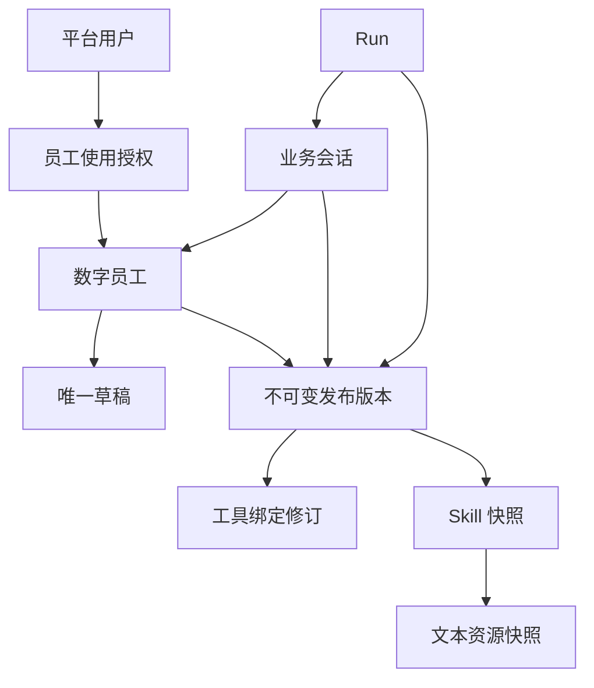

# 数字员工配置、发布与授权数据模型

> 2026-10-20 初稿：业务决策已确认，本文据此整理数据库逻辑模型与事务设计。当前物理字段和 DDL 状态以以下 2026-10-22 更新为准。业务依据见[一期配置与发布决策](一期配置与发布决策.md)。

> 2026-10-22 补充：本轮 Q2～Q6 已确认允许保存不完整草稿、当前内容相同时不造空发布、改回历史内容正常生成新版、版本可停用／恢复且不改当前指针、同内容发布不恢复停用、授权审计补四列。Q7 接受[建表基线](一期员工配置发布授权建表规格.md)，八表与审计扩列已落入 DDL；[全库评审](../一期全库实体关系与约束评审.md)及[29 表隔离验收记录](员工配置发布授权与全库建表验收记录.md)已完成。应用和真实后端仍待验收。

## 1. 一期闭环

管理员修改员工的唯一草稿，保存后点击一次“发布员工”。平台自动固定模型配置、指令、Skill 内容、MCP 工具绑定及平台约定的静态配置，形成不可变发布版本，并将它设为该员工后续新会话使用的版本。

普通用户按“用户 × 数字员工”获得使用授权，不按每个发布版本重新授权。已有 Session 及其 Run 固定原发布版本；发布新版不改写旧会话，也不自动升级旧会话。已有的显式“在新版继续”规则沿用[会话设计规格](../会话运行与消息/业务会话运行消息与跨渠道续传设计规格.md)。

一期不增加独立 Skill/工具发布流程，不实现回滚、发布审批或强制测试门槛。管理员使用本人绑定手机号走正常调用链路，不增加专门测试隔离；原有跨用户、跨员工的隔离要求继续有效。

## 2. 核心实体与关系

以下为八个逻辑实体：原有六个配置/发布/授权实体，加上用户已确认的两张 Skill 快照明细。对应 05 号 DDL 已通过隔离建表验收；已有身份与会话结构继续复用。Skills 的完整规则见[MySQL 管理与版本装载设计](Skills_MySQL管理与版本装载设计.md)。

| 实体 | 建议关键字段 | 关系与约束 |
| --- | --- | --- |
| `digital_employee` 数字员工 | `id`、`employee_code`、`display_name`、`description`、`current_release_id`、`last_release_no`、`row_version` | 稳定员工身份；`employee_code` 唯一。新员工尚未发布时当前版本可为空；当前版本必须归属本员工。 |
| `employee_draft` 员工草稿 | `id`、`employee_id`、`draft_revision`、`config_schema_version`、`config_json`、`saved_by` | `employee_id` 唯一，每员工一份持久草稿；浏览器未保存编辑不构成第二份草稿。保存使用修订号防止多个管理页面相互覆盖。 |
| `employee_release` 员工发布版本 | `id`、`employee_id`、`release_no`、`source_draft_revision`、`config_schema_version`、`config_json`、`config_sha256`、`published_by`、`published_at`、`availability_status` | `(employee_id, release_no)` 唯一。配置、来源修订、摘要和发布信息不可改写；可用性是独立运行控制状态，不改变配置正文。 |
| `tool_binding_revision` 工具绑定修订 | `id`、`tool_binding_version`、`provider_key`、`tool_name`、`binding_json`、`binding_sha256`、`created_by` | `tool_binding_version` 唯一且不复用；固定目标、契约、Adapter、参数规则、执行身份注入方式、确认与恢复策略。无独立用户发布操作。 |
| `employee_use_grant` 员工使用授权 | `id`、`user_id`、`employee_id`、`grant_status`、`granted_by`、`granted_at`、`revoked_by`、`revoked_at` | `(user_id, employee_id)` 唯一保存当前关系；授予、撤销和再授予均留审计并提升用户 `authorization_version`。固定管理员按角色免此层显式授权。 |
| `employee_configuration_audit_event` 员工配置审计 | `id`、`actor_user_id`、`employee_id`、`action_code`、`draft_revision`、`employee_release_id`、`request_id`、`outcome`、脱敏变更摘要 | 追加记录草稿保存、员工发布及已有规则中的版本可用性调整。授权变更复用既有 `identity_audit_event`，不重复保存两套授权事实。 |
| `employee_release_skill` 正式 Skill 快照 | `id`、`employee_release_id`、`skill_name`、`description`、`metadata_json`、`skill_markdown`、`package_sha256`、`resource_count` | `(employee_release_id, skill_name)` 唯一；原文含完整 frontmatter 与正文；内容随员工发布固定，不原地编辑。 |
| `employee_release_skill_resource` 正式 Skill 文本资源 | `id`、`release_skill_id`、`resource_path`、`resource_content`、`content_sha256` | `(release_skill_id, resource_path)` 唯一；保存该 Skill 的实际参考文本，不跨版本读最新资源。 |

所有数值主键、员工/用户/发布引用沿用现有 `BIGINT UNSIGNED`；每表沿用 `id`、`gmt_create`、`gmt_modified`、中文注释与不建物理外键的团队规约。精确列长、索引和 `CHECK` 见建表规格及对应 DDL。

员工使用授权控制“能否使用该员工”；发布配置控制“该员工有哪些能力”；平台工具策略、会议身份与外部业务权限、具体写操作确认仍分别检查。版本固定不能冻结或替代当前用户授权。

## 3. 配置快照与可变运行数据

`config_schema_version` 标识平台配置结构的版本，不等于员工发布序号。`config_json` 是受固定结构约束的配置清单，不接收任意未知字段。建议按以下内容组织：

| 配置部分 | 草稿与发布内容 | 边界 |
| --- | --- | --- |
| 模型 | 平台模型配置引用、实际模型 ID、必要调用参数及非敏感连接修订信息 | 不从“最新模型配置”静默覆盖旧版。固定平台请求配置不代表冻结上游模型权重或可用性。 |
| 指令 | 本次员工指令全文 | 运行时不从可变草稿重新取指令。 |
| Skills | 草稿保存完整文本包；正式发布 JSON 保存快照 ID、名称和摘要，实际正文与文本资源分表保存 | 引用必须属于本发布版本，不能漏参考资料或回退到最新内容。没有独立 Skill 发布入口。 |
| 工具 | 选择的提供方、子工具以及各自 `tool_binding_version` | 每项必须能解析到不可变工具绑定修订；不自动并入新发现的工具。 |
| Workspace、Memory | 平台统一约定的模板/规则引用及其必要修订 | 固定静态约定，不复制用户记忆、运行文件或历史消息。 |

一期 Skill 使用 MySQL 管理：草稿继续使用 `employee_draft.config_json`，正式正文和参考资源使用两张不可变快照明细表，发布清单只保存引用。文本资源不得只留路径，必须保存真实内容及摘要；发布版本、全部 Skill 明细和版本指针在同一 SQL 事务提交。非文本资源需要另行确认消费方式，本次不将对象引用等同于已具备二进制 Skill 处理能力。

平台 SQL 发布快照是静态配置的权威来源。运行时通过按员工发布版本限定的只读 `ReleaseSkillRepository` 实现官方 `AgentSkillRepository` 接入，复用框架的 `AgentSkill`、装载及正文/文本资源读取，不强制先生成本地目录。框架所需目录或缓存是可重建运行产物；额外 Skill 来源与可写目录不得覆盖发布内容。真实装载及 Memory/Workspace 恢复由“框架隔离与存储映射”议题验证。

模型密钥、MCP 密钥不进入上述 JSON、Skill 包或审计。实际值从凭证管理读取，配置只保存引用。密钥轮换保持原提供方、目标和身份语义；改接入目标或改变执行身份语义须生成新配置修订并重新发布员工。

## 4. 后端 MCP 配置如何进入不可变版本

一期连接信息由后端配置文件维护，手机号注入、签名与确认机制由 Java 适配，网页只负责选择已接入的服务与子工具。

发布时，平台把所选工具对应的有效连接与契约信息解析成 `tool_binding_revision`，再写入员工发布清单。内容相同的既有修订可复用，改变内容须创建新修订，不允许原地覆盖。建议绑定至少覆盖：

- 受控提供方、工具名、连接目标、传输方式及非敏感必要参数；包括凭证引用，但没有秘密值。
- MCP 输入契约，以及平台规范化参数的 Schema/规则版本。
- 可部署、可识别的 Adapter 修订和执行身份注入方式。
- 查询/写入分类、必须确认的策略、实际支持的幂等与结果核对能力。

后端配置文件更新不能让旧发布版本自动改用新地址或新工具契约。运行时依据快照解析指定目标及修订；若当前部署无法提供该 Adapter、凭证引用或契约，应拒绝相关工具执行并记录原因，不能静默切到最新版本。

这固定的是平台如何调用外部服务，不保证外部 MCP 服务永远保留旧实现。接口不兼容或目标不可用仍须按真实结果处理，不自动改绑或猜测业务结果。

## 5. 保存与发布事务

### 保存草稿

1. 校验当前账号为有效固定管理员。
2. 按管理员用户、员工、草稿顺序读取并锁定所需记录，比较客户端携带的 `draft_revision`。
3. 修订不匹配则提示重新加载；匹配则保存配置、增加修订并追加审计，同一 SQL 事务提交。

发布按钮提交的是期望的已保存草稿修订。页面存在未保存编辑时先保存；不能直接发布浏览器拼装的另一份配置。

### 发布员工

1. 基于指定草稿修订完成固定结构、必填项、模型引用、Skill 静态文件及工具清单的有效性检查。不设置审批或强制测试通过门槛。
2. 准备不可变静态内容与工具绑定材料。涉及对象存储时先写入并校验，不能把网络调用放进长期持有的 SQL 行锁事务。
3. 在 SQL 事务内重新检查管理员、员工和草稿修订；若检查期间草稿被保存或相关接入配置已改变，拒绝本次发布，重新准备，不能混用新旧配置。
4. 在员工行锁下分配本员工下一发布序号，插入或复用工具绑定修订，插入发布记录、全部 Skill 正文和文本资源快照及完整配置清单，追加发布审计，并更新 `digital_employee.current_release_id`，同一事务提交。
5. SQL 提交失败时不切换当前版本。提交结果不明先按发布请求审计、源草稿修订及配置摘要核对，不能直接生成另一个发布版本。明确回滚且无正式引用的对象，按已有对象清理规则处理。

同一员工通过行锁串行发布。无论草稿修订是否变化，有效配置与当前版本相同时只保存无变化收据并返回该版本，不制造空发布、不增加发布号，也不恢复已停用版本。A→B→A 中第三次与当前 B 不同，因此产生新发布，历史摘要不能设为唯一。同一修订不重复产生两个版本。发布序号用于员工内展示，发布主键用于会话/Run 关联，两者不可混用。

每个草稿修订固定保存时可核对的有效依赖指纹，未能完整解析时标为未就绪；后端模型、工具接入或静态规则变化后须先重新保存新修订。此规则也覆盖此前无变化、没有生成发布记录的草稿，不能仅靠发布表的来源修订唯一键。成功请求重试返回原收据，不重新切换当前版本；有效内容摘要与含真实快照 ID 的最终清单摘要分别保存，具体技术协议见建表规格。

跨存储准备、精确摘要编码和异常核对需要在应用接入后验收。本设计不将多个存储系统当作一个原子事务。

## 6. 授权、创建会话与创建 Run

**授予或撤销。**按目标用户、员工顺序锁定记录，更新 `employee_use_grant`、增加 `platform_user.authorization_version` 并追加身份审计，同一事务提交。重新启用账号不恢复已撤销授权。

**新建会话。**在事务内按用户、员工顺序校验账号和员工使用权，读取并固定当时可用的 `current_release_id`；确认发布版本归属本员工、完整且可用后，创建 `business_session` 及独立状态槽。无已发布可用版本时不能发起运行。

**已有会话创建 Run。**锁定顺序统一为用户、员工、业务会话；再次检查账号、当前员工授权、会话归属和状态、活动 Run、会话原发布版本的可用性。`business_run.employee_release_id` 必须等于该 Session 的固定版本，不能改读员工最新版本。消息接纳与 Run 创建继续沿用既有会话事务。

授权写入也先锁目标用户，使授权撤销与该用户的 Run 创建具有确定先后关系。若撤销先提交，新 Run 被拒绝；若 Run 先创建，撤销生效后它在下一个授权或工具边界停止。已经发出的外部写操作继续核对结果，不因本地撤权假定已取消。

发布只切换员工的当前版本，不改写既有 Session。新会话创建与发布经员工行锁排序，创建操作固定一个完整版本，不会出现一部分 V1、一部分 V2。版本停用仍按已有会话规则阻止相关新 Run，不改写历史，也不触发自动回滚；默认版本不可用时新会话不得猜选其他版本。

固定管理员只免员工使用授权记录；本人手机号、工具策略、会议系统权限与本次写操作确认继续有效。

## 7. 与已建会话结构的对应

| 已有字段 | 本模型的目标 | 服务校验 |
| --- | --- | --- |
| `business_session.employee_id` | `digital_employee.id` | 会话归属员工，创建后不改绑。 |
| `business_session.employee_release_id` | `employee_release.id` | 版本所属员工与会话员工相同。 |
| `business_run.employee_release_id` | `employee_release.id` | 等于该 Run 所属 Session 的固定版本。 |
| `session_upgrade_attempt.target_release_id` | `employee_release.id` | 属于原员工且与来源版本不同；沿用完整历史预检与首次成功后激活规则。 |
| `tool_operation.tool_binding_version` | `tool_binding_revision.tool_binding_version` | 保持现有 `VARCHAR(64)` 标识形态；必须被本 Run 的员工发布清单引用。 |
| `tool_operation.arguments_schema_version` | 工具绑定内的平台参数 Schema 修订 | 与规范化参数及完整操作摘要一致。 |
| `operation_confirmation` 的授权、安全、身份版本 | 既有身份表与当次提案 | 消费及实际调用前重新检查；不能用发布快照替代当前身份和授权。 |

上述是逻辑关联；遵循现有“不建物理外键”规约，由事务和关联巡检校验。02／03 号 DDL 的员工目标表注释已更新；结构与关联证据引用本轮隔离验收，应用事务仍须实现并验证。

## 8. 后续工作与证据边界

- 完整实体与约束评审：字段、索引、全库 ER、DDL、关联巡检及 SQL 并发验收已完成；应用协议与真实后端证据继续待补，不能宣称整个 #9 已完成。
- 框架隔离与存储映射：验证固定发布配置如何装载为 AgentScope 运行实例，完成静态资产、AgentState、Workspace 和 Memory 的隔离、物化与真实恢复。
- 留存、删除与迁移：统一确定历史发布、引用资产、业务消息与用户记忆的保留和删除规则；不得提前清理仍被历史版本引用的内容。
- 证据边界：设计、原型脚本及内存状态流转已检查，DDL 已用真实隔离 MySQL 验证指定 SQL 并发性质；浏览器视觉、应用发布协议、MCP 调用、Skill 装载与 AgentScope 重启恢复仍未验收。
