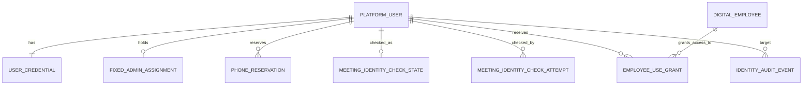

# 一期用户与管理员数据模型

> 状态：业务方于 2026-10-18 确认为后续设计的身份基线；物理模型现按[阿里巴巴 MySQL 规约](阿里巴巴MySQL规约核对.md)修订，具体执行状态见[建表验收记录](用户与管理员建表验收记录.md)。认证和账号管理应用尚未实现。依据当日业务决策与本地会议 MCP 联调契约；本文只设计用户与管理员。

## 1. 设计边界

平台以不可变的 `UserId` 识别用户。物理表以 `platform_user.id BIGINT UNSIGNED AUTO_INCREMENT` 承载该标识，服务层将它作为不含手机号的稳定身份传给 AgentScope；手机号用于登录，员工姓名只用于展示，均不能替代 `UserId`。一期面向单家企业，由一个部署初始化的固定管理员手工开通账号；批量导入是后续功能。普通用户使用数字员工须有显式授权，固定管理员默认可使用全部数字员工，但会议工具仍经过身份、平台工具策略、会议系统权限和写操作确认。

AgentScope Java 的 `userId` 是调用方传入的运行时身份字段；Gateway 会据此路由和隔离框架状态，但不承担企业账号登录、管理员角色、员工授权或会议账号核验。[Channel 文档](https://github.com/agentscope-ai/agentscope-java/blob/v2.0.4/docs/v2/zh/docs/harness/channel.md)、[本项目调研](../../调研/会话/AgentScope多渠道消息会话能力.md)。

“手机号属于哪位平台用户”由固定管理员依据企业可信员工名册核对并记录来源与时间；会议 MCP 自动检查的是该手机号能否作为有效会议账号发起请求。这两层不能混称为“本人核验”。平台须从已认证用户记录读取操作者手机号，不能从模型输出、对话文本或请求参数接受另一个操作者。账号可在会议账号检查失败时登录，但会议工具须受阻；检查结果与失败原因由平台记录。[一期总体设计](../../一期总体设计.md#4-登录身份与会议-mcp)。

现有[会议 MCP 联调说明](../../对接文档/MCP身份查询联调说明%20%281%29.md)要求每次 `/mcp` 请求携带签名及当前登录手机号，服务端校验其是否对应有效账号。文档没有单独的手机号核验或 `whoami` 工具，也没有返回当前操作者的会议账号 ID 或核验有效期。`identity.resolve` 查询的是候选员工，不能当作当前登录人的身份查询。签名或用户身份失败均可能返回 HTTP `401`，因此单次 `401` 不能解释成“手机号不存在”；HTTP `503` 表示服务端未配置验签凭证。手机号鉴权还要求目标环境部署对应版本，实际能力须在联调时核实。联调说明含测试凭据，设计及对外文档只引用接口规则，不复制凭据。

## 2. 逻辑关系

`DIGITAL_EMPLOYEE` 在后续“数字员工定义、发布版本与用户授权关系”议题中细化；本稿只固定授权关系的用户一侧。Web 登录会话使用认证基础设施持久化，与用户和数字员工之间的业务会话分开。

## 3. 实体和关键约束

| 实体 | 一期关键字段 | 约束及用途 |
| --- | --- | --- |
| `platform_user` | `id`、`phone_revision`、`display_name`、`account_status`、`security_version`、`authorization_version`、`created_by_user_id`、`modified_by_user_id`、`status_changed_at` | `id` 是不复用的 UserId；当前登录手机号从该用户唯一的当前号码保留记录取得，不在用户表重复存一份；管理员可更正普通用户号码而保持 `id` 不变；姓名允许重名和更正；停用不删除历史身份。`account_status` 先取 `ACTIVE`/`DISABLED`，首次改密由凭据状态单独控制。 |
| `user_credential` | `id`、`user_id`、`password_hash`、`is_password_change_required`、`password_changed_at`、`credential_version` | `user_id` 唯一形成用户一对一凭据；初始或重置密码只保存专用密码哈希，首次登录仅允许改密流程；改密和重置提升版本并撤销旧登录会话。不能从数据库或管理界面取回原密码。 |
| `fixed_admin_assignment` | `id`、常量单例键、`user_id`、`initialized_at` | 唯一单例键限制全库最多一个固定管理员；由部署初始化，管理界面不授予、撤销或停用该管理员。它是角色绑定，不是另一套账号。 |
| `phone_reservation` | `id`、`phone_normalized`、`owner_user_id`、`reservation_status`、`ownership_source_ref`、`ownership_checked_by/at`、`reserved_at`、`transferred_at` | `phone_normalized` 全局唯一；每名用户恰有一条 `CURRENT` 记录作为登录号码，其余旧号为 `HELD`。开通和改号前，管理员依据可信名册核对归属并留存可追溯来源编号，不复制整份名册。旧号码继续保留给原用户；跨用户放行须核对会议系统当前归属及历史数据权限，走受控流程并记录审批。 |
| `meeting_identity_check_state` | `user_id`、`checked_phone_id`、`checked_phone_revision`、`probe_status`、`probed_at`、`last_http_status`、`version` | 与用户一对一；只针对当前手机号版本有效。状态取 `UNCHECKED`、`PASSED`、`AUTH_OR_IDENTITY_REJECTED`、`UNAVAILABLE`、`ERROR`；只有目标服务版本已通过联调、状态为 `PASSED` 且手机号版本一致，才可进入会议工具。当前契约没有账号 ID 和有效期，不凭空增加这两列；探测结果不替代每次 MCP 请求的校验。 |
| `meeting_identity_check_attempt` | `id`、`user_id`、`phone_id`、`phone_revision`、`attempt_kind`、`observed_at`、`result_code`、`provider_request_id`（可空）、`http_status` | 追加记录签名 `tools/list` 探测及实际工具身份失败；不保存接口原始敏感响应。`401` 归类为签名或身份校验失败，不能单独归因于号码无效；工具业务结果 `FORBIDDEN` 属于另一类权限失败。 |
| `employee_use_grant` | `user_id`、`employee_id`、`grant_status`、`granted_by/at`、`revoked_at` | 同一用户与员工最多一条当前有效授权，变更留审计并提升 `authorization_version`；普通用户默认无权限，固定管理员按角色拥有使用权。使用权不等于会议工具权限。 |
| `identity_audit_event` | `id`、`actor_user_id`、`target_user_id`、`action_code`、`outcome`、`occurred_at`、`request_id`、脱敏详情 | 追加记录开通、停用/启用、改密/重置、手机号归属核对/变更、会议探测及员工授权变更；不写密码、完整手机号或会议密钥。通过手机号登记记录 `id` 等内部标识追溯号码；部署初始化事件的操作者可标记为系统。 |

以上已建实体均含 `id BIGINT UNSIGNED AUTO_INCREMENT` 主键和 `gmt_create`、`gmt_modified DATETIME(6)`；业务关联字段使用同型的 `BIGINT UNSIGNED`。依阿里巴巴规约不建立物理外键，由开户、改号、审计写入事务和定期孤儿数据巡检维护引用关系；唯一索引和 CHECK 约束仍由数据库承担。[建表规约](https://github.com/alibaba/p3c/blob/master/p3c-gitbook/MySQL%E6%95%B0%E6%8D%AE%E5%BA%93/%E5%BB%BA%E8%A1%A8%E8%A7%84%E7%BA%A6.md)、[SQL 规约](https://github.com/alibaba/p3c/blob/master/p3c-gitbook/MySQL%E6%95%B0%E6%8D%AE%E5%BA%93/SQL%E8%AF%AD%E5%8F%A5.md)。

密码哈希须使用适合密码存储的慢哈希算法，不能保存明文或快速摘要；具体算法与参数在实现时按部署资源验证。[OWASP Password Storage](https://cheatsheetseries.owasp.org/cheatsheets/Password_Storage_Cheat_Sheet.html)。

关键不变量如下：

1. `platform_user.id` 永不重用；姓名允许重名，不能参与身份或权限判断。登录时按唯一的 `phone_reservation.phone_normalized` 查找状态为 `CURRENT` 的归属用户；同一用户恰有一条当前号码，旧号虽保留但不能用于登录。号码规范化规则与发送给 MCP 的格式须在目标环境联调确认，不能直接透传页面自由文本。
2. `fixed_admin_assignment` 全库恰有一条，引用有效平台用户；管理界面没有授予、撤销、停用管理员或修改其手机号的入口。管理员改号或恢复走运维流程，同样须留审计和撤销原登录会话。
3. 账号、凭据、号码归属与授权记录均不硬删除。一个普通用户与一个数字员工最多有一条当前有效授权；撤销后旧授权不能因账号重新启用而自动恢复。
4. 平台认证、员工使用权、平台工具策略、会议系统权限、写操作确认是分开的判断。固定管理员只免去“员工使用授权”这一层，不免去其他层。

## 4. 登录会话、安全版本与运行中操作

Web 认证采用服务端会话。候选实现是 Spring Session JDBC 的 `SPRING_SESSION` / `SPRING_SESSION_ATTRIBUTES`，按稳定 `UserId` 建立 principal 索引以查找并撤销该用户的所有登录会话；这两张表属于认证基础设施，不充当业务会话或 AgentScope `AgentState` 表。[Spring Session JDBC](https://docs.spring.io/spring-session/reference/configuration/jdbc.html)、[按 principal 查找会话的接口](https://docs.spring.io/spring-session/reference/api.html)。

登录使用同一个手机号和密码表单，表单仅有一个“登录”提交按钮，不提供管理员/用户角色选择或分开的登录入口。认证通过后由服务端根据账号关联的可信角色分流：固定管理员进入管理端，普通用户进入用户端工作台。客户端不得提交或修改角色以选择管理端；首次登录需改密的用户在认证后进入受限改密流程，完成前不能发起 Run。交互草图见[一期总体设计](../../一期总体设计.md#4-登录身份与会议-mcp)中的原型链接。

登录会话记录创建时的 `security_version`。每次进入平台受保护请求、创建 Run 与调用工具前，都检查当前 `account_status` 和安全版本；删除服务端会话与版本检查配合，避免仅靠一次批量删除留下并发窗口。密码重置、手机号修改和停用/重新启用都提升 `security_version` 并撤销旧会话。普通员工授权变更提升 `authorization_version`，Run 和工具边界重新查权；授权变化无需把用户从整个 Web 平台登出。[OWASP Session Management](https://cheatsheetseries.owasp.org/cheatsheets/Session_Management_Cheat_Sheet.html)。

停用一经生效便拒绝新 Run；改号后旧登录会话不得再创建 Run，新号码重新登录后可按账号和员工授权创建 Run，但会议工具仍等待新号码探测通过。已经运行的 Run 在下一个平台授权或工具调用边界停止。已发送到会议平台的写操作继续核对结果并保留审计，不能仅凭本地状态变化认定外部操作已取消。号码修改还提升 `phone_revision`，使旧会议探测结果立即失效。

## 5. 一期流程

1. **手工开通**：固定管理员依据可信员工名册核对手机号归属，记录来源编号、核对人和时间，再录入手机号与姓名、设置一次性初始密码。事务内生成稳定 `UserId`、建立号码保留与凭据记录。用户首次登录只可完成改密；改密前不能发起 Run。批量导入留待后续。
2. **会议身份探测**：开通或改号后，以该用户的当前手机号按 MCP 顺序完成 `initialize`、`notifications/initialized`、`tools/list`，每个 HTTP 请求都使用新的签名与时间戳；目标环境确认部署手机号鉴权版本后，收到协议正确的工具列表才记录为通过。失败或不可用不阻止平台登录，但阻止会议工具；实际 `tools/call` 仍逐次接受 MCP 校验。`401` 只记为“签名或身份校验失败”，需分别排查应用凭据、时间戳和号码，不能据此直接判定号码无效。旧版本服务若忽略手机号头也可能让 `tools/list` 成功，因此版本联调验收前不把探测成功当成有效身份检查。
3. **使用数字员工**：先检查平台账号状态，再检查普通用户的显式授权或固定管理员身份。调用会议工具前检查本次手机号版本的探测状态、员工发布配置中的工具策略，以及写操作的本次确认；会议系统在每次请求中最终判权。工具 HTTP `401` 使当前号码的通过状态失效并暂停后续会议工具，业务 `FORBIDDEN` 记录为权限不足。
4. **忘记密码**：固定管理员为普通用户设置一次性重置密码，提升安全版本并撤销全部旧 Web 会话。用户用重置密码登录后只能先改密。固定管理员本人的密码恢复走受控运维流程。
5. **停用与重新启用**：固定管理员停用普通用户，立即阻止登录和新 Run，并撤销旧会话；已有 Run 按第 4 节停止。重新启用保持原 `UserId` 和审计，同时重置为一次性密码；已撤销的数字员工授权不恢复，会议工具仍须当前手机号探测通过。
6. **手机号更正**：固定管理员可修改普通用户手机号，先依据可信名册核对新号归属，再在事务内检查新号码未被占用、更新当前号码和 `phone_revision`、作废旧会议探测结果并提升 `security_version`，然后撤销旧登录会话；`UserId`、原会话归属和审计不变。旧号默认保留占用，不自动转交其他用户。固定管理员本人改号走受控运维流程。号码转交别人前须人工核对会议系统的当前归属及历史数据访问权，并记录放行依据。

## 6. 数据归属和落地顺序

`platform_user`、号码保留、固定管理员归属、密码凭据、员工使用授权、会议探测状态与身份审计是**平台业务数据**。Spring Session 表是 Web 认证基础设施数据。会议系统拥有会议账号有效性和业务权限事实；平台只保存已观察到的探测结果，不复制会议系统的员工主数据。AgentScope 的 `userId` 消费平台分配的稳定 `UserId`，其 AgentState/Memory/Workspace 另有存储边界。

落地先建立用户、凭据、号码保留及审计，再初始化唯一管理员与其密码；随后接入 Web 登录会话、账号管理和会议探测。`employee_use_grant` 的数字员工标识须等数字员工定义落地后确定，所有业务关联只用同型的数值 ID，不用字符串或手机号冒充主键，也不建立物理外键。

## 7. 与后续设计的接口

- 业务会话只引用 `user_id`，不以手机号或姓名作为所有者；创建 Run 时读取账号、员工授权与会议身份状态。
- 未来渠道身份应先可信绑定 `user_id`，再进入同一授权链；渠道发送人 ID 不直接等于 `user_id`。
- 数字员工发布版本与能力权限在后续议题设计；管理员默认可见全部员工不绕过工具策略、会议平台判权或写操作确认。

## 8. 评审场景

- 两名同名员工以不同手机号登录，得到不同 `UserId`、数字员工授权、业务会话和会议操作者身份。
- 号码确属甲，但会议 MCP 暂不可用：甲可改密并登录，会议工具拒绝；服务恢复且探测通过后才放行工具。
- 会议 MCP 返回 `401`：平台暂停后续会议工具并排查签名、时钟和账号，不把甲的手机号直接判为无效；业务 `FORBIDDEN` 不误报为登录失败。
- 管理员将甲的手机号改为新号：旧会话失效，旧 Run 在下个授权点停止，旧会议探测结果失效；原业务会话仍属于甲的 `UserId`，旧号不能自动分配给乙。
- 管理员停用后重新启用甲：甲以一次性密码重新登录，已撤销的员工授权不复活；管理员本人使用数字员工仍须通过会议身份和写操作确认。
