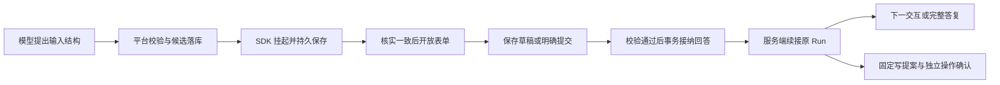

# 动态表单与交互请求生命周期设计规格

> 日期：2026-10-23，Asia/Shanghai。  
> 议题：[动态表单与交互请求生命周期 #19](https://github.com/BeyondzychenProton/agentscope-brain/issues/19)；所属[正式 Web 应用设计决策地图 #14](https://github.com/BeyondzychenProton/agentscope-brain/issues/14)。  
> 正式结论：[完整 resolution](https://github.com/BeyondzychenProton/agentscope-brain/issues/19#issuecomment-6359974007)，已发布并读回核对，#19 按设计完成关闭。  
> 状态：Q1—Q15 已由用户逐轮确认，本文将这些决定整理为端到端契约；确认经过见[讨论记录](动态表单与交互请求生命周期设计草稿.md)。尚未创建正式应用、修改 DDL 或进行框架／Web／会议集成验收。工程字段与上限是本契约的初始约定，不冒充框架默认值。

## 1. 范围与一次完整交互

一期为单企业、Web、一个会议室数字员工、单节点低并发。业务 Session、原 Run、发布版本和可信 UserId 沿用已有边界。同一 Session 只有一个活动 Run；同一 Run 同时只有一个可响应交互，等待期间不接纳普通新消息。

例如用户提出预约会议，数字员工发现缺时长和具体参会人：

1. 调用平台输入工具提出一份多字段结构。服务端校验、补齐可信候选与预填，保存候选交互，再通过原生 suspended 暂停本次 SDK 调用。
2. 确认平台事实和框架 pending 均持久保存且对应后，展示可提交卡片。浏览器只负责受控渲染和回答，页面关闭不取消 Run。
3. 用户修改并提交。服务端检查当前修订、权限、字段和业务条件；通过后，在同一 SQL 事务中保存原始回答、正式用户消息和待续接事实。
4. 提交接口返回“回答已接纳”。服务端再重建匹配 pending 的工具结果，续接原 Run；需要下一次询问时，顺序提出下一份请求。
5. 数据齐全后才能形成预约提案；用户针对该固定提案另行确认，会议 Adapter 才可按既有规则发送。表单提交本身不授权预约／取消。

图中的就绪、接纳和续接是三个不同事实，任何一个都不能直接表示会议操作成功。

## 2. 两类交互与已有业务事实

| 类型 | 谁能建立 | 展示及输入 | 持久权威与响应结果 |
| --- | --- | --- | --- |
| `FORM` | 模型通过平台受控输入工具提出，由服务端接纳结构 | 多字段表单、人员消歧、候选时间等均使用这一类型 | 平台交互修订与已接纳回答；回答形成原 Run 下正式 USER 消息 |
| `OPERATION_CONFIRMATION` | 服务端根据固定 `tool_operation` 和 `operation_confirmation` 建立 | Adapter 固定展示目标、参数与一次性确认 | 授权仍由已有确认记录决定；新增交互记录只是外壳和响应去重，不复制另一份授权 |

单个待响应约束同时覆盖两类。普通输入工具不能要求建立 `OPERATION_CONFIRMATION`，不能选择操作者、授权策略、MCP 地址、确认期限或长期权限规则。操作确认动作保留现有操作／确认／审计事实，不套用 FORM 的“字段回答新增正式消息”规则。

表单等待时普通文字只保留为聊天输入框草稿，提示先完成或取消当前任务；一期不支持自然语言替代填写。聊天草稿的跨刷新保存属于 #21 的工作台细节，本文只规定交互表单草稿必须服务端保存。

## 3. 表单契约 `form-v1`

### 3.1 结构、组件及资源边界

一份表单包含固定版本、标题、说明、`dataSchema`、`uiSchema`、`initialData` 及服务端候选引用。模型仅提出收集目标、字段和展示建议；最终对浏览器开放的对象由服务端生成，带 `requestId`、`revision`、`snapshotHash`、`draftRevision`、类型、状态和允许动作。

数据约束采用 JSON Schema draft-07 的受控子集，根为平面 `object`，根的 `additionalProperties` 固定为 `false`。支持以下字段：

| 字段 | 数据与界面约定 |
| --- | --- |
| 短文本／长文本 | `string`，允许长度限制，具体控件由受控 UI 类型区分 |
| 数字 | `integer` 或有限 `number`，允许最小／最大值；前后端采用同一数值边界与规范化规则 |
| 开关 | `boolean`；未填写与明确 `false` 分开，不替用户默认勾选 |
| 单选 | `string` 枚举，展示标签与实际值分开 |
| 多选 | 唯一字符串项的数组，允许最小／最大选择数；不支持可重复子表 |
| 日期／时间／日期时间 | `string`，分别声明 `date`、`time`、`date-time`；必须启用格式断言及应用语义校验 |
| 人员选择 | 使用服务端候选中的稳定引用，按单人或多人约束；姓名不是唯一值 |

2026-10-25 #22 Q16／Q18 后续确认：服务端采用 networknt 3.0.6 与 Boot 管理的 Jackson 3.1.7；完整值表示固定为日期如 `2026-10-25`、时间如 `09:30:00+08:00`、日期时间如 `2026-10-25T09:30:00+08:00`。时间及日期时间精确到秒、固定 `+08:00`，不接纳小数秒、其他偏移／Z、闰秒或宽松分隔／尾随字符；不静默转换／截断原值。草稿允许不完整的既定规则保留。前后端开启格式断言并采用共享 fixture 和字段错误映射，见[后端草稿第七轮](后端工程与用户链路设计草稿.md)。此处同步已确认契约，不表示已安装或验证依赖。

允许关键字为根的 `$schema/type/properties/required/additionalProperties`，字段的 `type/minLength/maxLength/minimum/maximum/enum/format`，以及多选的 `items/uniqueItems/minItems/maxItems`；`items` 仅允许字符串及枚举。字段标识、枚举去重、必填引用和 UI 引用须一致。`$schema` 固定为 draft-07，不接受嵌套 Schema 方言、外部引用、任意表达式、脚本或未知关键字。复杂条件联动、嵌套对象和动态增删行延后。

`uiSchema` 只承载字段顺序、分组、控件类型、纯文本标签／帮助和选项标签。不得用模型 HTML、脚本或资源 URL 作为 renderer。分组覆盖每个字段且无重复；服务端返回的未知契约版本／组件在客户端明确显示不可填写，并保留可读说明，不降级为任意 HTML 或可执行动作。

一期初始上限：每表单 32 字段、8 分组；每字段最多 100 个静态选项，人员候选一页最多 50 个、多选最多 50 项；标题／标签 128 字符、说明／帮助 512 字符；短文本默认最多 500 字符、长文本最多 10,000 字符；结构及 UI 合计 64 KiB，单次草稿／回答 64 KiB。数字绝对值不超过 `10^9`、最多 6 位小数且总有效数字不超过 15 位，禁止非有限值；整数可按更小业务范围约束。模型提出的边界只能更严格，不能放大平台上限。这些值在契约版本中固定，后续放宽不得静默改变旧请求。

会议业务时区由服务端固定为 `Asia/Shanghai` 并随请求展示。日期采用真实日历日期；时间按该业务时区解释；日期时间须明确 UTC offset，服务端保存规范化值并保留原始合法回答。浏览器本地时区不改变业务含义。跨字段先后顺序、会议可用性和权限仍由业务校验判断。

### 3.2 预填与可信候选

- 对话已经明确给出的信息可以预填，必须可见且可修改；表单不因预填齐全而自动提交。
- 同名人员命中多个候选时保持待选；候选名称、稳定引用、可见范围和查询来源由服务端可信查询提供，模型不能捏造可执行身份。
- 可信候选使用平台已注册的只读查询能力与受控参数，不使用客户端或模型提供的任意 URL。只读刷新也记录原 Run、操作者和查询事实。
- 保存草稿只检查允许字段、类型和资源边界，不要求必填完整，不触发模型或会议写操作。提交时再做完整校验。
- 字段错误一次返回所有能够确定的问题并保留输入；候选查询暂不可用时返回可重试的校验不可用状态，不伪造“候选有效”或“无候选”。

### 3.3 展示修订与并发草稿

已展示的结构、标签、候选快照、预填和摘要不可原地覆盖。候选刷新或必要调整生成新的不可变 `revision`，原版标为过时；仍未响应时才允许替换。兼容字段可带入新版草稿，界面明确说明变化，旧修订最后保存的内容仍可供本人复制，不静默丢失不兼容输入。

同一请求修订可以继续关联原 native pending ID，前提是原输入工具身份和收集目标不变，冻结的 ToolUse 不被修改；最终结果须带实际接纳的修订和摘要。工具目标或收集语义已经变化时，必须安全终结原 pending 后提出新请求，不能伪装为展示更新。

只读候选刷新不调用 SDK。不允许为了刷新而对有 pending 的状态槽发送普通消息或空输入；若确需重新推理，先按终结协议收敛旧等待，再由明确的用户动作继续。已接纳回答不能通过新修订重新开放编辑；后续更正以新请求或后续普通消息保留经过。

草稿保存采用当前 `revision + draftRevision` 条件更新。相同修订并发修改失败返回冲突及最新服务端版本；保留本地未保存内容，用户可比较后重新应用。提交时同时检查草稿版本；客户端显式提交完整回答，而不是让服务端猜测使用哪个自动保存版本。自动保存失败不谎报成功，也不清空本地填写值。

## 4. FORM 的 AgentScope 接入与就绪门槛

本契约基于已核实的 AgentScope Java v2.0.4 固定源码，项目依赖锁定和真实接入由 #22 执行。选择普通平台输入工具，如 `request_user_input`：先在方法体校验，合法才保存候选并返回 `ToolResultBlock.suspended(...)` 或抛出 `ToolSuspendException`。不使用会跳过方法体的 `externalTool=true` 注册方式承载这些平台步骤。

执行前受控 `onActing` 检查整个工具批次：含输入请求时，只允许一个输入调用且不得混入其他工具。非法批次在核心 Toolkit 调度前整体拒绝，以匹配的受控工具错误反馈模型。平台控制前置 Hook、工具注册及会议 Adapter，不能只依赖提示词、模型关闭并行或 SDK 串行配置。

非法结构与非法批次共用同一逻辑提案的一次修正预算。计数持久化，工具调用 ID 或模型改写标题不能重置预算；修正期间不生成可响应卡、不写正式用户回答。第二次仍失败则停止后续模型／工具步骤，保留错误与真实操作状态，按终结协议核实状态后结束，不能偷偷进入第三次修正。

候选交互先为 `PREPARING`。原生等待事件到达并不开放提交；本次调用结束后还须确认：

1. 框架持久状态存在，确为该 Session／发布版本／状态槽，当前唯一等待工具 ID、名称与冻结参数摘要匹配。
2. 本次 SDK 调用保存已经完成，持久 checkpoint／版本可核验；平台交互候选、展示修订及可信归属均已提交。
3. 没有未处理的同批其他 pending、取消、权限失效或不明写操作。

通过后，在平台事务中把 FORM 请求置 `WAITING`、Run 置 `WAITING_INPUT`。核实失败保持 `RECONCILING`，卡片可显示“正在核对”，不可提交。框架状态与平台 SQL 即使共用 MySQL，也不推定原子提交。

操作确认使用既有 `WAITING_CONFIRMATION`，其就绪证明来自固定提案、有效确认记录和对应原 Run 的受控等待事实，不强制存在 FORM 的 native pending。若实际接入关联了 ASK 或其他 native pending，也必须额外核实该关联已经持久保存且一致；不会因为类型不同就放过已知状态保存失败。

SDK 执行句柄、replyId、事件 ID 和协议 runId 都不作为平台 RunId。一次原 Run 可有多次受控 SDK 调用，每次记录服务端生成的调用键；只读恢复接口从不订阅用于执行的 SDK 源流。

## 5. 回答接纳与续接消费

### 5.1 FORM 接纳事务

对提交重新核验登录人、账号、员工使用授权及安全版本、Session／Run／发布版本归属、请求当前修订、快照摘要、允许动作、草稿版本和完整字段／业务条件。候选仍有效不能代替会议写入前的最终业务检查。

条件更新与以下内容在同一平台 SQL 事务中完成：

1. 按 `actorUserId + submissionKey` 查重；同键同语义返回原回答，同键不同语义拒绝。语义摘要覆盖请求、修订、展示摘要、动作与完整回答，不只覆盖文字。
2. 按固定全局锁顺序取得现有 `memory_profile` 序号分配行、Session、Run、交互／修订锁，并在锁内复核。锁顺序与其他输入路径统一，不能仅本接口各自排序。
3. 一份逻辑请求只插入一条有效响应。分配 Session `message_no` 和用户×员工 `input_sequence`，写结构化原始值、规范化值、确定性可读文本、正式 USER 消息与内容块。
4. FORM 消息 `initial_run_id` 指向原 Run，语义扩展为“首次接纳该消息所归属的 Run”；`business_run.input_message_id` 继续指向最初触发输入，不换发布版本、记忆启动快照或 Run。
5. 请求置 `ANSWERED`，响应置 `ACCEPTED`，写待续接事实和审计，Run 转 `RUNNING`。提交后返回同一组响应／消息／Run 标识，状态文字为“回答已接纳”。

SQL 提交结果不明先回查同提交键；客户端重试和第二标签页均不能再次分配消息序号、写消息或领取 SDK 执行。另一个提交键命中已经回答的请求，返回 `ALREADY_ANSWERED` 及本人可见的原回答摘要。

同键回查仍要求有效登录与本人归属；授权已撤销可返回已有回答的只读事实，但绝不恢复执行权。账号失效和跨用户访问不因幂等回查获得访问。

### 5.2 FORM 续接与消费证明

正常在线提交后可立即由服务端继续；接纳接口不等待模型完成。续接前再次鉴权，并从已保存回答与冻结工具关联重建 `ToolResultBlock`，不得透传浏览器提交的 SDK 对象。工具结果包含响应 ID、请求／修订、快照摘要和规范化回答；本次 SDK 输入只使用这一匹配工具结果，不把同一 FORM 消息再作为普通用户消息重复喂给模型。

响应先条件领取为 `CLAIMED`，记录新的 SDK 调用键、领取者、状态前 checkpoint 和 fence，再调用 SDK。同 Session 仍只有一个执行者；过期租约或进程重启不能自动重新领取已开始的调用。框架 `ExternalExecutionResultEvent` 仅作过程关联，不能当作持久消费证明。

SDK 调用正常完成且持久状态可核验后，才将响应标 `CONSUMED`，记录状态后 checkpoint 与关联摘要；验证须结合该次调用完整结果、状态保存和匹配结果／pending 的一致变化，不能仅看“pending 消失”。如果同次调用提出下一张卡，在同一平台收尾事务中记录旧回答消费及新卡就绪；如果产出最终答复，继续沿用既有 Run 成功与正式员工消息提交协议。

SDK 已开始但结果／保存不明，或框架与平台落盘错开，响应转 `RECONCILING`、Run 保持占用。回答和正式用户消息保留，不自动重送结果、不空输入探测、不重新提交表单；确定只是模型失败且状态／外部操作均已收敛，才按既有失败与显式重试协议处理。

FORM 回答可属于原成功 Run 的正式对话来源，但不单独登记记忆学习任务；任务唯一性、来源 eligibility、启动代次／修订和手工更正优先继续沿用。新分配的输入序号不能把旧 Run 换代补学，也不产生新的独立成功来源。

### 5.3 操作确认接纳

共用外壳的提交入口按服务端类型分派。`OPERATION_CONFIRMATION` 必须再次通过既有确认凭据、全部操作／参数摘要、十分钟期限、身份／授权／安全版本校验；在同一 SQL 事务里写一次交互响应、消费已有确认并把操作置待发送。该响应在事务提交时即为 `CONSUMED`，表示确认已经持久消费，新增响应的 `accepted_message_id` 为空，真正授权只在原确认记录中。

确认后的实际发送仍由工具模块原子领取并再次鉴权，不能因为输入工具续接就直接发送。确认响应的 `CONSUMED` 不表示工具已发送或业务成功，真实执行状态读取原操作账本。原生 ASK 如参与适配，由服务端从原提案重建 `ConfirmResult`；不接受客户端修改 ToolUse 或追加长期 PermissionRule。批次中的多个写确认同样不静默选取第一条。

确有 SDK 同步需要时，使用独立的 `sdk_sync_status` 和匹配调用／状态证据记录其进度，不能把“SDK 尚未同步”重新解释为“用户尚未确认”。已消费确认不进入 FORM 的 `ACCEPTED → CLAIMED` 续接领取路径，不再消费一次授权；重启后的执行继续／核对由工具模块遵守原 Run 明确继续和未知结果规则，接口映射由 #22 落实。

按钮“取消当前任务”走统一取消入口，不合成为 FORM 回答或一次同意。确认过期／失效结束旧等待，不自动换提案、延长期限或调用模型；确定未发送后按终结协议收敛当前任务，需要继续时由用户明确发起。

## 6. 状态与恢复

### 6.1 交互请求及响应

| 对象／状态 | 含义 | 允许行为 |
| --- | --- | --- |
| 请求 `PREPARING` | 正在校验或等待两边持久就绪 | 读取说明、取消；不可回答 |
| 请求 `WAITING` | 当前修订可响应 | FORM 保存草稿、刷新候选、提交；或固定操作确认 |
| 请求 `ANSWERED` | 已接纳唯一回答 | 只读回看与查询处理状态 |
| 请求 `INVALIDATED` | 取消、权限变化或提案不合法等使原等待不可响应 | 保留事实，执行终结／核对 |
| 请求 `EXPIRED` | 仅操作确认到期 | 禁止消费，结束旧等待 |
| 请求 `RECONCILING` | 交互与框架状态尚不能核实 | 只读查看及明确允许的核对／取消 |
| FORM 响应 `ACCEPTED` | SQL 已接纳，尚无 SDK 领取 | 正常在线可领取；重启后须用户明确继续 |
| FORM 响应 `CLAIMED` | 已记录开始意图，可能已调用 SDK | 查询；禁止按租约超时重发 |
| FORM 响应 `CONSUMED` | 已取得可核验的持久 SDK 消费事实 | 只读；业务 Run 可以继续等待下一交互 |
| FORM 响应 `RECONCILING` | 消费／后续执行不明 | 核对，不重新填表或重送 |
| 操作确认响应 `CONSUMED` | 原确认消费和操作待发送已在同事务落盘 | 只读；发送和结果查原操作账本，SDK 同步单独记录 |

历史修订不是第二个活动请求。有效当前修订指针与草稿 CAS 决定哪张卡可提交；任一修订已接受后，该逻辑请求永不重新开放。

### 6.2 页面刷新与服务重启

| 场景 | 恢复行为 |
| --- | --- |
| 页面刷新／断流，服务端进程仍正常 | 从持久快照恢复当前卡、最近成功保存草稿、已接纳回答及累计状态，再接事件；不重跑模型 |
| 重启，尚未提交 | 先只读核对归属、有效性及原 pending；通过后恢复表单，提交本身就是明确继续 |
| 重启，回答已接纳且状态确为未领取 | 展示“回答已保存”，核实状态后允许“继续处理”；不要求重新填写 |
| 重启，已有领取或无法确认消费 | 展示待核对；lease 失效、旧 SDK pending 存在都不构成重发理由 |
| pending／框架状态异常缺失 | 暂停原 Session；经受控修复或用户显式关联新会话处理，不能空状态冒充恢复 |
| 外部写操作可能已发出 | 原请求号／资源号／人工证据核对，保留 UNKNOWN 与 Run 阻断，不自动换号重发 |

启动扫描只恢复可查看性和安排允许的只读核对，不发起业务推理／写操作。用户“继续处理”也必须先通过当前权限、未领取证明与状态一致性检查，按钮不覆盖核对门槛。

### 6.3 取消、失效与 pending 终结接缝

取消先锁定原 Run、阻止新的接纳／领取并将当前卡失效，进入 `CANCEL_REQUESTED`；旧版提交不能复活等待。外部写操作已发出则继续核对。运行中句柄可作协作中断，但它不是持久状态已经终结的证明。

等待调用已经结束时，旧句柄 `interrupt` 不会关闭持久 pending。回填 ERROR 后调用 SDK 又可能进入模型；空输入恢复、开启 pending recovery、清缓存／全量 clearContext 都不能当作无副作用清理方案。

因此 #22 必须提供**受控 pending 终结接缝**，并证明：匹配的 pending 得到明确终结、冻结 ToolUse／历史保留、等待 metadata 一致、终结状态已持久保存且重启不复活；整个收敛过程不调用模型、不执行其余 pending 工具，也不重放会议写操作。实现可以由固定版本状态适配器承担，但本文不宣称 SDK 已提供现成高级 API。

该接缝未证明可用，或任一状态写入／核对失败时，Run 保持 `RECONCILING`、Session 暂停新 Run；不能仅因界面卡片标为取消就释放会话。满足无未决外部结果及状态终结条件后才标 `CANCELLED`；修正用尽等明确执行失败才可标 `FAILED`。保留已接纳回答和所有真实操作结果。

## 7. Web 接口契约

接口位于用户 API 下，使用现有可信登录身份与服务端查权。路径 ID 仅定位资源，不能选择 principal。所有写接口带稳定 UUID 请求键；同键不同语义冲突。回答接纳始终回查原事实；草稿／只读刷新在已有后续版本时返回版本冲突，旧请求重试不能回滚到旧草稿或旧候选。字段命名以本文 camelCase 为线格式，数据库使用 snake_case。

| 方法与路径 | 关键输入 | 输出与约束 |
| --- | --- | --- |
| `GET /api/runs/{runId}/interactions` | 本人 Run | 当前请求摘要和历史请求引用，含类型／状态／当前修订／允许动作；只读 |
| `GET /api/interactions/{requestId}` | 本人请求 | 当前修订、可信展示、草稿及版本、回答摘要、处理状态、失效原因；只读 |
| `PUT /api/interactions/{requestId}/draft` | `requestKey, revision, snapshotHash, expectedDraftRevision, data` | 返回新 `draftRevision`；仅当前 WAITING FORM；不完整草稿可保存，冲突不覆盖 |
| `POST /api/interactions/{requestId}/refresh` | `requestKey, revision, snapshotHash` | 受控只读候选刷新；返回未变或新修订及迁移说明，不调用 SDK |
| `POST /api/interactions/{requestId}/responses` | FORM：`submissionKey, revision, snapshotHash, expectedDraftRevision, data`；确认：`submissionKey, revision, snapshotHash, confirmationToken` | 由服务端类型分派；FORM 返回 `responseId, messageId, runId, acceptanceStatus, processingStatus`；确认返回原操作／确认及响应状态，不新增 FORM 消息 |
| `POST /api/interactions/{requestId}/continue` | `requestKey, responseId, expectedResponseVersion` | 仅 FORM：只接受经核实尚未领取的已接纳响应，条件领取后返回处理状态；不新增回答／消息，不重消费操作确认 |
| `POST /api/runs/{runId}/cancel` | `requestKey, expectedRunVersion` | 原 Run 的幂等取消，返回取消中／待核对／已取消；不把取消当新消息 |

`requestId` 为服务端生成的公共不透明标识；具体工具名、SDK tool ID、操作者、目标地址不作为客户端提交字段。操作确认可见凭据按已有规则校验，不在快照、草稿、正式消息、审计、幂等明文摘要材料或普通日志中保存原文；摘要材料使用确认记录引用与稳定操作摘要。

有效新接纳返回 `202`，表示回答已保存而非业务成功；重复同键返回原接纳标识与当前处理状态，不因后来续接状态变化改变接纳事实。草稿／读取正常返回 `200`。错误统一包含 `code, fieldErrors[], currentRevision, currentDraftRevision, retryable` 中适用字段：

| HTTP／受控码 | 语义 |
| --- | --- |
| `401 AUTH_REQUIRED` | 登录不可用 |
| `403 CONTINUATION_FORBIDDEN` | 当前使用权或安全条件不允许继续；不恢复执行 |
| `404 NOT_FOUND` | 资源不存在或不属于当前用户，不暴露他人交互 |
| `409 STALE_REVISION / DRAFT_CONFLICT / ALREADY_ANSWERED / IDEMPOTENCY_CONFLICT` | 修订、草稿、一次回答或提交键竞争 |
| `409 RECONCILING / RUN_NOT_WAITING` | 当前状态不能接纳／继续 |
| `410 INTERACTION_INVALIDATED / CONFIRMATION_EXPIRED` | 原请求失效或具体确认到期 |
| `422 ANSWER_INVALID / CANDIDATE_STALE` | 字段／业务校验失败，保留输入；候选变化需明确重选 |
| `503 VALIDATION_UNAVAILABLE` | 暂不能可靠核实业务条件，不接纳回答 |

接口支持从持久快照重建，传输方式、事件顺序与快照／增量衔接交 #20。事件只通知交互状态及修订变化，不能成为唯一交互存储。

## 8. 最小数据模型调整

采用三类通用平台记录，避免把草稿、表单结构和一次性写授权塞入同一旧表。这里只定义建表契约，未新增 DDL、迁移或运行验收；已有 29 表验收仍仅适用于原结构。

| 记录 | 最小内容与不变量 |
| --- | --- |
| `interaction_request` | 一个逻辑请求：服务端公共 ID、owner／Session／Run／员工发布版本、Run 内请求序号、FORM／OPERATION_CONFIRMATION、状态及当前修订、受控工具与冻结调用摘要、可空原生 pending ID／源 SDK 调用键／就绪 checkpoint、提案修正计数、授权／安全版本、可空确认记录引用、失效原因和行版本 |
| `interaction_revision` | 不可变展示：请求 ID＋修订号唯一、类型与展示契约、展示摘要；FORM 为 form-v1／draft-07、数据及 UI Schema、预填、候选来源与快照，另存该修订草稿、`draft_revision` 及最近保存请求键／摘要。确认类型保存 Adapter 固定展示与原确认引用，不允许草稿修改 |
| `interaction_response` | 请求 ID 唯一、actor＋提交键唯一、语义摘要、接纳修订与展示摘要、原始／规范化回答、可读内容、可空正式消息 ID、状态、可空 FORM 领取调用键／fence／前后 checkpoint／消费证明、继续请求去重信息、可空确认 SDK 同步状态与证据、时间及行版本 |

类型条件必须写入建表及服务约束：FORM 在就绪时必须有对应 native pending 证明、接纳后必须有正式消息引用；操作确认在就绪和接纳时必须关联原确认记录、消息引用为空，native pending／SDK checkpoint 仅在实际接入存在该关联时要求，不得凭空制造 FORM 续接任务。

每表沿用 `id/gmt_create/gmt_modified`、中文注释、ASCII 状态码、无物理外键／级联／存储过程的仓库规约。`requestId` 是公开 UUID，数据库数字 ID 不决定归属。索引至少覆盖请求公共 ID、Run 内顺序、活动请求的条件唯一键、修订唯一键、响应请求唯一键、actor 提交键及非空正式消息引用唯一键。

活动请求条件唯一覆盖 `PREPARING/WAITING/RECONCILING`，防止同 Run 创建两张可等待卡；已接纳请求不再可响应，后续新卡仍受 Run 执行和状态就绪门槛控制。引用一致性、当前修订、状态转换、checkpoint 和确认语义由服务事务与巡检联合证明，不能只靠单表 CHECK。

既有结构只需以下调整：

- `business_run.status` 加 `WAITING_INPUT`；原活动 Run 生成唯一键继续包含该非终态，不放宽一个 Session 一个活动 Run。
- `business_message.initial_run_id` 注释及应用规则扩展为“首次接纳所属 Run”；FORM 复用原 Run，初始普通消息仍创建 Run；不改 `business_run.input_message_id`。消息来源通过响应的唯一消息引用判别。
- 既有一次性确认记录和期限不被新表替代。外壳响应、确认消费与操作待发送须同事务，不形成第二条授权通道。
- `run_progress` 的结构化交互投影由 #20 设计；事实可通过以上记录重建，不假装既有文本列已经支持所有结构。
- 记忆启动快照、全局输入序号和成功 Run 任务唯一性维持原规则；FORM 不新增独立学习任务。

## 9. 验收场景与实施准入

以下均为待实施场景，本文没有运行这些用例。至少应使用受控合成数据和可计数的模型／工具替身证明：

| 场景 | 必须观察到的结果 |
| --- | --- |
| 合法多字段、预填、重名选择 | 服务端可控渲染；重名不静默代选；提交只补充输入 |
| 非法结构和混合／多输入批次 | 不展示非法卡，混合批次任何工具发送数为零；修正最多一次，重启不重置预算 |
| 挂起事件已发但状态保存失败 | 卡不可提交，Run 待核对，重开页面不调用模型 |
| 草稿未完成、断网、刷新、多标签竞争 | 合法不完整草稿可保存；恢复最近成功版本；冲突保留本地输入 |
| 旧卡、新修订、候选变化／查询故障 | 旧提交拒绝；兼容迁移可解释；故障不伪造有效候选 |
| 类型／越界／日期／业务错误 | 一次定位可确定错误；不接纳、不续接，字段值保留 |
| 双击、同键重发、换键再发 | 一条响应、一条 FORM 消息、一次序号分配和至多一次 SDK 领取；同键改内容冲突 |
| FORM 正式消息与失败 | 原 Run 和初始输入指针不变；回答失败后仍可回看；不重复注入 SDK 或新增记忆任务 |
| SQL 接纳后、领取前退出 | 回答存在，重启不自动继续；本人明确继续后才领取 |
| 领取后／SDK 应用后／状态保存中退出 | 不按租约自动重发；无确定消费证明则待核对 |
| SDK 保存成功但平台收尾失败 | 不凭 pending 是否存在盲猜；通过确定 checkpoint／调用证据收尾，否则暂停 |
| 等待中取消、修正耗尽、确认过期 | 卡失效；原 pending 确定终结并持久化；清理模型调用及其他工具发送数为零 |
| 终结能力不可用或状态缺失 | Run 保持待核对、Session 不开放新 Run；不谎报安全恢复 |
| 表单后预约与具体确认 | 单独表单不发送写操作；十分钟／提案摘要／再鉴权／一次发送规则继续有效 |
| 用户越权、撤权、身份／安全版本变化 | 不可读他人卡，不可代答／代确认；旧凭据和响应不恢复权限 |
| 服务重启／恢复读取 | 启动与 GET 的模型调用、SDK 执行和会议写发送数均为零 |

其中 pending 安全终结、批次前置阻断、平台／框架错开失败、草稿与回答竞争是正式功能准入门槛。未通过时由实现明确拒绝相应执行，不凭静态研究或旧 SQL 验收宣布通过。

## 10. 下游归属与证据

- [#20](https://github.com/BeyondzychenProton/agentscope-brain/issues/20)：本契约两类请求、就绪／已接纳／已消费／待核对状态的可恢复投影，以及快照与增量的传输契约。
- [#21](https://github.com/BeyondzychenProton/agentscope-brain/issues/21)：受控组件及表单 renderer、草稿冲突提示、继续／取消状态和工作台交互；不重开已定生命周期。
- [#22](https://github.com/BeyondzychenProton/agentscope-brain/issues/22)：三类记录及现有列语义调整、事务与锁顺序、输入工具与批次闸门、checkpoint／消费证明、pending 终结接缝及固定依赖适配。
- [#23](https://github.com/BeyondzychenProton/agentscope-brain/issues/23)：把第 9 节变成分阶段可复现验证，再进行真实 Web／框架／会议闭环；静态契约与运行通过分别记录。

来源：[运行与交互契约核验](../调研/正式Web应用/AgentScope运行与交互契约核验.md)、[表单与协议复用核验](../调研/正式Web应用/动态表单与交互协议复用核验.md)、[既有会话与 Run 规则](../数据库设计/会话运行与消息/业务会话运行消息与跨渠道续传设计规格.md)、[通用操作与确认](../数据库设计/会话运行与消息/通用素材与工具操作设计.md)、[记忆控制与输入序号](../数据库设计/状态记忆与工作区/Issue9实体与约束评审及记忆控制建表规格.md)。

固定源码的关键边界：普通工具挂起参见 [ToolSuspendException](https://github.com/agentscope-ai/agentscope-java/blob/0b6743b263ba8e39eb417e35048026f1e0196548/agentscope-core/src/main/java/io/agentscope/core/tool/ToolSuspendException.java#L29-L35)及 [ToolExecutor](https://github.com/agentscope-ai/agentscope-java/blob/0b6743b263ba8e39eb417e35048026f1e0196548/agentscope-core/src/main/java/io/agentscope/core/tool/ToolExecutor.java#L231-L300)；等待／消费事件早于最终保存参见 [等待事件](https://github.com/agentscope-ai/agentscope-java/blob/0b6743b263ba8e39eb417e35048026f1e0196548/agentscope-core/src/main/java/io/agentscope/core/ReActAgent.java#L3287-L3305)、[结果应用](https://github.com/agentscope-ai/agentscope-java/blob/0b6743b263ba8e39eb417e35048026f1e0196548/agentscope-core/src/main/java/io/agentscope/core/ReActAgent.java#L2235-L2324)、[状态保存](https://github.com/agentscope-ai/agentscope-java/blob/0b6743b263ba8e39eb417e35048026f1e0196548/agentscope-core/src/main/java/io/agentscope/core/ReActAgent.java#L1204-L1234)。终态句柄不能关闭等待参见 [RunControl](https://github.com/agentscope-ai/agentscope-java/blob/0b6743b263ba8e39eb417e35048026f1e0196548/agentscope-core/src/main/java/io/agentscope/core/agent/RunControl.java#L68-L92)，空输入及部分 pending 续接参见 [doCallInner](https://github.com/agentscope-ai/agentscope-java/blob/0b6743b263ba8e39eb417e35048026f1e0196548/agentscope-core/src/main/java/io/agentscope/core/ReActAgent.java#L1821-L1915)。
