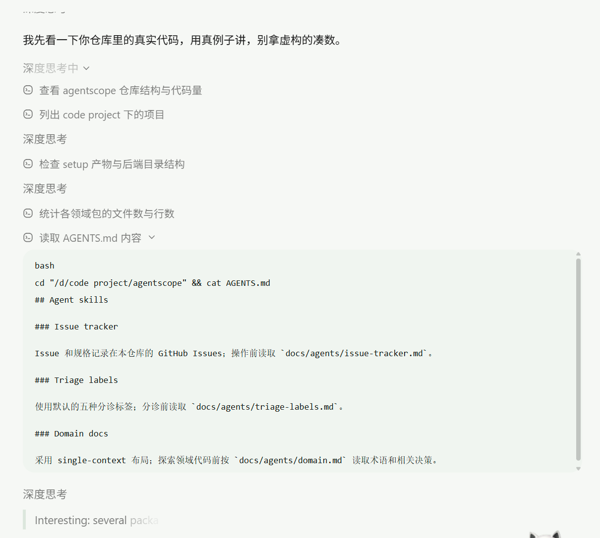

# 过程时间线与 WorkBuddy 式展示设计修订

> 日期：2026-10-27，Asia/Shanghai。同日按固定提交做了静态源码核对；核对不是运行验收。  
> 状态：设计修订提案。**尚未**替代 #20／#21 已关闭决议中的默认展示策略，也**尚未**实现。本文不升格为已关闭规格。原生 Session Log 经核对后对本项目仍是**候选**，不在当前 AgentScope Java v2.0.4 基线内。  
> 关联：[#20 消息渲染、运行事件与恢复投影设计规格](消息渲染运行事件与恢复投影设计规格.md)、[#21 工作台交互与前端工程设计规格](工作台交互与前端工程设计规格.md)、[正式 Web 应用设计入口](README.md)、[AgentScope 运行与交互契约核验](../调研/正式Web应用/AgentScope运行与交互契约核验.md)。版本化依据见下文第 2.1 节；未标注提交的文档站页面不作为 2.0.4 证据。

## 1. 动机与结论

产品侧希望过程区呈现 **WorkBuddy 式交错时间线**：可折叠「深度思考」、带时钟图标的工具步骤、可展开的有界工具详情，最后才是正式回复气泡。

**结论：**

- **目标传输与恢复模型不变**：`AgentEvent`（live）→ SessionLog（候选；原生 `SessionEvent` journal）→ 业务账本（业务表与工具／确认账本）→ `web-projection-v1`（薄映射）→ 前端 reducer。第二层在本项目采用的 SDK 上尚不存在，见第 2.1 节。
- **浏览器仍只认投影**；不从 SDK live、开源 QwenPaw Console SSE 或 AG-UI 原流作为恢复源。
- **变更点在过程展示策略与投影形状**：过程卡从「仅受控阶段标签」扩展为「可配置过程时间线」（受控阶段／工具步／可选原生推理）。该扩展在字段冻结、兼容方案落实，并且第 6 节前置验收通过之前，不向浏览器开放。
- **不是**一场景一个 Adapter；配置挂在员工发布，映射挂在 `runtime` 通用管线。

参考交互（目标交互示意，非运行证据，亦非本仓库实现证据）：深度思考可折 → 工具步骤列表 → 展开后显示命令与有界输出 → 正式回复。



上图为目标交互示意（非运行证据）。它只说明期望的交错布局，不证明本仓库已经实现该时间线，也不替代已关闭的 #20／#21 默认展示策略。

## 2. 四层职责（复习）

目标形态仍是四层：AgentEvent → SessionLog → 业务账本 → `web-projection-v1`。浏览器侧 reducer 只消费最后一层。SessionLog 这一名称在下文专指原生 `SessionLog`／`SessionEvent`；它是候选，不是 2.0.4 已交付能力。

| 层 | 职责 | 思维／过程相关 |
| --- | --- | --- |
| `AgentEvent` live | 执行侧实时信号；仅服务端订阅。v2.0.4 已有 | 可含 `THINKING_BLOCK_*`；**不直推浏览器** |
| SessionLog（候选） | 若将来采用含该 API 的稳定 SDK：已提交 journal；`seq` 前缀与 checkpoint | 是否能单独取出 reasoning **尚未**在本项目基线上核实；**不等于**对用户公开 |
| 业务账本 | Session／Run、正式消息、工具操作、确认、素材。v2.0.4 路径实际使用这一层，而不是原生 Session Log | **不**将思维原文写入正式消息或确认载荷 |
| `web-projection-v1` | 浏览器唯一展示真相。`changes[]` 枚举仍以已关闭的 #20 为准 | 默认可仅阶段。`PROCESS_STEP_*` 不是 v1 已冻结成员，见第 3.3 节 |

### 2.1 源码核对与 v2.0.4 适用边界

2026-10-27 核对 GitHub 发布列表与两个标签的文件树。v2.0.4 于 2026-10-08 11:40（Asia/Shanghai）发布，附注标签剥到提交 `0b6743b263ba8e39eb417e35048026f1e0196548`，与 #22 已固定提交相同。预发布 v2.1.0-BETA1 于同日 20:42（Asia/Shanghai）发布，提交 `5451c73abe47053340683a1cc6d67b290b056648`。当时发布列表中的最新稳定版仍是 v2.0.4，没有 v2.0.5。以下是静态源码事实，不是本仓库已经集成或跑通的证据。

| 事实 | 版本 | 依据 | 适用边界 |
| --- | --- | --- | --- |
| 项目基线没有原生 Session Log | v2.0.4／`0b6743b` | 该提交文件树中不存在 `io.agentscope.core.session.SessionLog`、`SessionEvent`、`JournalSessionLog`、`SessionLogStore`，也不存在 `docs/v2/**/harness/session-log.md` | 不能把文档站上的 Session Log 页面当成 2.0.4 契约，也不能在 2.0.4 上实现 `native_from_log` |
| live 思维事件存在，但是执行期信号 | 同上 | [`AgentEventType`](https://github.com/agentscope-ai/agentscope-java/blob/0b6743b263ba8e39eb417e35048026f1e0196548/agentscope-core/src/main/java/io/agentscope/core/event/AgentEventType.java#L56-L58) 的 `THINKING_BLOCK_START`／`DELTA`／`END` | 只允许服务端订阅；**禁止**作为投影或恢复源 |
| 2.0.4 的会话文件不是原生 journal | 同上 | [`SessionTree`](https://github.com/agentscope-ai/agentscope-java/blob/0b6743b263ba8e39eb417e35048026f1e0196548/agentscope-harness/src/main/java/io/agentscope/harness/agent/memory/session/SessionTree.java#L52-L63) 写 `agents/{agentId}/sessions/{sessionId}.jsonl` 与 `.log.jsonl` | `.log.jsonl` 是 Harness 会话文件，不是 `SessionEvent` |
| thinking 被并进消息正文，类型丢失 | 同上 | [`SessionTranscriptWriter.deriveEntries`](https://github.com/agentscope-ai/agentscope-java/blob/0b6743b263ba8e39eb417e35048026f1e0196548/agentscope-harness/src/main/java/io/agentscope/harness/agent/memory/session/SessionTranscriptWriter.java#L184-L236)：`ThinkingBlock` 文本进入与 `TextBlock` 相同的 `content`；一旦有文本，`blockTypes` 为 null | **不能**从 `.log.jsonl` 再分离原生推理。用它填充 `kind=REASONING` 会把思维和正式正文混在一起 |
| 工具结果写入该文件前被截断 | 同上 | 同文件 `OUTPUT_TRUNCATE_CHARS = 1000` | 这不是本提案的投影上限，也不能当作完整工具详情 |
| 原生 Session Log 只在预发布标签出现 | v2.1.0-BETA1／`5451c73` | [`SessionLog`](https://github.com/agentscope-ai/agentscope-java/blob/5451c73abe47053340683a1cc6d67b290b056648/agentscope-core/src/main/java/io/agentscope/core/session/SessionLog.java)、[`SessionEvent`](https://github.com/agentscope-ai/agentscope-java/blob/5451c73abe47053340683a1cc6d67b290b056648/agentscope-core/src/main/java/io/agentscope/core/session/SessionEvent.java)、[会话日志文档](https://github.com/agentscope-ai/agentscope-java/blob/5451c73abe47053340683a1cc6d67b290b056648/docs/v2/zh/docs/harness/session-log.md) | **候选来源**。项目未采用该预发布版；未换成稳定版并重新核对前，不启用 |
| 内置事件没有独立 reasoning 类型 | 同上 | [`SessionEventTypes.BUILTIN`](https://github.com/agentscope-ai/agentscope-java/blob/5451c73abe47053340683a1cc6d67b290b056648/agentscope-core/src/main/java/io/agentscope/core/session/SessionEventTypes.java#L24-L82) 含 `step/start`、`step/end`、`message/assistant`、`tool/result`、`state/checkpoint` 等，没有 reasoning／thinking 类型名 | 「已提交 reasoning → `REASONING`」仍是产品映射候选，不是已核实的事件类型 |
| 记录器保存整条 `Msg` | 同上 | [`SessionRecorder.captureState`](https://github.com/agentscope-ai/agentscope-java/blob/5451c73abe47053340683a1cc6d67b290b056648/agentscope-core/src/main/java/io/agentscope/core/session/SessionRecorder.java#L346-L354) 将整个 `Msg` 写入 `message/assistant` 等事件；该处未见删除 ThinkingBlock，也未见单独的 reasoning 事件 | 思维是否稳定留在 JSON 载荷里，要在锁定相应稳定版后重核序列化。此前不得开启 `native_from_log` |
| 大载荷外置 | 同上 | [`JournalSessionLog`](https://github.com/agentscope-ai/agentscope-java/blob/5451c73abe47053340683a1cc6d67b290b056648/agentscope-core/src/main/java/io/agentscope/core/session/JournalSessionLog.java#L225-L236) 对超过 65536 字节的 `payloadJson` 改存 blob，事件本体改写为 `{}` | 只说明该预发布实现的存储方式。它不是本项目投影上限，2.0.4 中也没有这段代码 |

上游议题 [agentscope-java#3567](https://github.com/agentscope-ai/agentscope-java/issues/3567) 自述：换代随 #3441 进入 2.1.0-BETA1，不在 2.0.4，并计划 backport 到 2.0.5。该 backport 截至上述发布列表并未发布。议题叙述不改变本项目的 2.0.4 基线。

**2.0.4 上允许依靠的过程事实**只有：服务端可见、但不得直推的 `AgentEvent`；已经落在业务账本中的 Run 阶段、工具操作和确认。会议默认 `stages_only` 继续走这条路径。`reasoningDisplay=native_from_log` 在 2.0.4 上没有合格来源，配置即使被写上也不开放对应投影。

## 3. 过程时间线投影形状

在现有 `changes[]` 上增加（名称以实现契约冻结为准，语义如下）。冻结前这些名称不是 `web-projection-v1` 的成员，服务端不得把它们写入 v1 批次，见第 3.3 节。

| 变更 | 含义 | UI |
| --- | --- | --- |
| `PROCESS_STEP_UPSERT` | 按 `stepId` 幂等写入／更新时间线一步 | 一行思考或一行工具／阶段 |
| `PROCESS_STEP_DETAIL_SET` | 为某步设置可展开详情（有界） | 展开区：命令、输出摘要 |
| 既有 `TEXT_*`／`MESSAGE_COMMIT` | 预览与正式正文 | 最终气泡；推理**不**升格为正式员工消息 |
| 既有 `RUN_SET`／`TOOL_SET`／`INTERACTION_SET` | Run 态、工具账本、交互壳 | 与时间线并存；账本权威仍在业务表 |

### 3.1 `PROCESS_STEP` 字段（建议）

- `stepId`、`runId`、投影 `seq` 锚点
- `kind`：`REASONING` | `TOOL_STEP` | `STAGE`
- `title`：短中文（如「深度思考」「读取 AGENTS.md」「正在理解预约需求」）
- `status`：`RUNNING` | `DONE` | `FAILED`
- `summary`：可选一行摘要
- `detail` 或 `detailRef`：有界详情（命令、截断后的输出）；**禁止**确认 token、系统提示、未完成工具参数、原始密钥
- `collapsedByDefault`：reasoning 默认折叠；当前 `RUNNING` 工具步可默认展开

字段名、JSON 示例和内联详情上限都还没有冻结。未冻结、且第 6 节三项前置验收未通过时，不开放时间线投影。

### 3.2 映射规则

1. 原生 Session Log 中已提交、且能与正式正文分开的 reasoning → `kind=REASONING`。**仅当**员工配置 `reasoningDisplay=native_from_log`，并且运行时 SDK 已经换成含 `SessionLog` 的稳定版本、完成第 2.1 节所说的重新核对。v2.0.4 不满足该条件，此映射保持关闭。
2. 工具完整提案／执行／结果 → `kind=TOOL_STEP`（标题用产品文案；详情有界）。详情只有在第 6 节前置验收通过后才能进入投影。
3. 关闭原生推理且需要进度时 → `kind=STAGE`（一期会议默认路径，对齐原「受控阶段」）。在时间线投影开放前，同样的阶段继续只靠既有 `RUN_SET`／`TOOL_SET` 表达。
4. `THINKING_*` live **禁止**直接进入投影；只消费已提交、且来源版本已核实的 log，或已落盘工具事实。v2.0.4 的 `.log.jsonl` 不是这种 log。
5. 合并：reasoning／碎正文可沿用约 100 ms 或新增 4 KiB；新工具步、状态变为 DONE／FAILED、交互等待等**立即**落盘投影。该合并预算沿用 #20，不单独放宽。
6. `AGENT_END`／SDK 完成 **不等于**业务成功；正式成功仍靠平台收尾与 `MESSAGE_COMMIT`／真实回执。

### 3.3 与 `web-projection-v1` 的兼容及旧客户端

#20 已冻结 `web-projection-v1` 的 `changes[]`：`SESSION_SET`、`RUN_SET`、`CONTENT_SET`、`TEXT_APPEND`、`CONTENT_CLOSE`、`MESSAGE_COMMIT`、`TOOL_SET`、`INTERACTION_SET`。同一规格规定：只有契约写明无语义影响的可选 `extensions` 可以忽略；未知状态、动作、变更类型或主版本不视为成功。整批应用，失败批次不跳过，应用游标不提前前移。

`PROCESS_STEP_*` 会改变过程区展示，**不是**无语义 `extensions`。兼容方案如下；它仍是提案，不改写 #20 已关闭文本。

- **v1 批次保持原枚举。** 请求 `protocolVersion=web-projection-v1` 时，服务端返回的每个批次都只含 #20 已列出的变更。时间线未开放时，过程仍是 `RUN_SET` 的受控阶段和 `TOOL_SET` 的有界摘要，旧客户端行为与已关闭规格一致。
- **新类型不写入 v1 批次，也不从已发出的批次里滤掉。** 时间线使用另行冻结的 `protocolVersion`。名称与 `PROCESS_STEP_*` 字段一起冻结；冻结前没有第二套已经生效的协议，服务端也不发射这些变更。同一应用游标只属于一个协议版本，不能用 v1 游标续读含新类型的批次。
- **旧客户端不会因为旁人升级而收到新类型。** 持久投影若要同时保留 v1 读者和新读者，就分成按协议版本可读的批次，而不是在一个 v1 批次里混入 `PROCESS_STEP_*`。服务端不得先写混合批次，再指望旧客户端跳过不认识的项。

旧客户端如果仍然收到含未知变更类型的批次（错误实现或错误路由），行为就按 #20，不另造一套宽松规则：

| 行为 | 要求 |
| --- | --- |
| 整批结果 | **不视为成功**。同批中的 `MESSAGE_COMMIT`、`RUN_SET` 等也不部分应用 |
| 游标 | **不前移**。不跳过该批去应用后续批次 |
| 未知类型 | **不**当作 `extensions` 丢弃，**不**执行其载荷 |
| 用户可见状态 | 有界只读停止，说明协议不兼容。此前已经成功应用的快照可以继续显示 |

认识 `PROCESS_STEP_*` 的新客户端仍整批应用。缺少时间线步骤不表示业务成功或失败；正式结果仍看 `MESSAGE_COMMIT`、工具账本和回执。

## 4. 员工配置

```text
reasoningDisplay: off | stages_only | native_from_log
toolStepDetail: summary | summary_and_bounded_output
```

建议默认：

| 员工类型 | `reasoningDisplay` | `toolStepDetail` |
| --- | --- | --- |
| 会议数字员工（一期主路径） | `stages_only` | `summary` |
| Coding／调研类（WorkBuddy 目标） | `native_from_log` | `summary_and_bounded_output` |

`native_from_log` 和带详情的工具步都是目标配置。在第 2.1 节的 SDK 边界没有解除、并且第 6 节前置验收没有通过之前，运行中的有效值仍是会议路径：`stages_only`，且不开放新的时间线投影。浏览器无独立旁路开关；只渲染投影中已有的过程项。

## 5. 前端

- 组件：`ProcessTimeline`，挂在对应 Run 的过程区。未开放投影时不挂真实数据，合成夹具只用于布局。
- 按应用游标后的有序 `PROCESS_STEP` 列表渲染；保留用户展开状态；阶段／步骤更新不抢焦点。
- 总览可显示「深度思考中」类摘要；点步展开 detail。
- 正式区仅预览与 `MESSAGE_COMMIT`；与确认卡、表单底部区并存规则同 #21。
- SSE 失败时降级轮询；时间线与会话投影共用应用游标，并共用第 3.3 节的协议版本。旧客户端走 v1 读路径，不解析 `PROCESS_STEP_*`。

## 6. 开放前置与实现切片

详情大小限制、脱敏和敏感内容检查是**开放时间线投影的前置验收条件**。三项缺一，就不向任何客户端发射 `PROCESS_STEP_*`，也不把 `native_from_log` 或 `summary_and_bounded_output` 当作已生效配置。会议员工继续使用 #20／#21 已关闭的受控阶段。合成夹具上的组件布局不是开放投影。

| 前置项 | 验收必须看到的结果 | 未通过时 |
| --- | --- | --- |
| 详情大小限制 | 内联 `detail` 的 UTF-8 上限已经冻结并有拒绝用例。提案对齐 #20 的结果摘要 8 KiB；超出只允许 `detailRef` 指向固定版本，截断正文不得显示成完整输出。批次仍受 #20 的单批 1 MiB、128 项等预算约束 | 不发射 `PROCESS_STEP_DETAIL_SET`，不开放时间线投影 |
| 脱敏 | 确认 token、系统提示、未完成工具参数、原始密钥、身份凭据、原始请求／响应报文在写入投影前已被替换或删除，投影中只保留可理解占位 | 不开放时间线投影 |
| 敏感内容检查 | 即将写入的过程项拒绝 rawThinking、confirmationToken、systemPrompt 等键。检查失败，或不能证明载荷干净时，失败关闭；禁止先写入原文、再依赖前端隐藏 | 不开放时间线投影 |

这三项通过之后，才按下面的顺序实现。顺序本身不是已经开始实现的声明。

| 切片 | 内容 | 验收 |
| --- | --- | --- |
| P0 | 契约字段 + 前端时间线组件（只用不含真实秘密的合成数据） | 布局达到 WorkBuddy 交错效果；不接入真实投影 |
| P1 | 业务账本中的工具事实 → `TOOL_STEP`；会议默认 `STAGE` | 约会议室可见步骤，无 Thinking 原文。不读取 Session Log，也不读取 2.0.4 的 `.log.jsonl` 思维文本 |
| P2 | 已复核的稳定版 Session Log reasoning → `REASONING` | 仅当第 2.1 节的候选已变成锁定后的稳定 SDK，且配置打开。2.0.4 到不了这一片 |
| P3 | 与确认／`MESSAGE_COMMIT` 并存，刷新恢复 | 刷新不丢；token 永不进投影。详情上限、脱敏和敏感检查已在开放前完成，不把它们留到本片才第一次执行 |

**明确不做：** 每业务场景一个事件 Adapter；以 AG-UI／QwenPaw Console 为恢复源；将整段 Thinking 写入正式员工消息；把 `PROCESS_STEP_*` 塞进 `web-projection-v1` 批次；在 2.0.4 上把 `.log.jsonl` 当作原生推理来源。

## 7. 与已关闭规格的关系

- **不推翻** #20：先入库再 SSE、读路径不调模型／SDK、整批 reducer、确认 token 不进投影、未知变更类型不视为成功。
- **修订** #20／#21 过程卡一节的范围仅限于本提案：默认仍是 `stages_only`；WorkBuddy 为配置开启、且前置验收通过后的时间线形态。
- 字段名与 JSON 示例须先与已关闭的 #20／#21 对齐并冻结，再进入实现；冻结前默认展示策略不变。
- 实现归属后续正式工程议题（原 #22／#23 范围）。本文保持设计提案，不构成已实现声明，也不把 SDK 预发布能力写成项目基线。

## 8. 修订检查清单（合入正式规格前）

- [ ] 与 #20 `changes[]` 枚举及 JSON 示例对齐并冻结字段名；确认 `PROCESS_STEP_*` 使用新的 `protocolVersion`，不进入 `web-projection-v1`
- [ ] 与 `run_progress`／`structured_payload`／`source_kind` 白名单对齐（是否复用或新增过程项表）
- [ ] 前置验收：详情大小上限、脱敏、敏感内容检查；未通过则不开放时间线投影
- [ ] 旧客户端收到未知变更类型时的只读停止，有与 #20 一致的失败用例
- [ ] 换成含 `SessionLog` 的稳定 SDK 后，重新核对 reasoning 能否与正式正文分离；在此之前 `native_from_log` 保持关闭
- [ ] 原型：将合成过程卡升级为时间线交互说明（非运行证据）
- [ ] 员工发布配置项写入配置／发布规格，并写明 2.0.4 上的有效值
