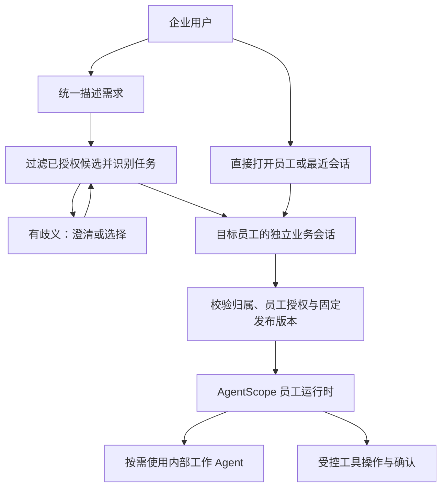

# AgentScope 多 Agent 入口与数字员工产品形态调研

> 调研日期：2026-10-20（Asia/Shanghai）。  
> 性质：供产品与架构讨论的研究和建议，未确认为新的产品决策，不修改现有一期规格。  
> 方法：核对本仓库当前规格、AgentScope Java 固定版本官方文档与源码，并参考产品方自己的使用说明和工程报告。未运行模型路由实验、可用性测试或多 Agent 联调；体验判断与成本分析均标注为分析，不能当作实测结论。

## 1. 结论与适用前提

针对本项目的企业内部数字员工，我建议：**以“选择员工、会话归属员工”为主；后续增加统一提问入口，帮助用户找到合适员工；跨员工协作在出现真实任务需求后再引入。**

当前任务具有清晰职责、持续多轮交互、独立授权、写操作确认和审计要求。稳定的任务负责人更容易向用户解释，也更容易沿用现有会话与发布设计。若未来主要需求是“用户完全不知道找谁，而且一个请求经常需要跨多个领域完成”，统一助理承担主对话与协作的价值会提高，应通过任务数据重新评估。

更关键的区别是：

- **用户看到几个入口**：一个统一入口，还是员工列表。
- **谁拥有这段对话、解释结果并处理后续追问**：统一助理，还是某个专业员工。
- **后台怎样执行**：一个 Agent 配合 Skills/工具，还是多个 Agent 协作。

这三项可以分别选择。一个用户可见的员工内部可以使用多个 Agent；统一入口也可以仅分流到一个员工，而不参与后续推理。**数字员工是产品中的职责与授权单位，Agent 是运行时的执行单位，两者不必一一对应。**这是本文的建模建议；本仓库已有的数字员工定义见[平台术语](../../../GLOSSARY.md)。

## 2. 先把“两种形态”拆成实际可实现的模式

| 模式 | 用户看到什么 | 谁持续负责对话 | 后台行为 | 主要新增问题 |
| --- | --- | --- | --- | --- |
| A：统一入口分流 | 先在统一输入框描述需求，再进入目标员工 | 目标员工 | 首次识别任务并选择目标；进入后固定负责人 | 识别歧义、分错后的修正、首条消息如何无损交接 |
| B：统一助理委派 | 始终与统一助理聊天，可看到任务进度和执行者 | 统一助理 | 主 Agent 调用专家、接收结果并继续回复 | 父子任务状态、上下文传递、结果汇总、跨员工权限和恢复 |
| C：统一入口每轮重新分配 | 一个聊天框，但每条新消息都可能由不同员工处理 | 需要另行定义 | 每轮重新识别意图和目标 | 指代漂移、待确认动作归属、不同领域历史混杂 |
| D：显式选择员工 | 用户选“会议安排”“报销助手”等后聊天 | 选定员工 | 直接构造该员工运行时；内部仍可调用子 Agent | 选错员工、能力发现、跨领域任务如何交接 |

用户描述的第一种可以对应 A、B 或 C，三者的技术代价相差很大。第二种通常对应 D。**不建议把 C 作为默认策略**：它增加了负责人不稳定的问题，却没有 B 中明确的主协调者。A 则可以与 D 共用同一套员工会话机制。

路由与动态拆解也应分开：前者是把请求交给合适处理者；后者是规划多个子任务再综合结果。Anthropic 的官方模式说明分别讨论这两种结构，不能把“自动选专家”直接等同于完整多 Agent 协作。[官方模式说明](https://www.anthropic.com/engineering/building-effective-agents)

## 3. 用同一个会议任务比较体验

### 3.1 显式选择员工

用户进入“会议安排”，发送“帮我订明天下午三点的八人会议室”。员工查询后问“园区 A 和园区 B 都可以，你选哪一个？”用户回答“A”。

用户与系统都知道“A”是会议任务的补充参数。后续的“改成四点”“取消刚才那场”仍在该员工的会话里理解。用户的选择没有替代写操作确认，真实预约或取消前仍需展示具体参数并按现有规则确认。

代价在入口：新用户得先知道这件事归哪个员工。如果职责名称太抽象，或者多个员工都宣称“企业办公全能”，这个选择会很困难。

### 3.2 统一入口分流

用户先在首页说同一句话，系统判断应由会议员工处理，界面明确进入“会议安排”。之后的多轮补充和操作确认继续由它负责。

与显式选择相比，主要多出一个任务识别与交接步骤，**不需要每一轮都让通用大模型重新规划一次**。规则、分类模型或 LLM 都可以参与识别；是否增加 LLM 调用取决于具体实现。

分错时提供“改由其他员工处理”，进入另一个独立会话，并明确本次交接内容。用户已输入的原始需求和已授权素材需要保留来源，不能要求用户重新打一遍，也不能静默复制其他员工的全部历史。

### 3.3 统一助理委派

用户说“安排客户来访：找会议室、整理客户资料，再准备一份接待清单”。统一助理可以分别委派会议、客户资料与文档能力，再展示总进度。

这里的价值是跨领域协调。但必须回答：会议员工要补充园区时，谁向用户提问？统一助理如何把回答送回正确子任务？会议成功而资料查询失败时，如何解释部分完成？用户说“取消”究竟是停止剩余工作，还是取消已经预约的会议？

这些都是产品与业务执行问题，不能由“框架支持调用多个 Agent”自动解决。若只是预约单个会议，增加主助理规划、专家执行和汇总可能没有足够收益。

### 3.4 最容易被低估的追问

“就按刚才那个办”“换到明天”“取消它”经常不包含完整领域关键词。每轮只分类最新一句，很容易失去所指；把全部历史交给所有员工，又会扩大上下文、权限和数据共享范围。

因此，路由需要读取明确的活动任务状态；当前 Run 等待补充或确认时，应将对应输入送回原任务处理链。对操作确认，应绑定原操作及参数，不能把一个孤立的“好的”交给路由器猜测。以上是本项目现有确认规则在未来多员工入口中的延伸建议，原规则见[会话与 Run 规格](../../数据库设计/会话运行与消息/业务会话运行消息与跨渠道续传设计规格.md)和[工具操作设计](../../数据库设计/会话运行与消息/通用素材与工具操作设计.md)。

## 4. 用户体验与产品取舍

以下是结合任务结构的分析，尚无本项目用户实验支持优劣排序。

| 维度 | 统一助理自动处理 | 选定员工后交互 | 设计含义 |
| --- | --- | --- | --- |
| 首次使用 | 可直接说需求，较少要求用户理解员工划分 | 要先识别职责，选择成本可能较高 | 统一入口的价值主要来自降低找人的成本 |
| 能力发现 | 一个空输入框容易让人不知道能问什么，也可能高估能力 | 员工职责与示例可直接呈现 | 两者都需要真实能力说明与可点击任务示例 |
| 持续多轮任务 | 需要维护主任务、子任务和追问归属 | 负责人固定，更容易保留领域语境 | 长期任务更依赖稳定负责人 |
| 结果信任与归责 | 服务承诺集中；后台出了问题用户仍找主助理 | 用户较容易知道谁处理、去哪继续 | 统一入口不能只转发错误后结束 |
| 纠错 | 系统分错且未说明时，用户可能不知道如何修正 | 用户也可能选错，但能看见当前员工 | 必须能便捷改选，并解释交接结果 |
| 跨领域工作 | 主协调者可统一规划、汇总与报告部分结果 | 需要用户切换或显式发起协作 | 协作是否高频，比 Agent 数量更能决定入口价值 |
| 高频重复任务 | 若记住任务偏好可简化入口；重复识别也可能增加等待 | 最近会话、收藏和直达链接可以很快 | 不应让熟练用户每次重新选员工 |
| 历史找回 | 混合领域长会话需要按任务检索、分组 | 按员工自然分组；跨员工查找需要全局搜索 | 全局历史检索可独立建设，无须合并运行状态 |
| 权限预期 | 一个统一人格可能让人误以为它拥有所有业务权限 | 可在员工入口说明使用范围 | 两种 UI 都必须由服务端做真实授权 |

交互上应提供四件事：清楚的能力说明、当前负责人、任务进度、可以修正的入口。这与微软人机交互研究中关于能力预期、纠错和不确定时澄清的建议一致；该研究并未证明本项目应该选择某一种入口。[微软官方研究说明](https://www.microsoft.com/en-us/research/blog/guidelines-for-human-ai-interaction-design/)

具体界面建议：

1. 员工列表按“能完成什么”命名，附一两条真实示例；姓名或头像可作补充。
2. 默认恢复用户最近工作的员工和会话；只有一个已授权员工时直接进入，无须增加选择页。
3. 提供“描述需求，帮我找员工”的统一入口；分流后显示“由会议安排处理”，允许改选。
4. 跨员工交接时展示将传递哪些任务资料；后台内部的检索、校验子 Agent 无须逐个变成聊天对象。
5. 进度与结果区分“处理中”“待你补充”“待确认”“部分完成”“结果待核对”。不能把专家正在执行的中间文本包装成已经完成的业务承诺。

## 5. 技术影响：差异主要落在状态和业务控制

### 5.1 路由本身

直接选择员工时，服务端也必须验证目标员工、当前授权和会话归属。前端传入 employeeId 并不产生权限。

自动路由时，在同样检查之外，需要维护可发现的能力目录、识别策略、歧义澄清和纠错。候选应先按当前用户的可用范围过滤，再把必要描述提供给模型；执行前仍重新校验。路由输出只应提出目标，不能直接授予工具权限。

能力描述的重叠会让选择变难。新增一个职责相近的员工后，至少要复测相近领域的请求、追问和改选场景。需要回归的是受到候选变化影响的范围，无须假定所有员工升级都必须全量重测。

### 5.2 会话、AgentState、Memory 和 Workspace

| 事项 | 显式员工 / 统一入口分流 | 统一助理负责全程 |
| --- | --- | --- |
| 用户可见会话 | 可继续固定一个员工及其发布版本 | 可将统一助理作为会话所属员工；仍须定义专家调用的归属 |
| 运行时状态 | 按用户、员工、会话隔离 | 还需区分主助理状态、专家状态及调用关系 |
| 长期记忆 | 默认保持用户 × 员工边界 | 统一个人资料与领域私有记忆应分别定义；不会因统一 UI 就自然共享 |
| 资料传递 | 跳转时传递明确选定的需求与资料 | 每次委派定义输入、素材权限、结果结构和来源 |
| 未完成事项 | 在所属会话与 Run 中找回 | 需要从主任务定位未完成子任务、对应确认和恢复位置 |

不要把所有专家的历史、系统指令、Memory 和 Workspace 直接拼接成一个大上下文。需要传递的是任务必需信息及其来源、可信参数、允许访问的素材和已完成结果，而不是让一个员工获得另一个员工的全部内部状态。

本项目已有的“员工新版继续时严格全量导入正式对话”是**同一员工的版本升级规则**。它不意味着可以在跨员工委派时自动复制全部历史。若要改变该边界，应另行确认。[当前规格](../../数据库设计/会话运行与消息/业务会话运行消息与跨渠道续传设计规格.md)

### 5.3 授权、身份与操作确认

统一助理能调用专家，不等于用户获得了该专家的业务权限。若目标是独立产品员工，平台应检查当前用户对该员工的使用权限、父级委派政策、目标发布版本和工具约束；若只是员工内部工作 Agent，则按所属员工的受控能力配置管理，不必给它另造面向用户的员工授权入口。

可信操作者始终来自服务端认证身份，并贯穿委派与工具调用。不能把“用户手机号”作为普通自然语言参数交给主 Agent 再让专家自行决定身份。会议系统仍校验真实操作者及业务权限。

预约、取消等写操作确认必须绑定实际目标、执行版本、参数和原操作。切换员工、重新路由或变更参数不能复用旧确认。统一助理可以负责显示确认，但确认处理应回到原操作链。[现有工具操作边界](../../数据库设计/会话运行与消息/通用素材与工具操作设计.md)

### 5.4 Run、流式展示、取消、恢复

主助理委派会新增“父任务与子任务关系”。至少需要能核对：谁发起、调用哪个专家版本、传入哪些允许的数据、子任务状态、结果来源、等待哪个用户输入、相关工具操作及最终结果。具体映射为业务 Run、内部执行记录还是子任务实体，属于后续设计，不在本次直接定表。

流式 UI 应知道某条进度来自哪个执行者，以及谁负责最终答复，避免主助理和专家重复回复。停止主助理需要向未完成的子执行传播取消；已经发出的外部写操作仍须核对，不能承诺本地取消已撤销业务结果。

重启后不能只重跑根任务，因为先前子任务可能已成功预约。需要找回执行与外部操作记录，核对不明结果，再继续尚未完成的步骤。框架的事件流和会话状态是实现材料，是否能满足这些业务保证必须单独验证。

### 5.5 发布版本和依赖

显式员工会话已经固定 employeeId + definitionVersion。统一入口仅分流后继续使用该规则即可，路由决策单独留记录。

主助理若动态调用其他独立员工，**仅固定主助理版本还不足以固定实际执行能力**。需要决定：

- 主助理发布时一并固定专家依赖版本；还是
- 在子任务创建时选择允许的专家版本并固定到该次执行，接受后续调用可能不同。

两种策略对复现、升级和兼容性各有影响，必须明确后才能实施。不要在子任务执行到一半或用户确认后偷偷改成目标员工的最新版本。若是随主员工发布的内部工作 Agent，其配置可纳入同一发布快照，较容易保持一致。

### 5.6 延迟、费用和容量

可用下面的示意式评估用户完成任务的总耗时：

- 显式选择：选择员工的时间 + 专家执行时间 + 选错后的恢复时间。
- 自动分流：识别/澄清时间 + 专家执行时间 + 分错后的恢复时间。
- 主助理委派：规划时间 + 子任务关键路径时间 + 交接与汇总时间 + 异常恢复时间。

这些是比较变量，不是性能预测。规则分流可以不增加一次模型调用；LLM 分流通常增加分类调用；主助理调用专家后再生成总结，则增加协调阶段。专家调用能够并行时可能缩短复杂任务耗时；依赖前一步结果的任务不能靠增加 Agent 数量获得同样收益。

费用需要统计整条链路的模型输入输出、重复传递的上下文、工具费用、失败重试和资源占用，不能只看用户可见回复的 token。显式员工若内部用了同样的子 Agent，同样承担这些成本。微软的多 Agent 文档明确提醒额外编排跳转会增加延迟和治理面；Anthropic 研究系统也报告其任务中的 token 成本上升。均不能据此套用本项目的固定倍率。[微软文档](https://learn.microsoft.com/en-us/microsoft-copilot-studio/authoring-add-other-agents)、[Anthropic 工程报告](https://www.anthropic.com/engineering/multi-agent-research-system)

## 6. 官方产品与实践能提供什么证据

| 一级来源 | 已核实的形态或能力 | 对本项目的启发与证据边界 |
| --- | --- | --- |
| [Microsoft Copilot 使用说明](https://support.microsoft.com/en-us/microsoft-365-copilot/get-started-with-agents-in-the-microsoft-365-copilot-app) | 从导航中的 Agents / All agents 找到目标并选择，再输入问题 | 显式选择是实际产品采用的入口；使用说明没有证明这种方式的完成率更高 |
| [Anthropic Research 工程报告](https://www.anthropic.com/engineering/multi-agent-research-system) | 主研究 Agent 协调后台研究子 Agent 并综合结果 | 一个可见助理可以内部多 Agent；适合研究任务的经验不等于适合所有办公事务 |
| [Copilot Studio 多 Agent 模式](https://learn.microsoft.com/en-us/microsoft-copilot-studio/guidance/multi-agent-patterns) | 讨论内部子能力、独立连接 Agent、上下文交接及父子执行关联 | 可以把产品员工与内部执行单元分开；这是另一平台的架构参考，不是 AgentScope API 契约 |

Copilot Studio 的相关“连接其他 Agent”页面包含预览能力说明；这里只借鉴职责划分和已写明的设计影响，不将其外部协议、可用性或生命周期规则视为 AgentScope 已具备的能力。

从这些来源不能得出“行业已统一选择自动路由”或“员工越多越应采用总助理”。应以自己的任务分布、使用者理解成本和实际执行质量决定。

## 7. 对当前项目的推荐演进

当前[一期总体设计](../../一期总体设计.md)仍是单企业、Web、会议室员工、少量用户；[会话规格](../../数据库设计/会话运行与消息/业务会话运行消息与跨渠道续传设计规格.md)已固定员工、版本与独立状态。本次研究不改变该范围。

**近期：让一个员工把事情办好。** 登录直接进入会议室员工，完成可信身份、多轮交互、确认、结果核对、历史找回与重启恢复。内部确有必要时才使用子 Agent；不为展示“多 Agent”而拆分预约步骤。

**新增其他员工后：员工工作台加统一找人入口。** 用户可以直达或恢复某员工会话，也可以先说需求，由统一入口推荐或分流。职责明确时进入目标员工；歧义明显时给出两三个任务选项或一句澄清；无法处理时说明缺少的能力。分流完成后不逐轮重新选择负责人。

**跨员工任务反复出现后：再增加协调型员工。** 让它承担明确的复合任务，例如接待筹备，并由它解释跨员工进度、部分成功和后续动作。保留专业员工直达入口。给协调范围、子任务数量、重试和预算设定控制，并补充版本依赖与恢复设计；是否采用由试验决定。

推荐的第二阶段结构：

图中的统一入口只是入口能力，不要求它从第一天就成为一个拥有全部员工权限、长期记忆与业务写工具的总助理。若后续确定由统一助理拥有整段对话，应单独制定它的主会话与专家任务规则。

## 8. 什么时候应重新选择

| 观察到的实际情况 | 更值得优先试验的形态 |
| --- | --- |
| 用户经常知道找谁、重复做同类事务，任务持续多轮 | 员工直达与最近会话 |
| 用户普遍不知道职责归属，但一次请求主要交给一个员工就能完成 | 统一入口分流 |
| 一个请求经常跨领域，而且用户希望一个负责人持续跟进 | 统一助理委派 |
| 主要是外部客户服务，用户不应了解企业内部部门 | 统一服务入口，后台按任务路由 |
| 多个“员工”只有提示词略有不同，权限、知识和工具大体相同 | 先考虑一个员工配合 Skills / 工具，而非继续增加员工 |
| 知识、权限、维护团队、发布周期和任务历史都明显不同 | 独立员工；可再由统一入口发现和委派 |

划分员工的依据应是职责、能力边界、使用授权、知识/记忆边界和维护责任；不宜把每个工具、Skill 或推理步骤都包装成一个数字员工。

## 9. 如何用小规模试验验证建议

以下是拟议的研究方法，没有实际执行。

先用同样的专业员工、模型、工具和后端，制作“直接选员工”和“统一入口分流”两个轻量版本。选择十余个覆盖不同熟练度的企业用户做形成性测试，交叉安排任务顺序，避免第二次因为记住答案而显得更快。这个样本只能帮助发现主要问题，不能直接证明统计显著优势。任务至少包含：

- 职责明确的新请求，以及需要查找旧会话的重复任务。
- 职责模糊、相邻领域易混淆的请求，以及根本不支持的请求。
- “换到明天”“就用第二个”等上下文追问。
- 等待确认时补充或变更参数、分错后的改选。
- 无目标员工权限、工具不可用、执行部分成功与结果不明。
- 一项真实需要多个员工合作的任务；另与单专家任务分别统计。

记录从开始找入口到业务完成的总时间、完成率、选择/澄清/重复输入次数、分错后的恢复时间、任务及结果归属理解情况、整条调用链费用，以及错误宣称完成、越权或重复写操作。人工选择也会分错，不能只统计模型路由准确率而忽略直接选择组。

路由评估应包含“澄清、拒绝和不支持”这些有效结果；不要强制每条请求都落到某个员工，也不要把模型自报的置信度当作已校准概率。上线门槛应结合任务影响和评测结果确定，而不是先承诺一个通用百分比。

只有统一入口减少的选择成本超过识别、澄清与纠错成本时，才扩大默认自动分流；只有跨员工任务的完成质量明显改善且费用与恢复可接受时，才扩大自主协作。先用证据决定默认入口，再优化细节。

## 10. AgentScope Java 框架核查

下列部分为固定版本官方文档与源码核查。产品建议建立在这些能力与限制之上，不代表已经完成本项目实现或运行验收。

### 10.1 版本与现有项目基线

2026-10-20 在线核对，官方 Releases 仍将 **v2.0.4** 标为 Latest；`2.1.0-BETA1` 标为 Pre-release。以下框架结论固定到 `v2.0.4` tag，不以官网随时间更新的页面充当固定版本依据。[官方 Releases](https://github.com/agentscope-ai/agentscope-java/releases)

本项目[一期总体设计](../../一期总体设计.md)目前确定：登录后直接进入会议室员工；业务 Session 固定用户、员工和发布版本；员工切换加载该员工自己的会话与位置，不合并历史、AgentState 或可写长期记忆。本次比较研究不自动改写这些决定。

### 10.2 先分清三个层次

| 层次 | 本次讨论中的意思 | Java 框架能提供的部分 |
| --- | --- | --- |
| 产品入口 | 用户先找通用助理，还是先选会议室、财务等员工 | `GatewayBootstrap` 注册多个 HarnessAgent；`withAgentId()` 显式选目标 |
| 执行编排 | 一个员工自己完成，还是委派专家、并行或汇总 | 工具调用式委派、Harness 子 Agent、事件流、Teams 基础构件 |
| 平台业务身份 | 谁被授权使用哪名员工，哪个版本执行，谁确认写操作 | 应用层在可信入口校验并传递上下文；不能由模型选中了哪个 Agent 来代替 |

前两层不必绑定：用户只看到一个员工，后端可以有多个子 Agent；用户选了多个独立员工，后端也不必互相委派。这是基于框架入口与编排 API 相互独立所作的设计推论。[Channel 多 Agent 路由](https://github.com/agentscope-ai/agentscope-java/blob/v2.0.4/docs/v2/zh/docs/harness/channel.md#多-harnessagent-路由)、[Harness 架构](https://github.com/agentscope-ai/agentscope-java/blob/v2.0.4/docs/v2/zh/docs/harness/architecture.md)

### 10.3 显式选员工：框架可以直接分发，无需先让通用模型判断

官方提供 `GatewayBootstrap.builder().agent("sales", salesAgent).agent("support", supportAgent).mainAgent("sales")`，调用方通过 `SendOptions.withAgentId("support")` 指定目标。该能力是按目标标识分发；`mainAgent` 是默认目标，并不意味着框架自动根据自然语言推断应去哪个员工。[固定版本示例与说明](https://github.com/agentscope-ai/agentscope-java/blob/v2.0.4/docs/v2/zh/docs/harness/channel.md#多-harnessagent-路由)

**推论：**浏览器提交已选员工，服务端验证用户对该员工的使用权限后，可以直接构造对应运行时。仅“选择目标”这一步不需要新增一次 LLM 调用；具体员工执行任务仍会进行自己的推理或工具调用。

框架支持多会话，`RuntimeContext.userId`、`sessionId` 决定 AgentState 槽位。Agent 实例可复用服务多个用户，不需要把“一个数字员工”实现为“每位用户各创建一个常驻 Agent 对象”。同一个 Agent 实例内，相同用户和会话的调用串行，不同槽位可并行。[上下文与状态](https://github.com/agentscope-ai/agentscope-java/blob/v2.0.4/docs/v2/zh/docs/building-blocks/context.md)

**平台仍须保证：**员工和发布版本在运行时、会话及存储命名空间中的区分。`(userId, sessionId)` 本身没有表达完整的业务授权和不可变员工发布；不能仅因为 userId 不同就认为所有员工、版本和存储复用方式都已经隔离。[RuntimeContext 与状态存储约定](https://github.com/agentscope-ai/agentscope-java/blob/v2.0.4/docs/v2/zh/docs/building-blocks/agent.md#runtimecontext-per-call-上下文)

### 10.4 通用入口自动路由：至少有三种不同实现

| 实现 | 消息实际如何走 | 路由环节模型成本 | 主要影响（设计推论） |
| --- | --- | --- | --- |
| 规则分发 | 固定入口 → 服务端规则/当前上下文绑定 → 员工 | 可以没有额外 LLM | 分类边界明确时简单；自然语言歧义需兜底 |
| 语义分类后转交 | 固定入口 → 分类模型 → 员工 | 通常增加一次分类推理；澄清、重试另计 | 要定义置信度、未命中、用户纠正，以及会话何时固定员工 |
| 主 Agent 持续主持并委派 | 用户 → 通用 Agent → 专家子 Agent → 通用 Agent 汇总 | 通常有主 Agent 选工具、专家执行、主 Agent 继续推理 | 保留统一对话，但增加父子状态、错误定位、确认和取消的复杂度 |

第二、三种不是同一种“自动路由”。官方 `RoutingByToolCallsExample` 展示第三种的基础形式：主 `ReActAgent` 以工具调用选择领域工具，工具里创建并调用专家 `ReActAgent`，结果返回主循环。它没有宣称自然语言分类具有特定准确率或只消耗固定一次模型调用。[固定版本官方示例](https://github.com/agentscope-ai/agentscope-java/blob/v2.0.4/agentscope-examples/documentation/src/main/java/io/agentscope/examples/documentation2/tool/RoutingByToolCallsExample.java)

**不能笼统地说“通用入口一定多一次模型”，也不能说“自动路由免费”。**规则、分类器、主 Agent 委派的调用路径不同；ReAct 循环还可能多轮调用工具。[ReAct 执行流程](https://github.com/agentscope-ai/agentscope-java/blob/v2.0.4/docs/v2/zh/docs/building-blocks/agent.md)

成本比较还应计入上下文长度、模型规格、重试，以及启用的 Memory flush、consolidation、compaction 辅助调用；这些不是专属于多 Agent 的成本，不宜全部算在路由上。[Memory 的三类独立模型调用](https://github.com/agentscope-ai/agentscope-java/blob/v2.0.4/docs/v2/zh/docs/harness/memory.md)

### 10.5 Agent as Tool：有真实能力，但不要认错类名

`io.agentscope.core.tool.AgentTool` 是所有模型工具的通用接口，**不是**“把 Agent 包成工具”的专有实现。真正的一个封装是 `io.agentscope.core.tool.subagent.SubAgentTool`：接受 `message` 和可选 `session_id`，通过 provider 创建 Agent，并可装载/保存子对话状态。它还对取消订阅作中断处理。[AgentTool 接口](https://github.com/agentscope-ai/agentscope-java/blob/v2.0.4/agentscope-core/src/main/java/io/agentscope/core/tool/AgentTool.java)、[SubAgentTool 源码](https://github.com/agentscope-ai/agentscope-java/blob/v2.0.4/agentscope-core/src/main/java/io/agentscope/core/tool/subagent/SubAgentTool.java)

Harness 另提供更完整的声明式子 Agent 管理，如 `SubagentDeclaration`、`agent_spawn`、`agent_send`、后台任务与流式转发。本项目已基于 Harness 设计，应优先围绕这套能力评估，不必为了“多 Agent”同时叠加两种状态管理方式。[Harness 子 Agent 文档](https://github.com/agentscope-ai/agentscope-java/blob/v2.0.4/docs/v2/zh/docs/harness/subagent.md)

工具接口支持 `isReturnDirect()`，让符合契约的成功结果直接结束本轮，跳过下一轮推理；默认是 false。混合外部恢复结果与框架执行结果、或跨多次恢复才完成的工具批次，仍会反馈给模型。该能力说明“专家结束后由主模型再改写一次”可以在合适实现中避免，但不能据此假定每个子 Agent 调用已经默认这样配置。[接口的直接返回契约](https://github.com/agentscope-ai/agentscope-java/blob/v2.0.4/agentscope-core/src/main/java/io/agentscope/core/tool/AgentTool.java#L115-L130)

### 10.6 子 Agent 上下文、工作区、权限和持久化分别配置

Harness 默认每次 `agent_spawn` 建立新的子实例与会话；声明 `persistSession(true)` 后，根据父会话、Agent 类型、label 生成确定性标识，以便后续同组合复用。该标志解决的是会话寻址和复用；可重启恢复还依赖实际状态存储、定义可重建和隔离配置。[SubagentDeclaration 持久会话契约](https://github.com/agentscope-ai/agentscope-java/blob/v2.0.4/agentscope-harness/src/main/java/io/agentscope/harness/agent/subagent/SubagentDeclaration.java)、[AgentSpawnTool 确定性标识实现](https://github.com/agentscope-ai/agentscope-java/blob/v2.0.4/agentscope-harness/src/main/java/io/agentscope/harness/agent/tool/AgentSpawnTool.java#L360-L397)

`DefaultAgentManager` 调用子 Agent 时以子 sessionId 替换父 sessionId，同时传入委派的 prompt，并从父 RuntimeContext 复制运行信息。**这不等于自动把全部父对话历史复制给孩子。**所需任务背景、文件和结构化参数应明确传递。[调用路径](https://github.com/agentscope-ai/agentscope-java/blob/v2.0.4/agentscope-harness/src/main/java/io/agentscope/harness/agent/subagent/DefaultAgentManager.java#L164-L194)

`WorkspaceMode.ISOLATED` 与 `SHARED` 控制工作区，general-purpose 子 Agent 特别使用共享工作区。不同上下文不等于文件、记忆和工具自然隔离；共享工作区是显式能力，不能把它当作互不影响的数字员工边界。[WorkspaceMode 的路径与状态分桶规则](https://github.com/agentscope-ai/agentscope-java/blob/v2.0.4/agentscope-harness/src/main/java/io/agentscope/harness/agent/subagent/WorkspaceMode.java)

声明的非空 `tools` 列表过滤继承来的父工具；空列表表示继承所有父工具，子构建器仍可能注册自己的工具。默认继承父 DENY 规则，但允许通过声明关闭。**推论：**平台须按目标员工发布版本重新落实工具白名单、调用者身份和业务写操作确认，不能只靠“父 Agent 已授权”。[SubagentDeclaration 工具与权限契约](https://github.com/agentscope-ai/agentscope-java/blob/v2.0.4/agentscope-harness/src/main/java/io/agentscope/harness/agent/subagent/SubagentDeclaration.java)

### 10.7 流式、取消与重启：有构件，不等于业务工作流可靠性已经完成

`streamEvents()` 可输出 Agent 生命周期、文本、工具调用等事件；子事件带来源路径，远程子任务还可带任务和父会话标识。产品界面可以只显示最终结果，也可以渲染“已交给会议室员工/正在查询”等步骤。后者仍需平台对事件脱敏、过滤思考内容和统一业务运行标识。[消息与事件](https://github.com/agentscope-ai/agentscope-java/blob/v2.0.4/docs/v2/zh/docs/building-blocks/message-and-event.md)、[子 Agent 流式说明](https://github.com/agentscope-ai/agentscope-java/blob/v2.0.4/docs/v2/zh/docs/harness/subagent.md#子-agent-流式)

v2.0.4 提供 `prepareRun` / `prepareCall` 返回 `AgentRun`，支持精确取消某次排队或运行中的调用；`interrupt()` 为协作中断。取消不回滚外部副作用，不能强行停止不响应取消的阻塞工具；立即 cancel 也不保证经过协作中断的恢复回复和状态保存路径。平台运行管理器负责句柄查找、鉴权及终态清理。[单次执行控制的明确限制](https://github.com/agentscope-ai/agentscope-java/blob/v2.0.4/docs/v2/zh/docs/building-blocks/agent.md#控制单次执行)

`WorkspaceTaskRepository` 把任务记录持久化，当前节点仍以 Future 执行本地任务。跨节点可读任务状态，不能由此推导 JVM 崩溃后本地执行会从中间自动续跑：源码区分本地任务与远程协议任务，并为失去心跳的本地任务提供孤儿清理；远程任务另有重新连接查询路径。[WorkspaceTaskRepository 的存储与执行契约](https://github.com/agentscope-ai/agentscope-java/blob/v2.0.4/agentscope-harness/src/main/java/io/agentscope/harness/agent/subagent/task/WorkspaceTaskRepository.java#L44-L76)

同样，AgentState 恢复不是预约等外部业务动作的事务恢复。操作记录、幂等号、确认参数、结果不明时核对外部事实，仍须本平台实现。这是根据框架执行控制限制与本项目一期业务要求所得的边界判断。

### 10.8 `expose_to_user` 能支撑“先委派，再直接找专家”，但不能原样充当企业员工入口

该能力可在 Gateway 注册子 Agent，发出 `SubagentExposedEvent`，让客户端拿到 `subagentId` 后直接对话，绕过父 Agent。暴露优先级为运行时覆盖、声明策略、模型参数，默认 false。没有绑定 bridge 时不能按文档预期暴露；`agent.channel(...)` 提供自动接线，`GatewayBootstrap` 模式需要相应 bridge。[官方产品形态与接线说明](https://github.com/agentscope-ai/agentscope-java/blob/v2.0.4/docs/v2/zh/docs/harness/subagent.md#向用户暴露子-agent)

对本项目尤其相关的是固定版本源码中的下列静态事实：

1. `HarnessGateway.exposeSubagent()` 将路由记录中的 `userId`、`parentSessionId` 写为 null。[v2.0.4 源码第 369 行起](https://github.com/agentscope-ai/agentscope-java/blob/v2.0.4/agentscope-harness/src/main/java/io/agentscope/harness/agent/gateway/HarnessGateway.java#L369-L378)
2. `runSubagent()` 及流式版本只接收 `subagentId` 与消息；本方法根据句柄找到目标，再构造仅含 sessionId 的 RuntimeContext，没有在这条方法路径上取得当前登录人并校验员工授权。[普通调用第 485 行起](https://github.com/agentscope-ai/agentscope-java/blob/v2.0.4/agentscope-harness/src/main/java/io/agentscope/harness/agent/gateway/HarnessGateway.java#L485-L494)、[流式调用第 540 行起](https://github.com/agentscope-ai/agentscope-java/blob/v2.0.4/agentscope-harness/src/main/java/io/agentscope/harness/agent/gateway/HarnessGateway.java#L540-L549)
3. `SubagentRecord` 保存子 Agent 类型、sessionId 等恢复信息，结构中没有本项目的不可变 `employeeReleaseId / definitionVersion`。[记录结构](https://github.com/agentscope-ai/agentscope-java/blob/v2.0.4/agentscope-harness/src/main/java/io/agentscope/harness/agent/gateway/SubagentRecord.java#L23-L48)
4. 持久 registry 只承担路由元数据；源码明确把可变对话状态的并发安全交给状态存储，而且注册写入异常会记录 warning。配置 `.distributedStore(...)` 提供恢复基础，仍需验证实际持久化及重建结果。[registry 责任和错误处理](https://github.com/agentscope-ai/agentscope-java/blob/v2.0.4/agentscope-harness/src/main/java/io/agentscope/harness/agent/gateway/StoreBackedSubagentRegistry.java#L24-L67)

**适用结论：**可以把该特性作为分支对话的框架构件，但不能直接复制示例作为企业授权入口。平台必须补齐用户归属、目标员工授权、固定发布版本、可信身份透传及恢复验收；对当前项目，沿用统一业务入口并显式构造目标员工运行时更符合既有约束。这些观察只证明上述调用路径缺少这些平台语义，**没有做安全运行测试，也不宣称已证明整个框架或应用存在可利用漏洞**。

### 10.9 Teams、Handoff、MsgHub 与 Pipeline 的版本边界

v2.0.4 存在 `TeamsMiddleware`、`TeamClient`、`TeamTool` 等团队任务板和消息构件。但 `LocalTeamClient.spawnMember()`、`shutdownMember()`、计划提交及审批等方法直接返回“不支持，需 control-plane TeamClient”；不能把存在 Teams 类等同于单独引入 Harness 就获得完整团队生命周期管理。[TeamsMiddleware](https://github.com/agentscope-ai/agentscope-java/blob/v2.0.4/agentscope-harness/src/main/java/io/agentscope/harness/agent/middleware/TeamsMiddleware.java)、[LocalTeamClient 限制](https://github.com/agentscope-ai/agentscope-java/blob/v2.0.4/agentscope-harness/src/main/java/io/agentscope/harness/agent/team/LocalTeamClient.java#L407-L437)

Java v2 迁移指南明确删除 `io.agentscope.core.pipeline.*`，包含 `Pipeline`、`Pipelines`、`SequentialPipeline`、`FanoutPipeline` 和 `MsgHub`；替代建议为 middleware、子 Agent 与事件流。[官方迁移清单](https://github.com/agentscope-ai/agentscope-java/blob/v2.0.4/docs/v2/zh/docs/change-log.md#L34-L47)

本次没有在已核查的 Java v2.0.4 文档与 tag 路径中确认一个可直接采用、承诺业务会话迁移语义的通用 `Handoff` API。本文将“转交”作为产品/编排概念：可以由应用层路由、委派、暴露子 Agent 等方式实现；不凭其他框架同名术语编造 Java API。[固定 tag 源码树](https://github.com/agentscope-ai/agentscope-java/tree/v2.0.4)、[官方 Channel](https://github.com/agentscope-ai/agentscope-java/blob/v2.0.4/docs/v2/zh/docs/harness/channel.md)

## 11. 框架来源索引

本节框架技术来源均为 AgentScope 官方仓库或发布记录。正文各项给出直接链接，下面按核查用途归组，便于复查。

| 用途 | 一级来源 |
| --- | --- |
| 稳定版/预发布识别 | [Releases](https://github.com/agentscope-ai/agentscope-java/releases) |
| 显式 Agent 选择、多入口、Channel | [v2.0.4 Channel](https://github.com/agentscope-ai/agentscope-java/blob/v2.0.4/docs/v2/zh/docs/harness/channel.md) |
| 工具式语义路由 | [RoutingByToolCallsExample](https://github.com/agentscope-ai/agentscope-java/blob/v2.0.4/agentscope-examples/documentation/src/main/java/io/agentscope/examples/documentation2/tool/RoutingByToolCallsExample.java) |
| Agent 状态、运行、确认和上下文 | [Agent](https://github.com/agentscope-ai/agentscope-java/blob/v2.0.4/docs/v2/zh/docs/building-blocks/agent.md)、[Context](https://github.com/agentscope-ai/agentscope-java/blob/v2.0.4/docs/v2/zh/docs/building-blocks/context.md)、[Memory](https://github.com/agentscope-ai/agentscope-java/blob/v2.0.4/docs/v2/zh/docs/harness/memory.md) |
| Harness 子 Agent 定义、实例复用 | [子 Agent 文档](https://github.com/agentscope-ai/agentscope-java/blob/v2.0.4/docs/v2/zh/docs/harness/subagent.md)、[SubagentDeclaration](https://github.com/agentscope-ai/agentscope-java/blob/v2.0.4/agentscope-harness/src/main/java/io/agentscope/harness/agent/subagent/SubagentDeclaration.java)、[AgentSpawnTool](https://github.com/agentscope-ai/agentscope-java/blob/v2.0.4/agentscope-harness/src/main/java/io/agentscope/harness/agent/tool/AgentSpawnTool.java) |
| 工作区与任务恢复 | [WorkspaceMode](https://github.com/agentscope-ai/agentscope-java/blob/v2.0.4/agentscope-harness/src/main/java/io/agentscope/harness/agent/subagent/WorkspaceMode.java)、[WorkspaceTaskRepository](https://github.com/agentscope-ai/agentscope-java/blob/v2.0.4/agentscope-harness/src/main/java/io/agentscope/harness/agent/subagent/task/WorkspaceTaskRepository.java) |
| 暴露子 Agent 的直接调用路径 | [HarnessGateway](https://github.com/agentscope-ai/agentscope-java/blob/v2.0.4/agentscope-harness/src/main/java/io/agentscope/harness/agent/gateway/HarnessGateway.java)、[SubagentRecord](https://github.com/agentscope-ai/agentscope-java/blob/v2.0.4/agentscope-harness/src/main/java/io/agentscope/harness/agent/gateway/SubagentRecord.java)、[StoreBackedSubagentRegistry](https://github.com/agentscope-ai/agentscope-java/blob/v2.0.4/agentscope-harness/src/main/java/io/agentscope/harness/agent/gateway/StoreBackedSubagentRegistry.java) |
| Teams 与旧版 API 边界 | [LocalTeamClient](https://github.com/agentscope-ai/agentscope-java/blob/v2.0.4/agentscope-harness/src/main/java/io/agentscope/harness/agent/team/LocalTeamClient.java)、[v1→v2 迁移指南](https://github.com/agentscope-ai/agentscope-java/blob/v2.0.4/docs/v2/zh/docs/change-log.md) |

## 12. 核查限制

- 本次完成官方版本确认、文档与关键源码的交叉核查；没有启动 Java 示例、访问会议 MCP、测试模型延迟、并发、取消、断电重启或多副本恢复。
- 因而不提供实测路由准确率、节省成本比例、固定响应时延、完整安全结论或可用性承诺。成本和复杂度比较是根据调用路径作出的推论，后续应在同一任务集和同一权限边界下验证。
- 稳定版本身份以 2026-10-20 调研时的在线结果为准；实施或升级前需重新确认版本。本文固定 tag 的事实不自动延伸到其他 Java 版本或 AgentScope Python。
- 本次只新增调研文档及目录入口，未读取含测试凭据的 MCP 联调资料，未修改现有规格、术语、代码、配置或原型。
