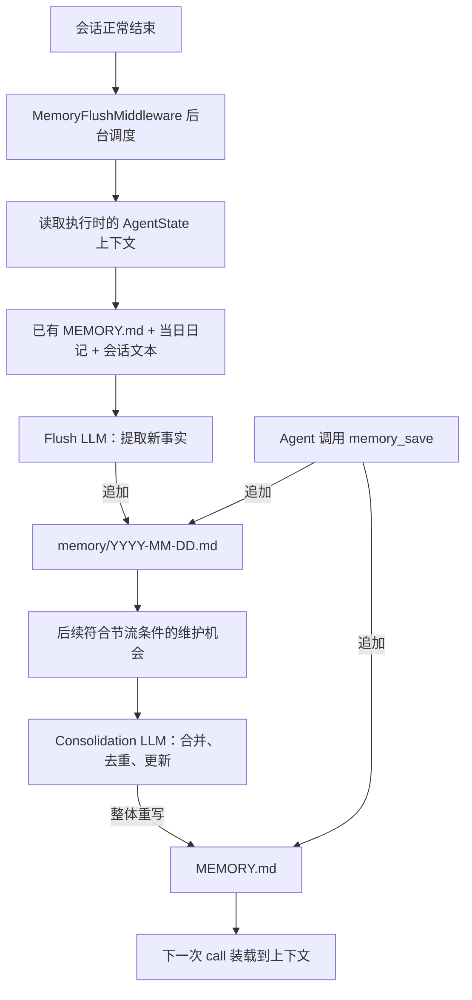

# AgentScope 长期记忆机制与自动提取调研

> 核对日期：2026-10-21（上海时间）。范围为 AgentScope **Java v2.0.4**，固定提交 `0b6743b263ba8e39eb417e35048026f1e0196548`；该提交根 POM 的 revision 为 2.0.4。[版本]
>
> 本文依据官方文档及该提交的一手源码静态核对，区分原生机制、本项目选择与源码差异。没有运行 Java 示例、真实模型调用、MySQL 接入、跨用户隔离或重启恢复测试。只新增本文件，未修改既有文件，未执行 Issue 更新、Git 暂存、提交、推送或部署。

## 1. 先区分框架能力与项目规则

本项目此前选择“长期记忆只提炼长期个人偏好、只接受成功业务 Run 的正式对话、用户手工更正优先、清空开启新代次”。这是[本项目设计协议](../../数据库设计/状态记忆与工作区/状态记忆与工作区隔离存储设计规格.md)，不能当成 AgentScope 原生行为。

Harness 的默认提取提示词范围更广：用户偏好、个人信息、项目背景、决策及理由、承诺、期限、待办、人员关系等。它交给辅助 LLM 判断哪些内容值得保存；普通问候、短暂状态和工具调用本身被提示忽略。来源序列化仍包括 USER、ASSISTANT 和工具内容，不能把提示词的“忽略”理解为来源已经在代码中剔除。[提取器]

提取结果保存在模型外部，之后被读回上下文。源码路径是额外的模型调用与文件读写；本机制不涉及更新基础模型权重。[提取器] [合并器] [上下文装载]

## 2. 原生采用两层文本文档，另有会话上下文

| 层次 | 内容 | 写入者与用途 |
| --- | --- | --- |
| 当前会话上下文 | AgentState 中的上下文消息 | 支撑当前推理；上下文过大时可摘要压缩。 |
| 第一层：每日记忆 | `memory/YYYY-MM-DD.md` | Flush 把提取结果带时间戳追加进去；内容是提炼出的事实，不是完整聊天逐字存档。 |
| 第二层：整理后的长期记忆 | `MEMORY.md` | Consolidator 将日记和现有记忆合并、去重、更新、裁剪后整体重写。 |
| 主动保存入口 | `memory_save` 工具 | Agent 主动调用，直接向 MEMORY.md 与当日日记各追加一次。 |

“Flush 只写日记、Consolidator 整体重写 MEMORY.md”描述的是自动后台管线；由于还有 memory_save，不能说整个框架只有 Consolidator 能写 MEMORY.md。[提取器] [合并器] [主动保存]

文件读写经过 WorkspaceManager / AbstractFilesystem，逻辑 Markdown 文件可映射到本地、Sandbox 或共享 Store。把文件放到什么后端，与提取、合并两段模型处理是两个层次。[合并器] [远程存储映射] [Workspace读写]

## 3. 自动提取的完整运行链



图中维护机会与 Flush 之间是数据依赖，**不是一次调用内部必然先后完成的同步链**。两个调用后中间件都异步调度；当前 Flush 刚产生的日记不保证马上被本次维护读到。[调用后提取] [后台维护]

### 3.1 谁触发

MemoryFlushMiddleware 在 `next.apply(input).doOnComplete(...)` 里调度后台任务。默认每次调用正常完成都允许 Flush；还可设置 NEVER 或按时间节流。它不等待“整段会话关闭”，也不要求必须发生对话压缩。[调用后提取] [MemoryConfig]

Harness 在存在可用模型且未 disableMemoryHooks 时装配 Flush 和维护中间件；普通压缩是另一个独立配置入口。即使没有配置 compaction(...)，调用后 Flush 仍可以工作。[Harness装配]

后台提取以隔离 key 排队，同一 key 的待执行任务可合并。同一会话任务是在**真正执行时**读取 AgentState 当前上下文，而非在本次业务 Run 结束时冻结一份来源快照；队列及在途协调是进程内机制。[调用后提取]

### 3.2 输入如何构造

MemoryFlushManager 执行：

1. 序列化对话窗口，排除 SYSTEM、带内部 session_context 标记的消息与压缩摘要消息。
2. 将 USER、ASSISTANT、工具调用及工具结果呈现为带角色的文本；工具参数最多截取 500 字符，单个工具结果 TextBlock 最多截取 1000 字符；这条序列化路径主要处理文本与工具块。
3. 读取已有 MEMORY.md、当天已追加的日记，作为避免重复提取的上下文。
4. 构造一条 SYSTEM 提取提示和一条 USER 数据消息，调用 `model.stream(...)`。
5. 合并返回的文本块。空结果或精确的 NO_REPLY 表示不写入；其他文本追加到当日日记，附上 Flush 时间戳。[提取器]

因此“自动”由中间件触发，“什么值得记住”由提示词和辅助模型判断，落地由代码执行。默认提示要求 Markdown 项目符号，但此写入路径没有验证每条事实是否真实，也没有把输出强制转换为结构化偏好条目。[提取器]

### 3.3 用会议偏好举例

以下只是机制示意，未实际调用模型：

```text
用户输入：
以后优先安排下午的会议，尽量找靠窗的会议室。

Flush 候选输出：
- 用户安排会议时偏好下午。
- 用户优先选择靠窗的会议室。
```

候选追加到当天日记后，后续合并可能把它整理进 MEMORY.md 的“会议偏好”段落。是否提取、如何措辞、是否与已有内容合并，受模型和提示词影响，不能把示例当成确定输出。[提取器] [合并器]

## 4. 合并不是简单拼接

MemoryConsolidator 读取当前 MEMORY.md，并枚举上次合并水位之后修改的日记文件；首次运行读取符合范围的全部日记。没有新日记则不调用模型。筛选粒度是日记文件修改时间，符合条件的文件正文会被读取，而非逐条消费一个持久消息队列。[合并器]

合并提示要求保留长期可复用信息、消除重复、合并相关主题、用新信息更新旧信息，并输出完整的新 Markdown 文档。实现随后整体覆盖 MEMORY.md，再推进合并水位；模型输出为空时跳过写入。[合并器]

默认 consolidationMaxTokens 为 4000，代码把 token 值及约四倍字符值传给提示词。**这是合并提示预算，不是本方法对输出做严格 tokenizer 计数后的硬截断保证。** Workspace 的上下文装载还会按其自身预算裁剪可注入内容。[MemoryConfig] [合并器] [上下文装载]

维护由调用完成后的中间件触发，默认最小间隔 30 分钟；首次符合条件的调用可立即执行。它不是一个不依赖任何调用、每隔 30 分钟必跑的独立定时器。维护依次处理旧日记归档、合并、旧会话日志清理；是否实际发生 LLM 合并还取决于有无新日记。[后台维护]

Flush 与维护异步执行，失败记录日志；正常回复完成不代表长期记忆已经成功提取、合并或持久化。[调用后提取] [后台维护]

## 5. 记忆如何被再次使用

默认有两种读取方式：

- **自动装载**：WorkspaceContextMiddleware 在 onSystemPrompt 中读取 MEMORY.md，将其放入 loaded_context 的 memory_context。该类源码说明是每次 call 构建；不能把文档的“每轮 reasoning 重新读文件”直接当作此版本保证。
- **按需工具读取**：memory_search 扫描可见记忆文件的内容，以大小写不敏感的字面关键词逐行匹配；memory_get 再读取指定文件的行区间。该版本内置检索采用关键词方式，向量检索需要额外方案。[上下文装载] [关键词检索] [按行读取]

memory_save 是另一条由 Agent 自己决定的写入路径。系统提示引导它在用户要求记住、表达重要偏好或建立重要决策时调用；工具收到的内容不再经过 Flush LLM，直接追加到 MEMORY.md 和日记，后续可再被合并整理。[主动保存] [上下文装载]

## 6. 配置入口与默认值

以下是框架原生配置，不代表本项目已选用这些具体数值。[MemoryConfig]

| 配置 | 默认 | 控制内容 |
| --- | --- | --- |
| MemoryConfig.model | null，回退主模型 | 调用后 Flush 与后台合并的辅助模型。压缩路径的差异见第 8 节。 |
| flushPrompt | 内置 DEFAULT_FLUSH_PROMPT | 提取范围、语言、保留/忽略要求；直接作为 SYSTEM 文本，不要求占位符。 |
| consolidationPrompt | 内置合并提示 | 合并、去重、更新与篇幅要求；自定义文本必须包含恰好两个 %d，依次填 token 和字符预算。 |
| flushTrigger | ALWAYS | 调用后提取可选 ALWAYS / NEVER / THROTTLED。 |
| consolidationMaxTokens | 4000 | 传给合并模型的篇幅目标。 |
| consolidationMinGap | 30 分钟 | 调用后维护的最小间隔，与 Flush 节流独立。 |
| dailyFileRetentionDays | 90 天 | 维护时将旧日记移入 memory/archive/。 |
| sessionRetentionDays | 180 天 | 维护时尝试清理匹配的旧会话日志；不等于平台业务表留存规则。 |

配置示意；model、memoryModel 与 workspace 由调用方提供，未在本仓库编译或运行：

```java
MemoryConfig memoryConfig = MemoryConfig.builder()
        .model(memoryModel)
        .flushTrigger(
                MemoryConfig.FlushTrigger.throttled(Duration.ofMinutes(5)))
        .flushPrompt(MemoryFlushManager.DEFAULT_FLUSH_PROMPT + """
                
                Additional project rules:
                - Only extract durable meeting preferences stated by the user.
                - Write the extracted preferences in Chinese.
                - Do not record reservation status as a user preference.
                """)
        .consolidationMaxTokens(2000)
        .consolidationMinGap(Duration.ofMinutes(30))
        .build();

HarnessAgent agent = HarnessAgent.builder()
        .name("MeetingAssistant")
        .model(model)
        .workspace(workspace)
        .memory(memoryConfig)
        .build();
```

上述追加提示只影响经过相应配置路径的模型选择，不构成来源资格、权限、并发或删除协议。特别是本版本普通压缩前 Flush 未传入这份定制提示，不能据此认为所有提取路径都已受限。[Harness装配] [压缩中间件]

MemoryConfig 与 CompactionConfig 职责不同：前者管理长期记忆提取/合并/维护，后者管理当前会话压缩。压缩前可以另做一次 Flush，再生成压缩摘要；两次辅助推理产生的结果分别去日记和会话上下文。[压缩流程] [压缩配置]

## 7. 保存到哪里：Workspace 与存储后端

在原生实现中，MEMORY.md 和日记是逻辑文件，读写通过 WorkspaceManager 进入 AbstractFilesystem。RemoteFilesystemSpec 可把 MEMORY.md、memory/ 等路由到 BaseStore，以 namespace + key + value 管理内容。官方 JdbcStore 是候选数据库后端；它的方法分别获取 JDBC Connection，不能因为使用 MySQL 就推断多文件及平台业务表共用一个事务。[Workspace读写] [Workspace追加] [Workspace覆盖] [远程存储映射] [KV接口] [JDBC实现]

RemoteFilesystemSpec 默认 USER 隔离时，命名空间包含 agentId、userId 和路由分段；SESSION 则按 sessionId 分区。同一 spec 的默认记忆、计划和其他路由沿用同一个 scope。项目要求“记忆跨会话共享、运行资料按会话隔离”，需要受控的分别路由/namespace，不能仅统一切为 SESSION。[远程存储映射]

本项目选择正文和文本资料存 MySQL、原件存私有对象存储，并维护记忆代次/修订，是[平台设计](../../数据库设计/状态记忆与工作区/状态记忆与工作区隔离存储设计规格.md)；不是框架强制的数据库格式。原生文件式能力不等于已存在本项目 memory_profile、memory_document 等物理表。

## 8. 文档、源码和开关需要特别核对的差异

| 议题 | 固定源码得到的结论 | 影响 |
| --- | --- | --- |
| 所有 Flush 共用 flushPrompt | 调用后 Flush 接收 MemoryConfig.flushPrompt；普通 CompactionMiddleware 以两参数构造 MemoryFlushManager，使用默认提示；紧急压缩取定制 flushPrompt。 | 不能只改一个提示就宣称所有提取路径统一。 |
| 辅助模型 | 调用后 Flush 与合并采用 memoryConfig.model 或主模型；普通压缩内的 Flush 使用压缩模型；紧急压缩使用主模型。 | 成本、语言与提取规则应按实际调用路径验收。 |
| disableMemoryHooks | 阻止装配调用后 Flush 与维护；普通压缩的内嵌 Flush 仍由 CompactionConfig.flushBeforeCompact 控制；紧急路径临时创建默认压缩配置。 | 关闭两个记忆开关也不能据此保证所有压缩路径不再提取。 |
| MEMORY.md 注入时机 | 固定 WorkspaceContextMiddleware 源码是 onSystemPrompt、每次 call 构建。 | 长调用进行中不保证每个内部 reasoning 都重读最新文件。 |
| memory_save 的原子性 | 提示词称同时原子更新两处文件，但工具本体是两次顺序 append，没有跨文件事务控制。 | 两份内容一致性要由存储协议和故障验收证明。 |
| 关键词检索条数 | 文档写最多 30 条；该 MemorySearchTool 循环没有这项数量截断。 | 不把文档的 30 条当作本版本硬上限。 |
| 日记与 MEMORY.md 的去重 | 日记写入是直接追加，提示要求模型避免重复；合并再由模型消重。 | 没有数据库级“同一语义事实仅存一次”的保证。 |

前两行及关闭路径的证据来自 Harness 装配、CompactionMiddleware、ConversationCompactor 与紧急压缩实现；注入、保存、检索分别由对应工具与中间件源码核对。[Harness装配] [压缩中间件] [压缩流程] [紧急压缩] [关闭开关] [上下文装载] [主动保存] [关键词检索] [官方记忆文档]

关闭含义应分别理解：

1. flushTrigger.never() 仅关闭调用后 Flush；不关闭后台合并和压缩前 Flush。
2. disableMemoryHooks() 关闭调用后 Flush 与维护中间件。
3. disableMemoryTools() 不注册 memory_search / memory_get / memory_save / session_search。
4. 后两个开关一起使用时，默认 Workspace 上下文不再注入 MEMORY.md；保留其他工作区上下文。
5. 想严格接管写入，还必须逐条处理正常压缩、紧急压缩及其他文件写入口，不能只依赖开关名字。[MemoryConfig] [Harness装配] [内置工具注册] [关闭开关] [压缩中间件] [紧急压缩]

## 9. 我们项目需要追加哪些责任

| 项目要求 | 原生机制已有部分 | 平台仍须落实 |
| --- | --- | --- |
| 只从成功 Run 学习偏好 | 正常流完成后可自动提取 | 将平台 SUCCEEDED 和正式消息作为受控来源；框架 doOnComplete 不等于业务成功，默认来源还包含工具内容。 |
| 手工修改优先、清空后不复活 | 可读写文档，有后台合并 | generation + revision 条件提交，旧任务失效、当前空文档、来源截止和新输入资格。 |
| 多会话共享记忆、运行资料隔离 | 有 RuntimeContext、namespace 和文件路由 | 用服务端可信用户/员工/Session 绑定，分别设置记忆和会话资料范围。 |
| 记忆任务重启后可恢复 | 有后台执行、进程内队列和节流 | 持久任务、来源去重、资格复查、提交不明核对，不重放原业务 Run。 |
| 正文及审计一致提交 | 可接入数据库 KV，有水位 CAS | 明确同事务协议；合并水位 CAS 不是 MEMORY.md 正文版本保护。 |

这些责任来自既有[本地设计规格](../../数据库设计/状态记忆与工作区/状态记忆与工作区隔离存储设计规格.md)，没有在本次研究中新增或修改产品决策。原生读空时还有本地模板回退，清空语义必须处理这一读取路径。[空内容回退]

因此后续实现可以复用文件抽象和提取/合并思路，但是否沿用某个原生中间件、拦截哪些写入口，以及 JdbcStore 与平台事务怎样组合，仍需设计和运行证据。本次不宣称已经实现受控记忆管线。

## 10. 旧资料中的另一套 LongTermMemory API

官方 v1 资料常见 LongTermMemory.record/retrieve、STATIC_CONTROL / AGENT_CONTROL / BOTH，以及 ReMe 等外部服务集成。锁定的 v2.0.4 源码将该接口和 ReActAgent 的相关 builder 标记为自 2.0.0 起 deprecated、未来移除，同时保留兼容装配，不能说它们已经完全无效。[旧长期记忆接口] [旧API兼容装配] [旧API兼容执行]

本文主体研究的是本项目采用的 Harness 文件式长期记忆管线。旧接口所连接服务的内部抽取/检索算法属于外部组件，不能与 MemoryFlushManager / MemoryConsolidator 的两层实现混为一套，也不能从旧文章推断本项目必须部署 ReMe。

## 11. 本次验证边界与后续验收

已完成：固定版本确认、官方文档阅读、源代码调用链追踪、配置默认值和路径差异核对、独立报告整理。

未完成：模型实际输出质量/成本测量、Java 编译和依赖装载、数据库及对象存储接入、跨用户/员工隔离、并行 Flush/合并/手工编辑、删除不复活、进程退出恢复和端到端业务验收。

后续至少覆盖：普通调用后提取、普通压缩、紧急压缩、memory_save 四种写路径；每条路径核对模型、提示、来源资格、隔离键、文档版本以及故障后状态。验收要观察持久正文和用户可见行为，不能只检查某个 middleware 已被调用。

## 一手来源

各段来源链接全部固定到本文提交；行号依据本次 GitHub 文件读取结果。主要入口为[官方记忆文档]、[Harness装配]、[提取器]、[合并器]和[MemoryConfig]。文档与源码不一致时，本文按所列调用路径给出限定结论。

[版本]: https://github.com/agentscope-ai/agentscope-java/blob/0b6743b263ba8e39eb417e35048026f1e0196548/pom.xml#L24-L36
[官方记忆文档]: https://github.com/agentscope-ai/agentscope-java/blob/0b6743b263ba8e39eb417e35048026f1e0196548/docs/v2/zh/docs/harness/memory.md#L1-L275
[Harness装配]: https://github.com/agentscope-ai/agentscope-java/blob/0b6743b263ba8e39eb417e35048026f1e0196548/agentscope-harness/src/main/java/io/agentscope/harness/agent/HarnessAgent.java#L2518-L2608
[MemoryConfig]: https://github.com/agentscope-ai/agentscope-java/blob/0b6743b263ba8e39eb417e35048026f1e0196548/agentscope-harness/src/main/java/io/agentscope/harness/agent/memory/MemoryConfig.java#L52-L366
[调用后提取]: https://github.com/agentscope-ai/agentscope-java/blob/0b6743b263ba8e39eb417e35048026f1e0196548/agentscope-harness/src/main/java/io/agentscope/harness/agent/middleware/MemoryFlushMiddleware.java#L152-L301
[提取器]: https://github.com/agentscope-ai/agentscope-java/blob/0b6743b263ba8e39eb417e35048026f1e0196548/agentscope-harness/src/main/java/io/agentscope/harness/agent/memory/MemoryFlushManager.java#L57-L363
[合并器]: https://github.com/agentscope-ai/agentscope-java/blob/0b6743b263ba8e39eb417e35048026f1e0196548/agentscope-harness/src/main/java/io/agentscope/harness/agent/memory/MemoryConsolidator.java#L74-L384
[后台维护]: https://github.com/agentscope-ai/agentscope-java/blob/0b6743b263ba8e39eb417e35048026f1e0196548/agentscope-harness/src/main/java/io/agentscope/harness/agent/middleware/MemoryMaintenanceMiddleware.java#L138-L294
[上下文装载]: https://github.com/agentscope-ai/agentscope-java/blob/0b6743b263ba8e39eb417e35048026f1e0196548/agentscope-harness/src/main/java/io/agentscope/harness/agent/middleware/WorkspaceContextMiddleware.java#L38-L285
[关键词检索]: https://github.com/agentscope-ai/agentscope-java/blob/0b6743b263ba8e39eb417e35048026f1e0196548/agentscope-harness/src/main/java/io/agentscope/harness/agent/tool/MemorySearchTool.java#L28-L90
[按行读取]: https://github.com/agentscope-ai/agentscope-java/blob/0b6743b263ba8e39eb417e35048026f1e0196548/agentscope-harness/src/main/java/io/agentscope/harness/agent/tool/MemoryGetTool.java#L28-L84
[主动保存]: https://github.com/agentscope-ai/agentscope-java/blob/0b6743b263ba8e39eb417e35048026f1e0196548/agentscope-harness/src/main/java/io/agentscope/harness/agent/tool/MemorySaveTool.java#L29-L88
[压缩中间件]: https://github.com/agentscope-ai/agentscope-java/blob/0b6743b263ba8e39eb417e35048026f1e0196548/agentscope-harness/src/main/java/io/agentscope/harness/agent/middleware/CompactionMiddleware.java#L66-L149
[压缩流程]: https://github.com/agentscope-ai/agentscope-java/blob/0b6743b263ba8e39eb417e35048026f1e0196548/agentscope-harness/src/main/java/io/agentscope/harness/agent/memory/compaction/ConversationCompactor.java#L115-L210
[压缩配置]: https://github.com/agentscope-ai/agentscope-java/blob/0b6743b263ba8e39eb417e35048026f1e0196548/agentscope-harness/src/main/java/io/agentscope/harness/agent/memory/compaction/CompactionConfig.java#L270-L359
[紧急压缩]: https://github.com/agentscope-ai/agentscope-java/blob/0b6743b263ba8e39eb417e35048026f1e0196548/agentscope-harness/src/main/java/io/agentscope/harness/agent/HarnessAgent.java#L1046-L1100
[远程存储映射]: https://github.com/agentscope-ai/agentscope-java/blob/0b6743b263ba8e39eb417e35048026f1e0196548/agentscope-harness/src/main/java/io/agentscope/harness/agent/filesystem/spec/RemoteFilesystemSpec.java#L234-L355
[Workspace读写]: https://github.com/agentscope-ai/agentscope-java/blob/0b6743b263ba8e39eb417e35048026f1e0196548/agentscope-harness/src/main/java/io/agentscope/harness/agent/workspace/WorkspaceManager.java#L260-L281
[Workspace追加]: https://github.com/agentscope-ai/agentscope-java/blob/0b6743b263ba8e39eb417e35048026f1e0196548/agentscope-harness/src/main/java/io/agentscope/harness/agent/workspace/WorkspaceManager.java#L358-L399
[Workspace覆盖]: https://github.com/agentscope-ai/agentscope-java/blob/0b6743b263ba8e39eb417e35048026f1e0196548/agentscope-harness/src/main/java/io/agentscope/harness/agent/workspace/WorkspaceManager.java#L710-L728
[空内容回退]: https://github.com/agentscope-ai/agentscope-java/blob/0b6743b263ba8e39eb417e35048026f1e0196548/agentscope-harness/src/main/java/io/agentscope/harness/agent/workspace/WorkspaceManager.java#L812-L824
[KV接口]: https://github.com/agentscope-ai/agentscope-java/blob/0b6743b263ba8e39eb417e35048026f1e0196548/agentscope-harness/src/main/java/io/agentscope/harness/agent/filesystem/remote/store/BaseStore.java#L27-L96
[JDBC实现]: https://github.com/agentscope-ai/agentscope-java/blob/0b6743b263ba8e39eb417e35048026f1e0196548/agentscope-extensions/agentscope-extensions-jdbc/src/main/java/io/agentscope/extensions/jdbc/store/JdbcStore.java#L39-L195
[旧长期记忆接口]: https://github.com/agentscope-ai/agentscope-java/blob/0b6743b263ba8e39eb417e35048026f1e0196548/agentscope-core/src/main/java/io/agentscope/core/memory/LongTermMemory.java#L30-L111
[旧API兼容装配]: https://github.com/agentscope-ai/agentscope-java/blob/0b6743b263ba8e39eb417e35048026f1e0196548/agentscope-core/src/main/java/io/agentscope/core/ReActAgent.java#L5260-L5287
[旧API兼容执行]: https://github.com/agentscope-ai/agentscope-java/blob/0b6743b263ba8e39eb417e35048026f1e0196548/agentscope-core/src/main/java/io/agentscope/core/ReActAgent.java#L5470-L5488
[内置工具注册]: https://github.com/agentscope-ai/agentscope-java/blob/0b6743b263ba8e39eb417e35048026f1e0196548/agentscope-harness/src/main/java/io/agentscope/harness/agent/HarnessAgent.java#L2687-L2693
[关闭开关]: https://github.com/agentscope-ai/agentscope-java/blob/0b6743b263ba8e39eb417e35048026f1e0196548/agentscope-harness/src/main/java/io/agentscope/harness/agent/HarnessAgent.java#L2227-L2245
